<Table>
  <tr>
    <td><a href= "https://www.cps.sp.gov.br/"></td>
    <td>
      <a href= "https://www.inteli.edu.br/"></a>
    </td>
  </tr>
</table>

# Nome do projeto: Incloud

## Nome do grupo: Inclouders

## Integrantes:

<div align="center">
  <table>
    <tr>
      <td align="center"><a href="https://www.linkedin.com/in/andre-lobo-dev/"><br><sub><b>André Lobo</b></sub></a></td>
      <td align="center"><a href="https://www.linkedin.com/in/gabriel-nascimento-563382243/"><br><sub><b>Gabriel Nascimento</b></sub></a></td>
      <td align="center"><a href="https://www.linkedin.com/in/iasmim-/"><br><sub><b>Iasmim Santos</b></sub></a></td>
      <td align="center"><a href="https://www.linkedin.com/in/nicolasramons/"><br><sub><b>Nicolas Ramon</b></sub></a></td>
      <td align="center"><a href="https://www.linkedin.com/in/rafael-furtado-b30715265/"><br><sub><b>Rafael Furtado</b></sub></a></td>
      <td align="center"><a href="https://www.linkedin.com/in/thalyta-viana/"><br><sub><b>Thalyta Viana</b></sub></a></td>
      <td align="center"><a href="http://www.linkedin.com/in/viniciussavian"><br><sub><b>Vinicius Savian</b></sub></a></td>
    </tr>
  </table>
</div>

# Sumário

- [1. Introdução](#1-introdução)
  - [1.1 Termos e Abreviações](#11-termos-e-abreviações)
- [2. Entendimento do Projeto e do Negócio](#2-entendimento-do-projeto-e-do-negócio)
  - [2.1 Contexto da Indústria do Parceiro](#21-contexto-da-indústria-do-parceiro)
  - [2.2 Problema](#22-problema)
  - [2.3 Visão do Projeto e do Produto](#23-visão-do-projeto-e-do-produto)
  - [2.4 Personas e Jornada do Usuário](#24-personas-e-jornada-do-usuário)
  - [2.5 Modelagem do Fluxo de Negócio](#25-modelagem-do-fluxo-de-negócio)
    - [2.5.1 Fluxo de Negócio Atual (AS-IS)](#251-fluxo-de-negócio-atual-as-is)
  - [2.6 Matriz de Risco do Projeto](#26-matriz-de-risco-do-projeto)
  - [2.7 Ideação](#27-ideação)
    - [2.7.1 Brainstorming de features](#271-brainstorming-de-features)
  - [2.8 Canvas do Projeto](#28-canvas-do-projeto)
- [3. Requisitos do Projeto](#3-requisitos-do-projeto)
  - [3.1 Requisitos Funcionais (RFs)](#31-requisitos-funcionais-rfs)
  - [3.2 Requisitos Não Funcionais (RNFs)](#32-requisitos-não-funcionais-rnfs)
  - [3.3 Correlação RFs e RNFs](#33-correlação-rfs-e-rnfs)
- [4. Modelagem de Dados](#4-modelagem-de-dados)
  - [4.1 Modelo Conceitual de Dados](#41-modelo-conceitual-de-dados)
  - [4.2 Modelo Lógico de Dados](#42-modelo-lógico-de-dados)
  - [4.3 Modelo Físico de Dados](#43-modelo-físico-de-dados)
- [5. Solução Técnica (Design)](#5-solução-técnica-design)
  - [5.1 Diagrama de Componentes da UML](#51-diagrama-de-componentes-da-uml)
  - [5.2 Diagramas de Sequência da UML](#52-diagramas-de-sequência-da-uml)
- [6. Mapeamento Técnico de Infraestrutura e Implantação](#6-mapeamento-técnico-de-infraestrutura-e-implantação)
  - [6.1 Diagrama de Implantação da UML](#61-diagrama-de-implantação-da-uml)
  - [6.2 Justificativa das Escolhas de Implantação](#62-justificativa-das-escolhas-de-implantação)
  - [6.3 Considerações sobre Desempenho e Segurança](#63-considerações-sobre-desempenho-e-segurança)
- [7. Projeto Visual da Solução](#7-projeto-visual-da-solução)
  - [7.1 Desenvolvimento de Wireframes](#71-desenvolvimento-de-wireframes)
  - [7.2 Desenvolvimento de Mockups](#72-desenvolvimento-de-mockups)
  - [7.3 Guia Visual](#73-guia-visual)
- [8. Desenvolvimento do Projeto](#8-desenvolvimento-do-projeto)
  - [8.1 Arquitetura de Codificação e Estrutura de Diretórios](#81-arquitetura-de-codificação-e-estrutura-de-diretórios)
    - [8.1.1 Estrutura de Diretórios](#811-estrutura-de-diretórios)
    - [8.1.2 Arquitetura de Codificação](#812-arquitetura-de-codificação)
  - [8.2 Desenvolvimento de Features](#82-desenvolvimento-de-features)
    - [8.2.1 Sprint 3](#821-sprint-3)
    - [8.2.2 Sprint 4](#822-sprint-4)
    - [8.2.3 Sprint 5](#823-sprint-5)
  - [8.3 Testes Unitários e de Integração](#83-testes-unitários-e-de-integração)
  - [8.4 Documentações automáticas](#84-documentações-automáticas)
- [9. Planejamento e Execução de Testes](#9-planejamento-e-execução-de-testes)
  - [9.1 Testes Funcionais](#91-testes-funcionais)
    - [9.1.1 Planejamento](#911-planejamento)
    - [9.1.2 Resultados](#912-resultados)
  - [9.2 Testes de requisitos não funcionais](#92-testes-de-requisitos-não-funcionais)
    - [9.2.1 Testes de RNFs](#921-testes-de-rnfs)
     - [9.2.2 Planejamento](#922-planejamento)
    - [9.2.3 Resultados](#923-resultados)
  - [9.3 Testes de usabilidade com o usuário](#93-testes-de-usabilidade-com-o-usuário)
    - [9.3.1 Testes de Usabilidade](#931-testes-de-usabilidade)
    - [9.3.2 Planejamento](#932-planejamento)
    - [9.3.3 Resultados](#933-resultados)
- [10. Procedimentos de Implantação](#10-procedimentos-de-implantação)
  - [10.1 Implantação e Configuração do Banco de Dados](#101-implantação-e-configuração-do-banco-de-dados)
  - [10.2 Implantação do Protótipo para uso por equipe de desenvolvimento](#102-implantação-do-protótipo-para-uso-por-equipe-de-desenvolvimento)
- [Referências](#referências)

# 1. Introdução

&emsp;&emsp;&emsp;&emsp;Este documento foi elaborado com o objetivo de servir como um guia completo para o leitor, fornecendo uma visão ampla de todas as etapas e aspectos do projeto. Nele, são apresentadas desde a descrição do parceiro envolvido e o problema proposto, até as decisões estratégicas tomadas, as análises de negócios realizadas e a documentação técnica relacionada ao código desenvolvido

## 1.1 Termos e Abreviações

**Abreviações Utilizadas**

&emsp;Abreviações utilizadas na elaboração dessa documentação:

| **Abreviação** | **Significado**                                                                            |
| -------------- | ------------------------------------------------------------------------------------------ |
| **RF**         | Requisito Funcional                                                                        |
| **RNF**        | Requisito Não Funcional                                                                    |
| **ISO**        | International Organization for Standardization (Organização Internacional de Padronização) |
| **API**        | Application Programming Interface (Interface de Programação de Aplicação)                  |
| **CRUD**       | Create, Read, Update, Delete (Criar, Ler, Atualizar, Deletar)                              |
| **UI**         | User Interface (Interface do Usuário)                                                      |
| **UX**         | User Experience (Experiência do Usuário)                                                   |
| **DB**         | Database (Banco de Dados)                                                                  |
| **CRUD**       | Create, Read, Update, Delete (Criar, Ler, Atualizar e Excluir)                             |
| **UI/UX**      | Interface do Usuário/Experiência do Usuário                                                |
| **Log**        | Registro de eventos do sistema                                                             |
| **Deploy**     | Implementação do sistema em ambiente de produção                                           |
| **Sprint**     | Ciclo de desenvolvimento ágil                                                              |
| **Kanban**     | Método visual para gerenciamento de tarefas                                                |
| **MVP**        | Minimum Viable Product (Produto Mínimo Viável)                                             |

# 2. Entendimento do Projeto e do Negócio

&ensp;Nesta seção, apresentamos o contexto do projeto, incluindo informações sobre a indústria do parceiro, o problema a ser resolvido, a visão do projeto e do produto, as personas e a jornada do usuário, a modelagem do fluxo de negócio, a matriz de risco do projeto e a ideação do produto.

## 2.1 Contexto da Indústria do Parceiro

&nbsp;&nbsp;&nbsp;&nbsp;O Centro Paula Souza (CPS) é uma autarquia do Governo do Estado de São Paulo, vinculada à Secretaria de Ciência, Tecnologia e Inovação. Responsável pela maior rede pública estadual de Educação Profissional e Tecnológica da América Latina, atua exclusivamente no estado de São Paulo, estando presente em 345 municípios. A instituição administra 228 Escolas Técnicas (Etecs), 79 Faculdades de Tecnologia (Fatecs) estaduais e 468 Classes Descentralizadas, que oferecem um ou mais cursos sob a administração de uma Etec. Atualmente, o CPS conta com mais de 317 mil alunos matriculados em cursos técnicos de nível médio e superiores tecnológicos.

&nbsp;&nbsp;&nbsp;&nbsp;No Brasil, o setor de educação técnica e profissionalizante desempenha um papel estratégico no desenvolvimento econômico, sendo essencial para formar mão de obra qualificada e suprir as demandas do mercado de trabalho. Nesse contexto, o Centro Paula Souza (CPS) se destaca como uma instituição líder, reconhecida por sua capacidade de oferecer cursos específicos e alinhados às necessidades regionais. Essa abordagem fortalece o desenvolvimento local e é um dos principais diferenciais da instituição. Além disso, por ser vinculado ao governo estadual, o CPS possui a vantagem de não operar com fins lucrativos, permitindo que ofereça educação de qualidade mesmo em cidades menores do interior do estado, onde a iniciativa privada frequentemente encontra dificuldades para atuar de forma sustentável. No entanto, essa característica ainda pode ser mais explorada, especialmente ao expandir a oferta de cursos voltados para regiões com demandas educacionais e econômicas únicas, ampliando assim seu impacto socioeconômico.

&nbsp;&nbsp;&nbsp;&nbsp;Uma tendência expressiva no setor educacional brasileiro é o crescimento da Educação a Distância (EAD), modalidade que ganha cada vez mais espaço e aceitação. Apesar de sua vasta rede presencial, o CPS ainda possui oportunidades para ampliar sua atuação nessa área, já que atualmente oferece apenas um curso superior na modalidade EAD. Enquanto isso, o mercado privado tem investido fortemente nessa modalidade, expandindo rapidamente sua oferta e, consequentemente, reduzindo custos para os estudantes. A expansão da oferta de EAD pelo CPS pode democratizar ainda mais o acesso à educação técnica e tecnológica, permitindo que a instituição alcance públicos mais diversos e regiões menos assistidas, além de competir de forma mais efetiva com o setor privado.

&nbsp;&nbsp;&nbsp;&nbsp;Os principais desafios enfrentados pelo CPS estão relacionados à sua dependência do governo estadual para orçamento e legislação, o que limita sua autonomia e agilidade na implementação de mudanças. Embora a vinculação ao poder público seja uma vantagem em aspectos como a possibilidade de oferecer educação de qualidade sem fins lucrativos, essa mesma característica se torna uma desvantagem quando se trata da dependência de recursos públicos e das restrições impostas por normas e processos burocráticos. A escassez de recursos também dificulta investimentos em inovação, infraestrutura e expansão de cursos. Além disso, a crescente concorrência com instituições privadas e plataformas digitais exige que o CPS modernize seus métodos pedagógicos e adote soluções mais flexíveis para manter sua posição de liderança.

&nbsp;&nbsp;&nbsp;&nbsp;Ademais, a gestão e governança de uma organização como o CPS, com diversas unidades geograficamente dispersas e um número expressivo de alunos, apresenta grandes complexidades. Coordenar processos administrativos, pedagógicos e inclusivos em uma escala tão ampla exige soluções padronizadas e personalizadas para os desafios específicos, que garantam equidade e qualidade no atendimento às demandas de todas as unidades.

&nbsp;&nbsp;&nbsp;&nbsp;Nesse contexto, o nosso projeto surge como uma solução estratégica para apoiar a gestão desses processos, especialmente no que diz respeito à inclusão de alunos com deficiência. Ele foi concebido para simplificar a organização e o monitoramento de informações relacionadas aos recursos alocados para esses alunos, contribuindo diretamente para uma gestão mais eficiente e responsável.

&nbsp;&nbsp;&nbsp;&nbsp;Como exemplo dessas demandas específicas, podemos citar a necessidade de armazenar logs e documentos por longos períodos, conforme exigências legais e administrativas. Essa tarefa é ainda mais crítica no caso de alunos com deficiência, cujas necessidades envolvem a alocação de recursos como materiais didáticos acessíveis e equipamentos adaptados. Garantir que essas informações sejam registradas, monitoradas e acessíveis de forma centralizada e segura é essencial para promover uma gestão inclusiva e alinhada às normas institucionais.

&nbsp;&nbsp;&nbsp;&nbsp;Para consolidar seu papel como referência no setor educacional paulista, o CPS deve capitalizar seus pontos fortes, como a oferta de cursos específicos e regionalizados, enquanto investe em inovação e adaptação às principais tendências do setor, como o EAD. Além disso, é fundamental que a instituição avance na modernização de sua gestão e governança, especialmente considerando os desafios de coordenar processos em uma rede amplamente descentralizada. Ao equilibrar tradição e modernização, a instituição poderá não apenas superar os desafios, mas também aproveitar as oportunidades emergentes no cenário educacional brasileiro, reforçando seu compromisso com a inclusão, a qualidade educacional e a eficiência operacional em todas as regiões atendidas.

## 2.2 Problema


&ensp;Atualmente, a assessoria de inclusão do Centro Paula Souza realiza a gestão dos atendimentos aos alunos por meio de formulários digitais e planilhas do Excel. No entanto, esse processo apresenta limitações, como a ausência de um histórico estruturado de assistências, uma interface pouco intuitiva e a falta de dados organizados. Essas restrições dificultam ou até impossibilitam o acompanhamento do histórico dos alunos, a geração de informações e dados para auditoria e fiscalização, além da gestão dos profissionais envolvidos nos atendimentos.

## 2.3 Visão do Projeto e do Produto

&nbsp;&nbsp;&nbsp;&nbsp;O objetivo da aplicação é fornecer histórico de atendimentos do alunos com necessidades especiais para o Centro Paula Souza, para o mapeamento e gestão de quais alunos estão em atendimento, além de fornecer dados estatísticos sobre os atendimentos, para fornecer agilidade na organização e ajudar a gestão a ter um melhor mapeamento desses alunos.
&nbsp;&nbsp;&nbsp;&nbsp;O objetivo da aplicação é fornecer histórico de atendimentos do alunos com necessidades especiais para o Centro Paula Souza, para o mapeamento e gestão de quais alunos estão em atendimento, além de fornecer dados estatísticos sobre os atendimentos, para fornecer agilidade na organização e ajudar a gestão a ter um melhor mapeamento desses alunos.

&nbsp;&nbsp;&nbsp;&nbsp; O sistema visa agilizar e tornar mais eficientes as tarefas atualmente realizadas em planilhas, oferecendo:

- Uma interface de interação com suporte a leitor de tela para garantir acessibilidade a pessoas com deficiência visual,
- Uma API para coleta de dados,
- Uma camada de persistência para armazenamento e gestão segura das informações.

### O que o produto faz e não faz

#### O que ele faz

&nbsp;&nbsp;&nbsp;&nbsp;O software "InCloud" registra atendimentos, necessidades específicas e o histórico de alunos com necessidades especiais. Ele classifica os alunos com base nas Necessidades Educativas Especiais (NEE) e gera estatísticas para análise e tomada de decisões, auxiliando no acompanhamento e gestão educacional.

#### O que ele não faz

&nbsp;&nbsp;&nbsp;&nbsp;O InCloud não automatiza registros, sendo necessária a inserção manual de dados. Além disso, não administra informações de outros estudantes da organização e sua integração é limitada ao Centro Paula Souza e API, sem suporte para outras plataformas externas.
#### O que ele não faz

&nbsp;&nbsp;&nbsp;&nbsp;O InCloud não automatiza registros, sendo necessária a inserção manual de dados. Além disso, não administra informações de outros estudantes da organização e sua integração é limitada ao Centro Paula Souza e API, sem suporte para outras plataformas externas.

## 2.4 Personas e Jornada do Usuário

&emsp;Para compreender melhor a experiência dos usuários no contexto do Centro Paula Souza, desenvolvemos Personas representativas que refletem os diferentes perfis e responsabilidades dentro da instituição. Cada persona foi criada com base em características reais, permitindo uma análise mais detalhada de suas necessidades, desafios e interações com o sistema.

&emsp;A seguir, apresentamos as jornadas de três personas principais:

**Ana Paula** - Gestora administrativa, ocupando um cargo estratégico e de tomada de decisões.

**Carol Juliana** - Assesora do Centro Paula Souza, responsável pela supervisão de processos internos.
**Carol Juliana** - Assesora do Centro Paula Souza, responsável pela supervisão de processos internos.

**Elton Suarez** - Assessor encarregado de lidar diretamente com cadastros e registros.

&emsp;Cada jornada ilustra o fluxo de ações e interações que esses usuários realizam em seu dia a dia, ajudando a identificar pontos de melhoria e otimização no sistema.

&emsp; Abaixo a imagem da persona **Ana Paula** (Gestora Administrativa Geral):

<div align="center">
  <sub>Figura 01 - Persona 1</sub> <br>

  

<sup>Fonte: Material produzido pelos autores (2024).</sup>

</div>

&emsp; Abaixo a imagem da persona **Carol Juliana**(Assessora):

<div align="center">
  <sub>Figura 02 - Persona 2</sub> <br>

  

<sup>Fonte: Material produzido pelos autores (2024).</sup>

</div>

&emsp; Abaixo a imagem da persona **Elton Soarez**(Assessor de inclusão):

<div align="center">
  <sub>Figura 03 - Persona 3</sub> <br>

  

<sup>Fonte: Material produzido pelos autores (2024).</sup>

</div>

&emsp; A seguir, a jornada da persona, **Ana Paula**, atuando como Gestora Administrativa de todas as unidades de ensino:

<div align="center">
  <sub>Figura 04 - Jornada de Usuário - Persona 1</sub> <br>

  

<sup>Fonte: Material produzido pelos autores (2024).</sup>

</div>

&emsp; A seguir, a jornada da segunda persona, **Carol Juliana**, atuando como assessora:

<div align="center">
  <sub>Figura 05 - Jornada de Usuário - Persona 2</sub> <br>

  

<sup>Fonte: Material produzido pelos autores (2024).</sup>

</div>

&emsp;Jornada de **Elton Soarez**, Assessor de inclusão que realiza cadastros e registros:

<div align="center">
  <sub>Figura 06 - Jornada de Usuário - Persona 3</sub> <br>

  

<sup>Fonte: Material produzido pelos autores (2024).</sup>

</div>

As jornadas podem ser visualizadas em maior resolução clicando [aqui](https://miro.com/app/board/uXjVLMy_cOY=/?share_link_id=286844542267).

### 2.4.1 User Stories

&nbsp;&nbsp;&nbsp;&nbsp;As user stories a seguir foram elaboradas com base nas principais necessidades das personas do projeto, garantindo que todas as funcionalidades essenciais do sistema sejam abordadas de forma clara e objetiva. Cada história foi atribuída a personas específicas, representando os diferentes perfis de usuários que interagem com a plataforma.

| Identificação | US01                                                                                                                                               |
| ------------- | -------------------------------------------------------------------------------------------------------------------------------------------------- |
| Persona(s)    | Todas as personas                                                                                                                                  |
| Título        | Cadastro de usuário                                                                                                                                |
| User Story    | "Como um usuário não cadastrado, quero realizar meu cadastro para obter um nível de acesso específico e acessar as funcionalidades da plataforma." |

| Identificação | US02                                                                                                                                                                                                                                                                        |
| ------------- | --------------------------------------------------------------------------------------------------------------------------------------------------------------------------------------------------------------------------------------------------------------------------- |
| Persona(s)    | Todas as personas                                                                                                                                                                                                                                                           |
| Título        | Visualização de Todos os Alunos Sob Gestão e Seus Detalhes                                                                                                                                                                                                                  |
| User Story    | "Como um usuário logado, quero visualizar uma lista de todos os alunos sob minha gestão, bem como detalhes sobre cada aluno, incluindo histórico de atendimento e outras informações gerais, para acompanhar suas trajetórias e gerenciar seus dados de maneira eficiente." |

| Identificação | US03                                                                                                                                                                                                             |
| ------------- | ---------------------------------------------------------------------------------------------------------------------------------------------------------------------------------------------------------------- |
| Persona(s)    | Ana Paula                                                                                                                                                                                                        |
| Título        | Atribuição de recursos aos alunos                                                                                                                                                                                |
| User Story    | "Como gerente administrativo logado, quero atribuir recursos, como tecnologias assistivas e profissionais, aos alunos sob minha gestão para atender às suas necessidades específicas e melhorar seu desempenho." |

| Identificação | US04                                                                                                                           |
| ------------- | ------------------------------------------------------------------------------------------------------------------------------ |
| Persona(s)    | Todas as personas                                                                                                              |
| Título        | Filtro de alunos sob gestão                                                                                                    |
| User Story    | "Como um usuário logado, quero filtrar os alunos sob minha gestão para facilitar a visualização, gestão e tomada de decisões." |

| Identificação | US05                                                                                                                                                                                                                                         |
| ------------- | -------------------------------------------------------------------------------------------------------------------------------------------------------------------------------------------------------------------------------------------- |
| Persona(s)    | Ana Paula                                                                                                                                                                                                                                    |
| Título        | Gestão de profissionais e tecnologias assistivas                                                                                                                                                                                             |
| User Story    | "Como gerente administrativo logado, quero visualizar, incluir e excluir profissionais e tecnologias assistivas no sistema para ter uma visão clara dos recursos disponíveis e atender às mudanças nas necessidades específicas dos alunos." |

| Identificação | US06                                                                                                                                                                                                                      |
| ------------- | ------------------------------------------------------------------------------------------------------------------------------------------------------------------------------------------------------------------------- |
| Persona(s)    | Todas as personas                                                                                                                                                                                                         |
| Título        | Visualização de dados estatísticos e geração de Relatórios                                                                                                                                                                |
| User Story    | "Como um usuário logado, quero visualizar dados estatísticos sobre os alunos sob minha gestão através de gráficos e gerar relatórios com esses dados, para analisar a situação geral e tomar decisões baseadas em dados." |

&nbsp;&nbsp;&nbsp;&nbsp;As user stories descritas nesta seção servirão como base para a modelagem dos diagramas de sequência e outros artefatos de design do sistema. A partir delas, será possível detalhar os fluxos de interação entre os usuários e o sistema, assegurando que as funcionalidades sejam implementadas de acordo com as necessidades identificadas.

## 2.5 Modelagem do Fluxo de Negócio

Mapear o processo no qual estamos envolvidos é essencial para garantir que compreendemos integralmente o fluxo de trabalho e possamos desenvolver uma solução que se integre perfeitamente ao contexto operacional. Para a modelagem do processo, utilizamos a notação BPMN (Business Process Model and Notation), amplamente reconhecida como padrão para representação gráfica de processos de negócio e recomendada pelos docentes do Inteli. Para mais detalhes sobre essa notação, consulte: [https://www.bpmn.org/](https://www.bpmn.org/)

## 2.5.1 Fluxo de Negócio Atual (AS-IS)

O processo em questão abrange as etapas de triagem, cadastro, análise, atribuição de diferentes tipos de suporte e acompanhamento de alunos que indicaram necessitar de suportes específicos para ingressar no curso. Ele envolve três principais atores:

- Aluno : O principal beneficiário do processo, que solicita ou recebe suporte específico para ingressar no curso.

- Gerente da Unidade : Responsável por conduzir a análise das necessidades do aluno e acompanhar a execução desse suporte.

- Gerente Administrativo : Atua na atribuição do suporte necessário ao aluno, descartando casos em que o suporte não se faz necessário. Além disso, é responsável por lidar com auditorias ou fiscalizações externas, garantindo que as informações e recursos estejam alinhados às exigências regulatórias.

Abaixo apresentamos o mapeamento detalhado do processo utilizando a notação BPMN:

<div align = center>


</div>

Para facilitar a interpretação do fluxo, adotamos um esquema de cores que destaca pontos-chave do processo:

- **Azul**: Representa os pontos onde nossa solução pode ser implementada.
- **Amarelo**: Indica decisões críticas, onde cabe ao ator determinar o caminho que o processo seguirá para aquele aluno.
- **Vermelho**: Representa os possíveis fins do processo.
- **Setas e textos vermelhos**: Direcionam para os finais do fluxo.
- **Setas e textos verdes**: Indicam caminhos dentro do fluxo que não representam um fim.

Um ponto importante destacado durante o Workshop com o parceiro é que, ocasionalmente, o gerente administrativo pode receber solicitações de fiscalização ou auditoria de entes públicos. Essas solicitações podem ocorrer, por exemplo, para avaliar se os recursos destinados estão sendo utilizados de forma adequada. Esse cenário foi incorporado ao fluxo.

Adotamos simplificações estratégicas para garantir que o modelo seja ao mesmo tempo claro e fiel à essência do processo. Por exemplo, embora o aluno tenha a opção de realizar sua matrícula tanto online quanto presencialmente, decidimos não diferenciar essas modalidades no fluxo, uma vez que ambas seguem para o mesmo destino sem apresentar variações significativas entre si. Essa decisão foi tomada de forma intencional, com o objetivo de preservar a simplicidade do modelo, facilitando sua compreensão sem comprometer a precisão da representação.

Além disso, nossa solução foi projetada para se integrar ao fluxo de negócio existente, atuando na otimização das operações sem alterar a estrutura atual. Não foi necessário desenvolver um novo fluxo proposto, já que a implementação da solução se encaixa de maneira complementar ao processo já estabelecido. Esse ponto foi validado pelos docentes do Inteli, garantindo que aa escolhas tomadas estejam alinhadas às melhores práticas e respondam adequadamente às necessidades do projeto.

## 2.6 Matriz de Risco do Projeto

<div align="center">
<sub>Figura 07 - Matriz de Riscos</sub><br>
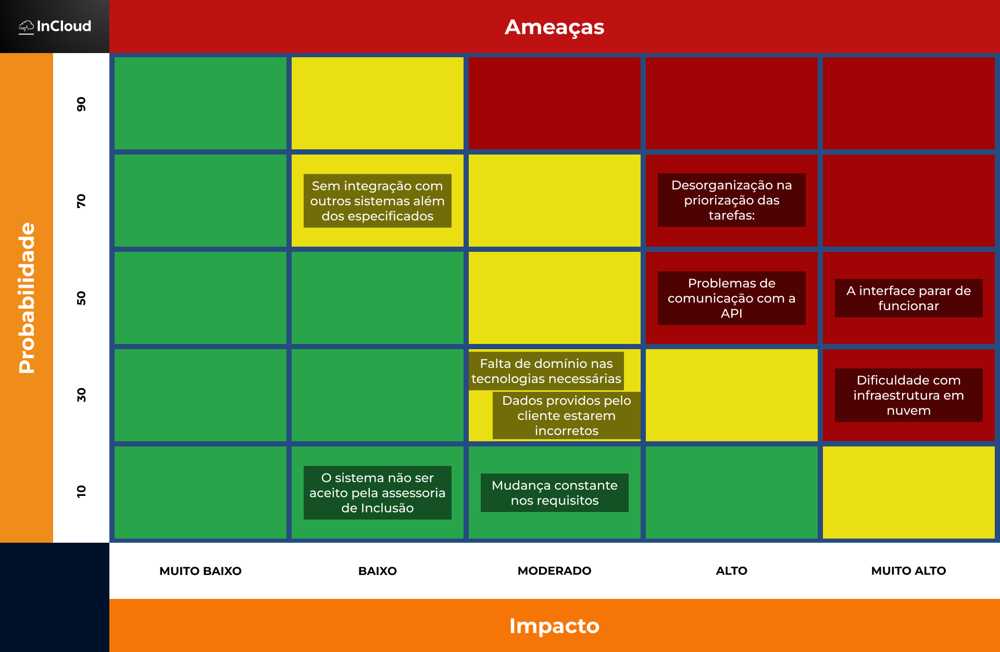<br>
<sup>Fonte: Material produzido pelos autores (2024)</sup>
</div>

### Descrição Geral dos Riscos

1. **O sistema não ser aceito pela assessoria de inclusão** (Probabilidade: 10, Impacto: Baixo)

   - O risco de o sistema não ser aceito tem uma probabilidade de 10, mas um impacto baixo, pois o grupo está considerando fortemente a inclusão de deficientes visuais no site. Além disso, mesmo que a assessoria não o aprove por falta de acessibilidade, o sistema ainda funcionaria sem impacto em outras demandas.

2. **Mudança constante nos requisitos** (Probabilidade: 10, Impacto: Moderado)

   - O risco de mudanças constantes nos requisitos tem uma probabilidade de 10 e um impacto moderado, pois os requisitos foram especificados pelo cliente durante o kick-off e documentados no TAPI. No entanto, caso ocorresse, o impacto seria moderado, exigindo adaptações rápidas e eficientes no escopo do projeto.

3. **Falta de domínio nas tecnologias necessárias** (Probabilidade: 30, Impacto: Moderado)

- O risco de falta de domínio nas tecnologias tem uma probabilidade de 30 e um impacto moderado, pois o projeto exige conhecimentos específicos em cloud computing, desenvolvimento de APIs e acessibilidade. Caso a equipe não domine essas tecnologias, pode haver atrasos e dificuldades na implementação, impactando a qualidade da solução.

4. **Dificuldade com infraestrutura em nuvem** (Probabilidade: 30, Impacto: Muito Alto)

- O risco de dificuldades com infraestrutura em nuvem tem uma probabilidade de 30 e um impacto muito alto, pois a solução precisa ser cloud-native. Problemas como configuração incorreta, falta de escalabilidade e custos inesperados podem comprometer o desempenho do sistema e inviabilizar sua manutenção.

4. **Dados providos pelo cliente estarem incorretos** (Probabilidade: 30, Impacto: Moderado)

   - O risco de os dados fornecidos pelo cliente estarem incorretos tem uma probabilidade de 30 e um impacto moderado, pois há uma alta chance de erro, dado que se trata de informações sensíveis. Tanto os usuários podem cometer equívocos ao inseri-las quanto os gestores ao carregá-las no banco de dados. Esse risco tem um impacto moderado, pois pode afetar a estruturação do projeto, causando erros na alocação de profissionais e alunos ou gerando confusão nas informações.

5. **Problemas de comunicação com a API** (Probabilidade: 50, Impacto: Alto)

   - O risco de problemas de comunicação com a API tem uma probabilidade de 50 e um impacto alto, pois instabilidades, erros de requisição ou mudanças não documentadas podem comprometer a integração. Isso pode resultar em falhas no carregamento de dados ou na indisponibilidade do sistema, impactando seu funcionamento e exigindo correções rápidas.

6. **A interface parar de funcionar** (Probabilidade: 50, Impacto: Muito Alto)

   - O risco de a interface parar de funcionar tem uma probabilidade de 50 e um impacto muito alto, pois falhas no sistema podem ocorrer facilmente, especialmente em casos de atualizações frequentes ou falhas no deploy. Caso isso aconteça, toda a equipe ficará sem acesso ao sistema para gerenciar os alunos com necessidades especiais, sendo forçada a adotar métodos antigos até que a interface seja restabelecida.

7. **Sem integração com outros sistemas além dos especificados** (Probabilidade: 70, Impacto: Baixo)

   - O risco de não haver integração com outros sistemas além dos especificados tem uma probabilidade de 70 e um impacto baixo, pois isso está alinhado com os requisitos do projeto. Como o cliente não exige essa integração, a ausência dela não compromete o funcionamento do sistema. No entanto, caso surja a necessidade de conectar-se a novos sistemas no futuro, a implementação pode ser desafiadora, mas sem impacto significativo no escopo atual.

8. **Desorganização na priorização das tarefas:**(Probabilidade: 70, Impacto: Alto)

- A desorganização na priorização das tarefas tem uma probabilidade de 70 e um impacto alto, pois pode gerar desperdício de tempo e recursos, atrasando o projeto e comprometendo a entrega do MVP. Sem um planejamento adequado, a equipe pode acabar focando em aspectos secundários em vez das funcionalidades essenciais.

## Mitigação dos riscos

1. **O sistema não ser aceito pela assessoria de inclusão**

   - **Plano de Ação**: Seguir as diretrizes de acessibilidade e testar a interface com usuários com deficiência visual antes da validação oficial. Caso a assessoria não aprove, realizar ajustes de acessibilidade com base no feedback, sem comprometer outras funcionalidades.
     <br>

2. **Mudança constante nos requisitos**

   - **Plano de Ação**: Definir e documentar claramente os requisitos no TAPI, assegurando alinhamento com o cliente. Caso haja mudanças, priorizar revisões no backlog, manter uma abordagem ágil e realizar ajustes de escopo sem comprometer o prazo e a entrega principal.
     <br>

3. **Falta de domínio nas tecnologias necessárias**

- **Plano de Ação**: Buscar ajuda e orientação dos professores em caso de dúvidas e realizar os auto estudos, recorrendo a outras plataformas e cursos caso seja necessário para compreensão dos conteúdos e aplicação no projeto.

4. **Dificuldade com infraestrutura em nuvem**

- **Plano de Ação**: Utilizar serviços que tenha uma documentação sempre atualizada para possíveis consultas, e realizar testes periódicos para entendimento e aplicação segura no projeto.

5. **Dados providos pelo cliente estarem incorretos**

   - **Plano de Ação**: Implementar validação automática dos dados no momento da inserção, exigindo padrões específicos. Criar um mecanismo de revisão e correção de dados, permitindo ajustes manuais ou automatizados quando erros forem identificados.
     <br>

6. **Problemas de comunicação com a API**

- **Plano de ação**: Implementar um sistema de retries com backoff exponencial para lidar com falhas temporárias. Criar logs detalhados para diagnóstico rápido e definir um fallback para que funcionalidades críticas continuem operando offline ou com dados em cache.

7. **A interface parar de funcionar**

- **Plano de ação**: Realizar testes rigorosos antes de cada atualização e implementar um sistema de rollback automático em caso de falha no deploy. Criar um ambiente de contingência para que a equipe tenha acesso mínimo ao sistema, além de um plano rápido de recuperação e comunicação em caso de falha.

8. **Sem integração com outros sistemas além dos especificados**

- **Plano de ação**: Definir claramente os sistemas suportados desde o início e documentar a estrutura do sistema para facilitar futuras integrações. Caso uma nova integração seja necessária, avaliar a viabilidade técnica e, se possível, desenvolver uma API intermediária para facilitar a compatibilidade sem grandes mudanças no sistema.

9. **Desorganização na priorização das tarefas**

- Utilizar corretamente as ferramentas agéis oferecidas pelo Inteli para manter um ciclo produtivo e organizado e criar um backlog bem estruturado, garantindo que os itens mais críticos sejam resolvidos primeiro.

<div align="center">
<sub>Figura 08 - Matriz de Oportunidades</sub><br>
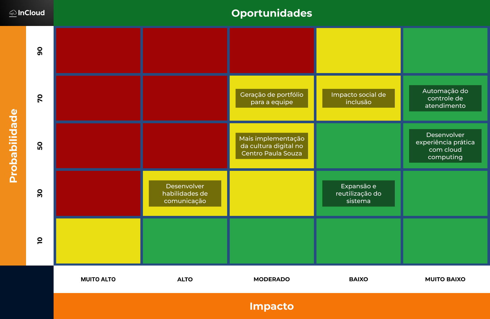<br>
<sup>Fonte: Material produzido pelos autores (2024)</sup>
</div>

### Descrição Geral das Oportunidades

1. **Expansão e reutilização do sistema** (Probabilidade: 30, Impacto: Baixo)
   <br>

   - Existe a oportunidade de expandir e reutilizar o sistema em outras unidades ou contextos semelhantes, o que poderia aumentar sua longevidade e eficiência. No entanto, a probabilidade dessa expansão ocorrer é baixa, pois depende da demanda e do interesse de novas instituições. O impacto também é baixo, já que, mesmo sem essa ampliação, o sistema continua cumprindo seu propósito original.
     <br>

2. **Mais implementação da cultura digital no Centro Paula Souza** (Probabilidade: 50, Impacto: Moderado)
   <br>

   - O sistema pode contribuir para fortalecer a cultura digital dentro do Centro Paula Souza, incentivando o uso de novas tecnologias para gestão e atendimento. A probabilidade de essa implementação acontecer é moderada, pois depende da aceitação e do engajamento dos usuários. O impacto, por sua vez, é significativo, pois a digitalização pode otimizar processos, melhorar a acessibilidade e modernizar o ambiente acadêmico.
     <br>

3. **Desenvolver habilidades de comunicação**(Probabilidade: 30, Impacto: Alto)

- O desenvolvimento do projeto oferece uma oportunidade valiosa para aprimorar as habilidades de comunicação da equipe. A necessidade de interagir, documentar requisitos e apresentar soluções exige clareza e objetividade na comunicação. Seu impacto é alto, pois boas habilidades de comunicação são fundamentais para o sucesso profissional e a eficiência no trabalho em equipe.

4. **Desenvolver experiência prática com cloud computing** (Probabilidade: 50, Impacto: Muito Baixo)

- É uma oportunidade para os membros da equipe adquirirem experiência prática com cloud computing. A probabilidade de a equipe se beneficiar dessa experiência é moderada, pois dependerá do envolvimento de cada membro com essa parte do desenvolvimento. No entanto, o impacto imediato é muito baixo, já que o foco principal do projeto não é a especialização em nuvem, mas sim a entrega da solução funcional.

5. **Impacto social de inclusão** (Probabilidade: 70, Impacto: Baixo)
   <br>

   - O projeto tem um forte potencial de impacto social ao promover inclusão, especialmente para alunos com necessidades especiais. Como o sistema já foi desenvolvido com essa finalidade, a probabilidade de gerar impacto positivo é alta. No entanto, o impacto direto pode ser considerado baixo, pois a adoção e o alcance do sistema ainda dependem da adesão dos usuários e do suporte institucional.
     <br>

6. **Automação do controle de atendimento** (Probabilidade: 70, Impacto: Muito Baixo)
   - A automação do controle de atendimento pode trazer benefícios ao reduzir tarefas manuais e melhorar a organização do suporte prestado aos alunos. A probabilidade de implementação é alta, pois faz parte dos objetivos do sistema. No entanto, o impacto imediato é muito baixo, já que a automação apenas otimiza processos internos sem mudanças significativas para os usuários finais no curto prazo.

## 2.7 Ideação

Nesta seção, são exploradas e desenvolvidas ideias para atender aos objetivos do projeto, utilizando métodos de geração e seleção de propostas.

## 2.7.1 Brainstorming de features

Após o _Kickoff_, foi realizado, através do _Lean Inception_, um _brainstorming_ de features para o projeto **Incloud**. Sendo elas:

1. **Cadastrar Alunos e Profissionais:**  
   Será possível cadastrar os alunos que possuem necessidades de utilização de tecnologia assistiva ou acompanhamento profissional, além do cadastro dos profissionais responsáveis por acompanhar esses alunos.

2. **Editar Dados Pessoais dos Alunos e dos Profissionais:**  
   Possibilitar a atualização de informações pessoais tanto dos alunos quanto dos profissionais, a edição das necessidades dos alunos e a alocação dos profissionais.

3. **Dashboard com Dados de uma Única Unidade:**  
   Interface onde o Gestor Local pode visualizar e gerenciar a unidade através dos dados obtidos.

4. **Dashboard com Dados de Todas as Unidades:**  
   Interface onde o Gestor Administrativo pode visualizar e gerenciar todas as unidades do Centro Paula Souza através dos dados presentes na plataforma.

5. **Conectar Aluno com Profissional:**  
   Funcionalidade que permite a alocação do profissional de saúde ao aluno que necessita de acompanhamento.

6. **Recursos de Acessibilidade:**  
   A plataforma será acessível para todos, incluindo pessoas com deficiência visual. Recursos como leitores de tela serão implementados.

7. **Login do Aluno e Visualização de Processo:**  
   Permitir que o aluno tenha um login na plataforma para acessar o andamento do seu processo e visualizar informações do seu perfil.

8. **Login do Profissional e Tela de Gestão dos Alunos:**  
   Possibilitar que o profissional tenha um login para acessar uma tela de gestão onde poderá acompanhar e gerenciar os alunos sob sua responsabilidade.

9. **Acesso como Visitante para Consulta de Dashboards:**  
   Oferecer acesso à plataforma como visitante, permitindo que a população em geral possa acompanhar dados consolidados dos dashboards sem necessidade de autenticação.

10. **Grau de Urgência do Caso:**  
    Implementar um sistema para atribuir um grau de urgência ao caso do aluno no momento do registro. O sistema deve monitorar automaticamente o tempo desde a última atualização do caso e ajustar o grau de urgência conforme o tempo decorrido.

Com base nesse _brainstorming_ inicial, foram construídos os requisitos funcionais e não funcionais do projeto, que podem ser observados na seção (Seção 3).
7. **Login do Aluno e Visualização de Processo:**  
   Permitir que o aluno tenha um login na plataforma para acessar o andamento do seu processo e visualizar informações do seu perfil.

8. **Login do Profissional e Tela de Gestão dos Alunos:**  
   Possibilitar que o profissional tenha um login para acessar uma tela de gestão onde poderá acompanhar e gerenciar os alunos sob sua responsabilidade.

9. **Acesso como Visitante para Consulta de Dashboards:**  
   Oferecer acesso à plataforma como visitante, permitindo que a população em geral possa acompanhar dados consolidados dos dashboards sem necessidade de autenticação.

10. **Grau de Urgência do Caso:**  
    Implementar um sistema para atribuir um grau de urgência ao caso do aluno no momento do registro. O sistema deve monitorar automaticamente o tempo desde a última atualização do caso e ajustar o grau de urgência conforme o tempo decorrido.

Com base nesse _brainstorming_ inicial, foram construídos os requisitos funcionais e não funcionais do projeto, que podem ser observados na seção (Seção 3).

## 2.8 Canvas do Projeto

A seguir o Canvas MVP do **Incloud**:

<div align = center>
<sub>Figura 09 - Canvas MVP</sub><br>

</div>

Veja o Canvas em maior resolução clicando [aqui](https://drive.google.com/file/d/1-NY5iqr1MbvgV3nBz9P6-D8tqfnuKIp6/view?usp=sharing).

### Detalhamento de "Custo e cronograma"

#### 1. Equipe e Remuneração Mensal

A equipe de desenvolvimento é composta por:

- 6 Analistas de TI Júnior
- 1 Head de TI

A remuneração mensal estimada para cada Analista de TI Júnior é de **R\$ 3.500**, totalizando **R\$ 21.000** por mês.  
A remuneração mensal estimada para o Head de TI é de **R\$ 33.333**.

**Total de custos com equipe: R\$ 54.333**

#### 2. Infraestrutura e Serviços Utilizados

- **Amazon EC2**: 750 horas gratuitas por mês (instância t2.micro ou t3.micro).
- **AWS Lambda**: 1 milhão de solicitações gratuitas por mês.
- **Amazon RDS** (Banco de Dados): 750 horas de uso (gratuitas no mês) de instâncias db.t2.micro, db.t3.micro e db.t4g.micro mono-AZ do Amazon RDS que executam bancos de dados MySQL, MariaDB e PostgreSQL por mês (mecanismos de banco de dados aplicáveis). Segundo o site da AWS atualmente, o valor pode variar dependendo do armazenamento utilizado, por exemplo:
  - Primeiros 1 TB/mês USD 0,0326 por GB;
  - Próximos 49 TB/mês USD 0,032 por GB;
  - Próximos 450 TB/mês USD 0,0315 por GB;
  - Próximos 500 TB/mês USD 0,0309 por GB;
    -Próximos 4.000 TB/mês USD 0,0304 por GB;
  - Mais de 5.000 TB/mês USD 0,0299 por GB.
- **Amazon S3** (Armazenamento de arquivos): Primeiro 50 GB gratuitos.
- **Elastic Load Balancing**: 750 horas gratuitas.

Vale ressaltar que o preço da infraestrutura é variável, dependendo da quantidade de armazenamento, do fluxo de dados e das horas necessárias para o projeto. No entanto, pensando em um MVP, essas são as estimativas.

#### 3. Tempo de Desenvolvimento

O desenvolvimento do sistema está previsto para **10 semanas**. Durante esse período, os custos serão:

- **Equipe (10 semanas)**: R$ 140.207

# 3. Requisitos do Projeto

&ensp; Nesta seção, apresentamos os requisitos do projeto **Incloud**. Os requisitos foram divididos em duas categorias: Requisitos Funcionais (RFs) e Requisitos Não Funcionais (RNFs). Os RFs descrevem as funcionalidades que o sistema deve possuir, enquanto os RNFs especificam as características que o sistema deve apresentar para atender aos critérios de qualidade e desempenho.

## 3.1 Requisitos Funcionais (RFs)

Nessa seção consta os requisitos funcionais da solução.


| **ID**   | **Requisito Funcional**                                                                                                                                                                                                                                                                                                                                | **Descrição dos Testes**                                                                                                                                                                                                                                                                                                                                                                                                                                                                                                                                                                                                                                                                                                                                             |
| -------- | ------------------------------------------------------------------------------------------------------------------------------------------------------------------------------------------------------------------------------------------------------------------------------------------------------------------------------------------------------ | -------------------------------------------------------------------------------------------------------------------------------------------------------------------------------------------------------------------------------------------------------------------------------------------------------------------------------------------------------------------------------------------------------------------------------------------------------------------------------------------------------------------------------------------------------------------------------------------------------------------------------------------------------------------------------------------------------------------------------------------------------------------- |
| **RF01** | O sistema deve registrar o histórico dos atendimentos realizados para cada aluno, mantendo a data, tipo de atendimento e comentários. <br> **Usuários que se beneficiam:** Profissionais que realizam os atendimentos (professores, tutores, equipe de inclusão), além de coordenadores e gestores que acompanham o histórico e a evolução dos alunos. | **Pré-Condição**: O aluno e o profissional devem estar cadastrados no sistema. <br> **Procedimento**: O usuário acessa o perfil do aluno, preenche os campos necessários e confirma o registro. <br> **Resultado Esperado**: O histórico do aluno é atualizado com o novo atendimento. <br> **Pós-condição**: O sistema mantém um registro completo dos atendimentos do aluno.                                                                                                                                                                                                                                                                                                                                                                                       |
| **RF02** | O sistema deve exibir qual é o profissional responsável pelo atendimento do aluno quando já definido. <br> **Usuários que se beneficiam:** Profissionais de inclusão, coordenadores e gestores que precisam identificar rapidamente o responsável pelo atendimento.                                                                                    | **Pré-Condição**: O aluno deve ter um profissional já designado. <br> **Procedimento**: O usuário acessa o perfil do aluno na interface do sistema. <br> **Resultado Esperado**: O nome do profissional responsável pelo atendimento é exibido. <br> **Pós-condição**: O sistema mantém a informação acessível para consultas futuras.                                                                                                                                                                                                                                                                                                                                                                                                                               |
| **RF03** | O sistema deve permitir o registro de alunos que necessitam de atendimento especial (alunos PCD), garantindo que suas informações sejam cadastradas adequadamente. <br> **Usuários que se beneficiam:** Profissionais de inclusão, equipe administrativa e gestores que precisam cadastrar e acompanhar alunos PCD.                                    | **Pré-Condição**: O sistema deve estar em pleno funcionamento e apto a receber os dados dos alunos. <br> **Procedimento**: O usuário ou responsável pelo cadastro acessa a funcionalidade de registro de alunos e insere os dados específicos de necessidades especiais. <br> **Resultado Esperado**: O aluno PCD é cadastrado no sistema com todas as informações necessárias para possibilitar seu atendimento. <br> **Pós-condição**: O aluno PCD consta no banco de dados do sistema, podendo ser consultado e gerenciado conforme as políticas de manutenção de dados.                                                                                                                                                                                          |
| **RF04** | O usuário deve conseguir atribuir um profissional para o atendimento de um aluno. <br> **Usuários que se beneficiam:** Coordenadores, gestores e profissionais de inclusão responsáveis pela designação de atendimentos.                                                                                                                               | **Pré-Condição**: O aluno e o profissional devem estar cadastrados no sistema. <br> **Procedimento**: O usuário acessa o perfil do aluno e seleciona um profissional disponível. <br> **Resultado Esperado**: O profissional é associado ao aluno. <br> **Pós-condição**: O sistema registra a atribuição e exibe essa informação nas consultas.                                                                                                                                                                                                                                                                                                                                                                                                                     |
| **RF05** | O usuário deve conseguir registrar se existe necessidade de um equipamento especial para o aluno. <br> **Usuários que se beneficiam:** Profissionais de inclusão, equipe administrativa e demais colaboradores que precisam gerenciar recursos e infraestrutura para atender alunos com necessidades específicas.                                      | **Pré-Condição**: O aluno deve estar cadastrado no sistema. <br> **Procedimento**: O usuário acessa o perfil do aluno e preenche as informações sobre a necessidade de equipamento especial. <br> **Resultado Esperado**: O sistema salva a informação sobre o equipamento necessário. <br> **Pós-condição**: O dado fica disponível para consulta e edição.                                                                                                                                                                                                                                                                                                                                                                                                         |
| **RF06** | O usuário deve conseguir editar o registro dos alunos que precisam de tecnologia assistiva. <br> **Usuários que se beneficiam:** Profissionais de inclusão, equipe administrativa e docentes que precisam atualizar as informações dos alunos para garantir o atendimento correto.                                                                     | **Pré-Condição**: O aluno deve estar cadastrado e o usuário deve ter permissão para edição. <br> **Procedimento**: O usuário acessa o perfil do aluno, altera os dados e confirma a edição. <br> **Resultado Esperado**: Os dados do aluno são atualizados no sistema. <br> **Pós-condição**: O histórico de alterações pode ser registrado no log do sistema.                                                                                                                                                                                                                                                                                                                                                                                                       |
| **RF07** | O sistema deve registrar logs de ações, contendo o usuário e a ação realizada e os dados alterados. <br> **Usuários que se beneficiam:** Administradores do sistema, gestores e coordenadores que necessitam acompanhar e verificar alterações para garantir segurança e rastreabilidade.                                                              | **Pré-Condição**: O usuário deve estar autenticado e realizar uma ação relevante (edição, exclusão, atribuição, etc.). <br> **Procedimento**: O sistema registra automaticamente a ação no log com informações do usuário, ação realizada e dados alterados. <br> **Resultado Esperado**: O log fica armazenado para auditoria e rastreamento de ações. <br> **Pós-condição**: O sistema mantém um histórico seguro das ações dos usuários.                                                                                                                                                                                                                                                                                                                          |
| **RF08** | O sistema deve possuir autenticação e níveis de acesso de acordo com o usuário. <br> **Usuários que se beneficiam:** Todos os usuários do sistema.                                                                                                                                                                                                     | **Pré-Condição**: O usuário deve estar cadastrado e ter credenciais de acesso. <br> **Procedimento**: O usuário insere login e senha na tela de autenticação. O sistema valida as credenciais e define o nível de acesso. <br> **Resultado Esperado**: O usuário tem acesso ao sistema conforme sua permissão. <br> **Pós-condição**: O sistema mantém a segurança e restringe funcionalidades conforme o perfil do usuário.                                                                                                                                                                                                                                                                                                                                         |
| **RF09** | O sistema deve possuir um dashboard para o monitoramento de alunos e atendimentos realizados. <br> **Usuários que se beneficiam:** Profissionais de inclusão que necessitam de um panorama geral e em tempo real dos atendimentos.                                                                                                                     | **Pré-Condição**: O usuário deve possuir acesso ao painel de monitoramento, e deve haver dados de alunos previamente cadastrados para a visualização. <br> **Procedimento**: O usuário acessa a função de “Dashboard” no sistema; O sistema coleta e consolida as informações de alunos e atendimentos do banco de dados.; O sistema exibe gráficos que permitem ao usuário acompanhar em tempo real o status de alunos e o histórico de atendimentos. <br> **Resultado Esperado**: O usuário obtém uma visualização clara e atualizada dos alunos e atendimentos realizados. <br> **Pós-condição**: O dashboard permanece disponível e atualizado de acordo com novas informações inseridas no sistema, possibilitando consultas contínuas e monitoramento efetivo. |
| **RF10** | O sistema deve exibir um dashboard com estatísticas de atendimento, destinado a coordenadores, gestores e profissionais responsáveis pela inclusão. <br> **Usuários que se beneficiam:** Gestores e equipe de inclusão, que utilizam essas métricas para análise, planejamento de recursos e melhorias no atendimento.                                 | **Pré-Condição**: O usuário deve estar autenticado e ter permissão para acesso e devem existir dados de alunos e atendimentos cadastrados. <br> **Procedimento**: O usuário acessa a tela de “Estatísticas”, seleciona os filtros desejados (como período, unidade ou tipo de curso) e o sistema processa esses dados para apresentar gráficos e indicadores, possibilitando ainda a exportação de relatórios. <br> **Resultado Esperado**: O usuário visualiza, de forma clara e atualizada, os dados de atendimento e acompanhamento de alunos, incluindo informações sobre necessidades especiais e tecnologias assistivas. <br> **Pós-condição**: Os relatórios exportados podem ser consultados e compartilhados.                                               |

## 3.2 Requisitos Não Funcionais (RNFs)

Nessa seção consta os requisitos não funcionais de acordo com a ISO 25010.

| ID    | Requisito Não Funcional                                                            | Categoria ISO 25010     | Descrição dos Testes                                                                                                                                                                                                                                                                                                                                                                                                                                                                                                                                                                   |
| ----- | ---------------------------------------------------------------------------------- | ----------------------- | -------------------------------------------------------------------------------------------------------------------------------------------------------------------------------------------------------------------------------------------------------------------------------------------------------------------------------------------------------------------------------------------------------------------------------------------------------------------------------------------------------------------------------------------------------------------------------------- |
| RNF01 | O sistema deve ser compatível com tecnologias assistivas.                          | Usabilidade             | **Pré-Condição**: O sistema deve estar instalado com um leitor de tela ativado e configurado. <br> **Procedimento**: Acessar funcionalidades com o leitor de tela ativado, testar a navegação por teclado e verificar feedback sonoro em elementos interativos. <br> **Resultado Esperado**: O leitor de tela deve descrever corretamente todos os textos e elementos interativos sem omissões ou erros. <br> **Pós-condição**: O sistema deve permanecer acessível e funcional para usuários que dependem de tecnologias assistivas.                                                  |
| RNF02 | O sistema deve garantir a integridade dos dados.                                   | Segurança               | **Pré-Condição**: O banco de dados deve conter dados de teste, regras de integridade configuradas e logs de transação ativados. <br> **Procedimento**: Executar operações simultâneas de leitura e escrita, testar transações financeiras, simular falhas e validar segurança dos dados. <br> **Resultado Esperado**: Os dados devem permanecer íntegros, sem corrupção, transações atômicas e acessos indevidos bloqueados. <br> **Pós-condição**: O banco de dados deve permanecer consistente, seguro e auditável.                                                                  |
| RNF03 | O sistema deve eliminar riscos operacionais como vazamento de dados.               | Segurança               | **Pré-Condição**: O sistema deve estar configurado com criptografia ativa, controle de acesso baseado em função e logs de auditoria. <br> **Procedimento**:Executar tentativas de acesso não autorizado, interceptação de dados em trânsito e extração de informações sensíveis. <br> **Resultado Esperado**: NNenhum dado sensível deve ser exposto, acessos não autorizados devem ser bloqueados e tentativas de violação devem ser registradas. <br> **Pós-condição**: O sistema deve permanecer seguro, funcional e com registros auditáveis das tentativas de acesso.             |
| RNF04 | O sistema deve permitir que o usuário aprenda a utilizá-lo em menos de 10 minutos. | Usabilidade             | **Pré-Condição**: Usuário com conhecimentos básicos de informática testando o sistema sem instruções prévias. <br> **Procedimento**: Realizar tarefas básicas cronometradas, testar navegação intuitiva e validar acessibilidade de informações. <br> **Resultado Esperado**: O usuário deve concluir as tarefas essenciais em até 10 minutos, sem precisar de suporte externo. <br> **Pós-condição**: O sistema deve permanecer intuitivo e de fácil uso para novos usuários.                                                                                                         |
| RNF05 | O sistema deve ter código modular para facilitar manutenção e evolução.            | Manutenibilidade        | **Pré-Condição**: Código-fonte disponível em repositório com controle de versão e documentação técnica acessível. <br> **Procedimento**: Modificar um módulo sem afetar outros, testar a integração de novas funcionalidades e simular falhas em componentes isolados. <br> **Resultado Esperado**: Alterações devem ser implementadas sem impactos colaterais e sem degradar funcionalidades existentes. <br> **Pós-condição**: O sistema deve permanecer modular, evolutivo e sustentável para futuras manutenções.                                                                  |
| RNF06 | O sistema deve responder a consultas padrão em até 2 segundos.                     | Desempenho e Eficiência | **Pré-Condição**: O banco de dados deve estar populado e o ambiente de produção configurado com carga típica de uso. <br> **Procedimento**: Executar consultas padrão sob condições normais de operação e medir o tempo de resposta. <br> **Resultado Esperado**: As consultas devem ser processadas em no máximo 5 segundos, garantindo desempenho estável. <br> **Pós-condição**: O sistema deve manter respostas rápidas e consistentes sem degradação de desempenho.                                                                                                               |
| RNF07 | O sistema deve ser responsivo em diversos dispositivos.                            | Portabilidade           | **Pré-Condição**: Sistema acessível em múltiplos dispositivos. <br> **Procedimento**: Testar a interface em múltiplas resoluções, validar adaptação a diferentes tamanhos de tela e verificar compatibilidade entre navegadores. <br> **Resultado Esperado**: Layout adaptável em todos os dispositivos. <br> **Pós-condição**: Sistema funcional em todas as plataformas.                                                                                                                                                                                                             |
| RNF08 | O sistema deve ser agnóstico de provedor.                                          | Portabilidade           | **Pré-Condição**: Sistema implementado em ambiente neutro de nuvem. <br> **Procedimento**: Migrar entre diferentes provedores. <br> **Resultado Esperado**: Sistema funcional após migração. <br> **Pós-condição**: Sistema operante em qualquer provedor de nuvem.                                                                                                                                                                                                                                                                                                                    |
| RNF09 | O sistema deve integrar-se a uma API externa para receber os dados dos alunos PCD. | Portabilidade           | **Pré-Condição**:O sistema deve autenticar-se corretamente na API externa e garantir disponibilidade dos dados. <br> **Procedimento**: Realizar chamadas autenticadas à API, testar requisições com dados inválidos e simular falhas de comunicação para validar recuperação. <br> **Resultado Esperado**: Os dados dos alunos PCD devem ser importados corretamente, armazenados sem falhas e recuperáveis após falhas temporárias da API. <br> **Pós-condição**: As informações dos alunos PCD devem permanecer disponíveis no banco de dados interno para consulta e gerenciamento. |

## 3.3 Correlação RFs e RNFs

A seguir a tabela que relaciona RFs e RNFs que tenham relações diretas:

| **ID RF** | **Requisito Funcional**                                       | **ID RNF** | **Requisito Não Funcional**                   | **Relação**                                                                   |
| --------- | ------------------------------------------------------------- | ---------- | --------------------------------------------- | ----------------------------------------------------------------------------- |
| RF01      | Registro de histórico de atendimentos                         | RNF02      | Garantir integridade dos dados                | O histórico deve ser armazenado sem perda                                     |
| RF03      | Inclusão automática via API                                   | RNF05      | Código modular para manutenção                | Código modular facilita integração da API                                     |
| RF06      | Editar registro de alunos                                     | RNF02      | Garantir integridade dos dados                | Edição de dados exige integridade preservada                                  |
| RF07      | Registro de logs de ações                                     | RNF03      | Eliminar riscos de vazamento de dados         | Logs devem ser protegidos contra vazamentos                                   |
| RF08      | Autenticação e níveis de acesso                               | RNF03      | Eliminar riscos de vazamento de dados         | Controle de acesso protege dados sensíveis                                    |
| RF09      | Exibir dashboard para monitoramento de alunos e atendimentos. | RNF06      | Processar consultas padrão em até 5 segundos. | A atualização de dados do dashboard deve ser rápida.                          |
| RF09      | Exibir dashboard para monitoramento de alunos e atendimentos. | RNF08      | Ser agnóstico de provedor.                    | O sistema deve funcionar corretamente em diferentes infraestruturas de nuvem. |
| RRF10     | Exibir dashboard com estatísticas de atendimento.             | RNF06      | Processar consultas padrão em até 5 segundos. | A geração de relatórios deve ser eficiente e rápida.                          |

# 4. Modelagem de Dados

A seguir são apresentados os modelos conceitual e lógico.

## 4.1 Modelo Conceitual de Dados

Segue diagrama do modelo conceitual:

<div align="center">
<sub>Figura 10 - Diagrama Conceitual</sub><br>
<br>
<sup>Fonte: Material produzido pelos autores (2025)</sup>
</div>

Para visualizar em melhor resolução [clique aqui.](https://drive.google.com/file/d/1g2RKBg3IUhBbIrg51IR38eqq3k2m0rnL/view?usp=sharing)

| Entidade                       | Descrição                                                                                                               |
| ------------------------------ | ----------------------------------------------------------------------------------------------------------------------- |
| **Aluno**                      | Representa os alunos com deficiência cadastrados no sistema, sendo interagível, mas sem um perfil próprio.              |
| **Funcionário**                | Representa os profissionais da instituição, alguns dos quais podem ser portadores de deficiência.                       |
| **Necessidade Especial**       | Define os tipos de deficiência que um aluno ou funcionário pode ter, como deficiência visual, auditiva ou motora.       |
| **Tecnologia Assistiva**       | Representa os recursos tecnológicos disponibilizados conforme a necessidade de cada aluno ou funcionário.               |
| **Auxiliar de Acompanhamento** | Profissional capacitado para prestar suporte a alunos com deficiência, podendo atuar em mais de um tipo de necessidade. |
| **Nível de Acesso**            | Controla o acesso ao sistema e as permissões dos funcionários.                                                          |
| **Log de Ações**               | Registra eventos e interações dos usuários no sistema.                                                                  |
| **Atendimento**               | Registra qual funcionário atendo qual aluno e também o status desse atendimento.                                                                  |

### **Atributos**

**Aluno**

`id_aluno` – Identificador único do aluno.

`nome` – Nome completo do aluno.

`data_nascimento` – Data de nascimento do aluno.

`unidade` – Unidade de ensino em que o aluno está matriculado.

`curso` – Curso do aluno.

`turno` – Turno em que o aluno estuda (manhã, tarde, noite, integral, EaD).

`tipo_necessidade` – Referência ao tipo de necessidade especial do aluno.

`necessita_tecnologia_assistiva` – Indica se o aluno necessita de tecnologia assistiva (Sim/Não).

`necessita_acompanhamento` – Indica se o aluno precisa de um auxiliar de suporte (Sim/Não).

`ano_matricula` – Ano em que o aluno se matriculou.

`data_da_matricula` – Data em que o aluno foi matriculado.

`data_fim_do_curso` – Data prevista para o término do curso.

`tipo_do_curso` – Categoria do curso (ex: técnico, superior).

`nome_do_responsavel` – Nome do responsável pelo aluno.

`tipo_de_responsavel` – Relação do responsável com o aluno (ex: pai, mãe, irmão).

`email_do_responsavel` – Endereço de e-mail do responsável.

`telefone_do_responsavel` – Número de telefone do responsável.

`atendimento_unidade_anterior` – Indica se o aluno já recebeu atendimento em outra unidade (sim/não).

`casos_na_familia` – Indica se há outros casos semelhantes na família (sim/não).

`observacao_casos_familia` – Observações adicionais sobre casos na família.

**Funcionário**

`id_funcionario` – Identificador único do funcionário.

`nome` – Nome completo do funcionário.

`cargo` – Cargo ocupado dentro da instituição.

`departamento` – Departamento ao qual pertence.

`email` – E-mail institucional.

`possui_deficiencia` – Indica se o funcionário é portador de alguma deficiência (Sim/Não).

`configuracoes_acessibilidade ` – Referência às configurações de acessibilidade utilizadas pelo funcionário.

**Necessidade Especial**

`id_necessidade` – Identificador único da necessidade especial.

`descricao` – Tipo de deficiência (visual, auditiva, motora, intelectual, múltipla).

**Tecnologia Assistiva**

`id_tecnologia` – Identificador único da tecnologia assistiva.

`nome` – Nome do recurso assistivo.

`descricao` – Breve descrição do recurso.

`tipo` – Tipo de tecnologia (leitor de tela, entre outros).

**Auxiliar de Acompanhamento**

`id_auxiliar` – Identificador único do auxiliar.

`nome` – Nome completo do auxiliar.

`especializacoes` – Lista de tipos de deficiência que o auxiliar está capacitado a atender.

`email` – E-mail de contato.

`telefone` – Telefone do auxiliar.

`empresa` – Nome da empresa terceira.

**Nível de Acesso**

`id_autenticacao` – Identificador único da autenticação.

`id_funcionario` – Referência ao funcionário autenticado.

`nivel_acesso` – Define qual o nivel de acesso ao sistema.

**Log de Ações**

`id_log ` – Identificador único do log.

`id_funcionario` – Referência ao usuário/funcionário que realizou a ação.

`data_hora` – Data e hora do evento registrado.

`descricao` – Detalhes sobre a ação realizada.

**Atendimento**

`id_atendimento ` – Identificador único do atendimento.

`id_aluno ` – Referência o aluno atendido.

`id_funcionario` – Referência ao usuário/funcionário que realizou a ação.

`status_atendimento` – define o nível de atendimento, 0 - pendente, 1 - em progresso e 2 - finalizado.

### **Relações do Sistema**

| Relação                                | Descrição                                                                                                                                                                            | Cardinalidade |
| -------------------------------------- | ------------------------------------------------------------------------------------------------------------------------------------------------------------------------------------ | ------------- |
| **Aluno e Necessidade Especial**       | Um aluno pode ter uma ou mais necessidades especiais cadastradas (1:N). Uma necessidade especial pode estar associada a múltiplos alunos (N:1).                                      | (N:N)         |
| **Aluno e Tecnologia Assistiva**       | Um aluno pode necessitar de uma ou mais tecnologias assistivas para suporte acadêmico (1:N). Uma tecnologia assistiva pode ser utilizada por múltiplos alunos simultaneamente (N:1). | (N:N)         |
| **Auxiliar de Acompanhamento e Aluno** | Um auxiliar pode acompanhar vários alunos ao mesmo tempo (1:N). Um aluno pode ser acompanhado por diferentes auxiliares, dependendo da necessidade (N:N).                            | (N:N)         |
| **Funcionário e Nível de Acesso**      | Cada funcionário tem uma autenticação vinculada (1:N).                                                                                                                               | (1:N)         |
| **Funcionário e Log de Ações**         | Todas as ações realizadas pelos funcionários são registradas no log. (1:N).                                                                                                           | (N:1)         |
| **Funcionário e Atendimento**         | Um funcionário pode realizar vários atendimentos. Um atendimento pode ter sido realizado por mais de um funcionário. (N:N)                                                                                                            | (N:N)         |
| **Aluno e Atendimento**         | Um aluno pode ser vinculado à vários atendimentos.(1:N)                                                                                                            | (N:1)         |


**Detalhamento**

&emsp; Para a implementação do sistema Incloud, será utilizada a modelagem conceitual detalhada anteriormente. O sistema permitirá o gerenciamento de alunos com deficiência, profissionais da instituição e os recursos assistivos necessários para garantir a acessibilidade.

&emsp; A estrutura do banco de dados será composta por entidades como Aluno, Funcionário, Necessidade Especial, Tecnologia Assistiva, Auxiliar de Acompanhamento, Nível de Acesso, Atendimento e Log de Ações. As relações entre essas entidades serão estabelecidas para garantir a integridade dos dados e permitir o controle eficiente das informações.

&emsp; Os requisitos funcionais contemplam funcionalidades como o cadastro de alunos e profissionais (RF01), o registro de atendimentos e o controle das tecnologias assistivas disponíveis. Além disso, será possível acompanhar as necessidades especiais de cada aluno e designar profissionais responsáveis pelo suporte (RF04). O sistema também permitirá a vinculação de tecnologias assistivas às necessidades específicas de cada usuário, garantindo um acompanhamento personalizado.

&emsp; Os requisitos não funcionais incluem medidas de segurança para controle de acessos e registros de ações realizadas no sistema (RNF01), garantindo a rastreabilidade das informações. Além disso, será desenvolvida uma interface acessível e compatível com tecnologias assistivas (RNF03), permitindo que usuários com deficiência naveguem com facilidade e utilizem leitores de tela.

&emsp; O desenvolvimento será orientado para garantir que o sistema atenda às necessidades de acessibilidade e inclusão, permitindo um acompanhamento eficiente dos alunos e a gestão dos recursos disponíveis na instituição

## 4.2 Modelo Lógico de Dados

A seguir temos o modelo lógico de dados.

<div align="center">
<sub>Figura 11 - Modelo Lógico</sub><br>
<br>
<sup>Fonte: Material produzido pelos autores (2025)</sup>
</div>

| **Tabela**                     | **Chave Primária (PK)**       | **Chaves Estrangeiras (FK)**                                                             |
|---------------------------------|-------------------------------|------------------------------------------------------------------------------------------|
| **Funcionário**                 | `id_funcionario`              | Nenhuma                                                                                  |
| **Autenticação**                | `id_autenticacao`             | `id_funcionario` → `Funcionário.id_funcionario`                                          |
| **Log de Ações**                | `id_log`                      | `id_funcionario` → `Funcionário.id_funcionario`                                          |
| **Necessidade Especial**        | `id_necessidade`              | Nenhuma                                                                                  |
| **Necessidade Especial e Aluno**| `id_necessidade_aluno`        | `id_aluno` → `Aluno.id_aluno` <br> `id_necessidade` → `Necessidade_Especial.id_necessidade` |
| **Tecnologia Assistiva**        | `id_tecnologia`               | Nenhuma                                                                                  |
| **Tecnologia e Aluno**          | `id_tecnologia_aluno`         | `id_aluno` → `Aluno.id_aluno` <br> `id_tecnologia` → `Tecnologia_Assistiva.id_tecnologia` |
| **Auxiliar de Acompanhamento**  | `id_auxiliar`                 | Nenhuma                                                                                  |
| **Auxiliar e Aluno**            | `id_auxiliar_aluno`           | `id_aluno` → `Aluno.id_aluno` <br> `id_auxiliar` → `Auxiliar_de_Acompanhamento.id_auxiliar` |
| **Aluno**                       | `id_aluno`                    | Nenhuma                                                                                  |
| **Atendimento**                 | `id_atendimento`              | `id_funcionario` → `Funcionário.id_funcionario` <br> `id_aluno` → `Aluno.id_aluno`       |
| **Funcionário e Atendimento**   | `id_funcionario_atendimento`  | `id_funcionario` → `Funcionário.id_funcionario` <br> `id_atendimento` → `Atendimento.id_atendimento` |
| **Atendimento_Historico**                 | Nenhuma              | Nenhuma       |
| **Aluno_Historico**   | Nenhuma  | Nenhuma |


**Tabelas de Rollback:**

&ensp;O único objetivo das tabelas `Alunos_Historico` e `Atendimento_Historico` é armazenar o estado anterior de linhas alterados por DELETE ou UPDATE nas tabelas principais. 

| **Tabela**                     | **Chave Primária (PK)**       | **Chaves Estrangeiras (FK)**                                                             |
|---------------------------------|-------------------------------|------------------------------------------------------------------------------------------|
| **Alunos_Historico**                 | **Não Possui**              | **Não Possui**                                                                                   |
| **Atendimento_Historico**   | **Não Possui**  | **Não Possui** |

## 4.3 Modelo Físico de Dados

&ensp;O arquivo README contém os scripts para criação e população do banco de dados, ao acessá-lo siga as instruções e configure o seu banco de dados.

### Dicionário do Banco de dados

Acesse aqui para configurar o banco de dados e entender como funciona
[Read Me do banco de dados](..\src\database\readme.md)

&nbsp;&nbsp;&nbsp;O dicionário de dados documenta a estrutura do banco, detalhando tabelas, campos, tipos de dados e relacionamentos. Ele é fundamental para compreender e gerenciar o sistema com eficiência.

#### Tabela: Funcionário

| Campo | Tipo de Dados | PK | FK | Descrição |
| :-- | :-- | :-- | :-- | :-- |
| id_funcionario | INTEGER | ✓ |  | Identificador único do funcionário |
| nome | TEXT |  |  | Nome completo do funcionário |
| cargo | TEXT |  |  | Cargo ocupado pelo funcionário |
| departamento | TEXT |  |  | Departamento ao qual o funcionário pertence |
| email | TEXT |  |  | Endereço de e-mail do funcionário |
| possui_deficiencia | BOOLEAN |  |  | Indica se o funcionário possui deficiência |
| configuracoes_acessibilidade | TEXT |  |  | Configurações de acessibilidade personalizadas |

**Relacionamentos:**

- Relacionamento 1:1 com a tabela Autenticação (ON DELETE CASCADE)
- Relacionamento 1:N com a tabela Log de Ações (ON DELETE SET NULL)
- Relacionamento 1:N com a tabela Funcionário e Atendimento (ON DELETE CASCADE)


#### Tabela: Autenticação

| Campo | Tipo de Dados | PK | FK | Descrição |
| :-- | :-- | :-- | :-- | :-- |
| id_autenticacao | INTEGER | ✓ |  | Identificador único da autenticação |
| id_funcionario | INTEGER |  | ✓ | Referência ao funcionário |
| nivel_acesso | INT |  |  | Nível de acesso do funcionário |

**Relacionamentos:**

- Relacionamento 1:1 com a tabela Funcionário (ON DELETE CASCADE)


#### Tabela: Log de Ações

| Campo | Tipo de Dados | PK | FK | Descrição |
| :-- | :-- | :-- | :-- | :-- |
| id_log | INTEGER | ✓ |  | Identificador único do log |
| id_funcionario | INTEGER |  | ✓ | Referência ao funcionário |
| data_hora | DATETIME |  |  | Data e hora da ação registrada |
| descricao | TEXT |  |  | Descrição da ação realizada |

**Relacionamentos:**

- Relacionamento N:1 com a tabela Funcionário (ON DELETE SET NULL)


#### Tabela: Necessidade Especial

| Campo | Tipo de Dados | PK | FK | Descrição |
| :-- | :-- | :-- | :-- | :-- |
| id_necessidade | INTEGER | ✓ |  | Identificador único da necessidade especial |
| descricao | TEXT |  |  | Descrição detalhada da necessidade especial |

**Relacionamentos:**

- Relacionamento 1:N com a tabela Necessidade Especial e Aluno (ON DELETE CASCADE)


#### Tabela: Necessidade Especial e Aluno

| Campo | Tipo de Dados | PK | FK | Descrição |
| :-- | :-- | :-- | :-- | :-- |
| id_necessidade_aluno | INTEGER | ✓ |  | Identificador único da relação |
| id_aluno | INTEGER |  | ✓ | Referência ao aluno |
| id_necessidade | INTEGER |  | ✓ | Referência à necessidade especial |

**Relacionamentos:**

- Relacionamento N:1 com a tabela Aluno (ON DELETE CASCADE)
- Relacionamento N:1 com a tabela Necessidade Especial (ON DELETE CASCADE)


#### Tabela: Tecnologia Assistiva

| Campo | Tipo de Dados | PK | FK | Descrição |
| :-- | :-- | :-- | :-- | :-- |
| id_tecnologia | INTEGER | ✓ |  | Identificador único da tecnologia assistiva |
| nome | TEXT |  |  | Nome da tecnologia assistiva |
| descricao | TEXT |  |  | Descrição detalhada da tecnologia |
| tipo | TEXT |  |  | Tipo/categoria da tecnologia assistiva |

**Relacionamentos:**

- Relacionamento 1:N com a tabela Tecnologia e Aluno (ON DELETE CASCADE)


#### Tabela: Tecnologia e Aluno

| Campo | Tipo de Dados | PK | FK | Descrição |
| :-- | :-- | :-- | :-- | :-- |
| id_tecnologia_aluno | INTEGER | ✓ |  | Identificador único da relação |
| id_aluno | INTEGER |  | ✓ | Referência ao aluno |
| id_tecnologia | INTEGER |  | ✓ | Referência à tecnologia assistiva |

**Relacionamentos:**

- Relacionamento N:1 com a tabela Aluno (ON DELETE CASCADE)
- Relacionamento N:1 com a tabela Tecnologia Assistiva (ON DELETE CASCADE)


#### Tabela: Auxiliar de Acompanhamento

| Campo | Tipo de Dados | PK | FK | Descrição |
| :-- | :-- | :-- | :-- | :-- |
| id_auxiliar | INTEGER | ✓ |  | Identificador único do auxiliar |
| nome | TEXT |  |  | Nome completo do auxiliar |
| especializacoes | TEXT |  |  | Especializações do auxiliar |
| email | TEXT |  |  | E-mail de contato do auxiliar |
| telefone | VARCHAR |  |  | Telefone de contato do auxiliar |
| empresa | TEXT |  |  | Empresa à qual o auxiliar está vinculado |

**Relacionamentos:**

- Relacionamento 1:N com a tabela Auxiliar e Aluno (ON DELETE CASCADE)


#### Tabela: Auxiliar e Aluno

| Campo | Tipo de Dados | PK | FK | Descrição |
| :-- | :-- | :-- | :-- | :-- |
| id_auxiliar_aluno | INTEGER | ✓ |  | Identificador único da relação |
| id_aluno | INTEGER |  | ✓ | Referência ao aluno |
| id_auxiliar | INTEGER |  | ✓ | Referência ao auxiliar de acompanhamento |

**Relacionamentos:**

- Relacionamento N:1 com a tabela Aluno (ON DELETE CASCADE)
- Relacionamento N:1 com a tabela Auxiliar de Acompanhamento (ON DELETE CASCADE)


#### Tabela: Aluno

| Campo | Tipo de Dados | PK | FK | Descrição |
| :-- | :-- | :-- | :-- | :-- |
| id_aluno | INTEGER | ✓ |  | Identificador único do aluno |
| nome | TEXT |  |  | Nome completo do aluno |
| data_nascimento | DATETIME |  |  | Data de nascimento do aluno |
| unidade | TEXT |  |  | Unidade escolar do aluno |
| curso | TEXT |  |  | Curso em que o aluno está matriculado |
| turno | TEXT |  |  | Turno de estudo do aluno |
| tipo_necessidade | TEXT |  |  | Tipo de necessidade especial |
| necessita_tecnologia_assistiva | TEXT |  |  | Indicação se necessita de tecnologia assistiva |
| necessita_acompanhamento | BOOLEAN |  |  | Indicação se necessita de acompanhamento |
| ano_matricula | DATETIME |  |  | Ano de matrícula do aluno |
| data_da_matricula | DATETIME |  |  | Data específica da matrícula |
| data_fim_do_curso | DATETIME |  |  | Data prevista para conclusão do curso |
| tipo_do_curso | TEXT |  |  | Tipo/modalidade do curso |
| nome_do_responsavel | TEXT |  |  | Nome do responsável pelo aluno |
| email_do_responsavel | TEXT |  |  | E-mail de contato do responsável |
| telefone_do_responsavel | VARCHAR |  |  | Telefone de contato do responsável |
| atendimento_unidade_anterior | TEXT |  |  | Informações sobre atendimento anterior |
| casos_na_familia | TEXT |  |  | Casos de necessidades especiais na família |
| observacao_casos_familia | TEXT |  |  | Observações sobre casos familiares |

**Relacionamentos:**

- Relacionamento 1:N com a tabela Necessidade Especial e Aluno (ON DELETE CASCADE)
- Relacionamento 1:N com a tabela Tecnologia e Aluno (ON DELETE CASCADE)
- Relacionamento 1:N com a tabela Auxiliar e Aluno (ON DELETE CASCADE)
- Relacionamento 1:N com a tabela Funcionário e Atendimento (ON DELETE CASCADE)

#### Tabela: Atendimento  

| Campo              | Tipo de Dados | PK  | FK  | Descrição                                      |
|--------------------|--------------|----|----|------------------------------------------------|
| id_atendimento    | INTEGER      | ✓  |    | Identificador único do atendimento            |
| status_atendimento | TEXT         |    |    | Status atual do atendimento (ex.: "Em andamento", "Concluído") |
| id_funcionario    | INTEGER      |    | ✓  | Referência ao funcionário responsável pelo atendimento |
| id_aluno         | INTEGER      |    | ✓  | Referência ao aluno que recebeu o atendimento |

**Relacionamentos**

- Relacionamento N:N com a tabela `Funcionário` (ON DELETE SET NULL)
- Relacionamento N:1 com a tabela `Aluno` (ON DELETE CASCADE)
- Relacionamento 1:N com a tabela Funcionário e Atendimento (ON DELETE CASCADE)
 
 #### Tabela: Funcionário e Atendimento

| Campo | Tipo de Dados | PK | FK | Descrição |
| ----- | ------------ | -- | -- | --------- |
| id_funcionario_atendimento | INTEGER | ✓ |  | Identificador único da relação |
| id_funcionario | INTEGER |  | ✓ | Referência ao funcionário |
| id_atendimento | INTEGER |  | ✓ | Referência ao atendimento |

**Relacionamentos:**
- Relacionamento N:N com a tabela Funcionário (ON DELETE CASCADE)
- Relacionamento N:1 com a tabela Atendimento (ON DELETE CASCADE)

 #### Tabela: Aluno

| Campo | Tipo de Dados | PK | FK | Descrição |
| :-- | :-- | :-- | :-- | :-- |
| id_aluno | INTEGER |  |  | Identificador único do aluno |
| nome | TEXT |  |  | Nome completo do aluno |
| data_nascimento | DATETIME |  |  | Data de nascimento do aluno |
| unidade | TEXT |  |  | Unidade escolar do aluno |
| curso | TEXT |  |  | Curso em que o aluno está matriculado |
| turno | TEXT |  |  | Turno de estudo do aluno |
| tipo_necessidade | TEXT |  |  | Tipo de necessidade especial |
| necessita_tecnologia_assistiva | TEXT |  |  | Indicação se necessita de tecnologia assistiva |
| necessita_acompanhamento | BOOLEAN |  |  | Indicação se necessita de acompanhamento |
| ano_matricula | DATETIME |  |  | Ano de matrícula do aluno |
| data_da_matricula | DATETIME |  |  | Data específica da matrícula |
| data_fim_do_curso | DATETIME |  |  | Data prevista para conclusão do curso |
| tipo_do_curso | TEXT |  |  | Tipo/modalidade do curso |
| nome_do_responsavel | TEXT |  |  | Nome do responsável pelo aluno |
| email_do_responsavel | TEXT |  |  | E-mail de contato do responsável |
| telefone_do_responsavel | VARCHAR |  |  | Telefone de contato do responsável |
| atendimento_unidade_anterior | TEXT |  |  | Informações sobre atendimento anterior |
| casos_na_familia | TEXT |  |  | Casos de necessidades especiais na família |
| observacao_casos_familia | TEXT |  |  | Observações sobre casos familiares |

**Relacionamentos:**

Nenhum

#### Tabela: Atendimento  

| Campo              | Tipo de Dados | PK  | FK  | Descrição                                      |
|--------------------|--------------|----|----|------------------------------------------------|
| id_atendimento    | INTEGER      |   |    | Identificador único do atendimento            |
| status_atendimento | TEXT         |    |    | Status atual do atendimento (ex.: "Em andamento", "Concluído") |
| id_funcionario    | INTEGER      |    |   | Referência ao funcionário responsável pelo atendimento |
| id_aluno         | INTEGER      |    |   | Referência ao aluno que recebeu o atendimento |

**Relacionamentos**

Nenhum

# 5. Solução Técnica (Design)

A seguir são apresentados os diagramas da UML utilizados no projeto.
A seguir são apresentados os diagramas da UML utilizados no projeto.

## 5.1 Diagrama de Componentes da UML

&nbsp;&nbsp;&nbsp;Nesta seção, apresentamos os Diagramas de Componentes, que fornecem uma visão geral da arquitetura do sistema, destacando como as funcionalidades são distribuídas entre os módulos principais e como cada componente se relaciona com os demais. Esses diagramas auxiliam na compreensão das responsabilidades, dependências e pontos de integração do sistema, contribuindo para uma arquitetura mais organizada e facilitando a manutenção e a evolução futura do projeto.

&nbsp;&nbsp;&nbsp;A seguir temos a representação visual do diagrama de componente desenvolvido:

<div align="center">
  <sub>Figura 12 - Diagrama de Componentes</sub> <br>

  

<sup>Fonte: Material produzido pelos autores (2025).</sup>

</div>

| **Componente**     | **Descrição**                                                                                                                           |
| ------------------ | --------------------------------------------------------------------------------------------------------------------------------------- |
| **{inCloud}**      | Representa a aplicação, que utiliza todos os componentes.                                                                               |
| **API CPS**        | Interface que conecta a aplicação aos sistemas do Centro Paula Souza, fornecendo dados acadêmicos dos alunos.                           |
| **Database**       | Banco de dados onde são armazenadas informações sobre os alunos, atendimentos, necessidades especiais e profissionais envolvidos. (AWS) |
| **Auth0**          | Serviço externo utilizado para autenticação e autorização, garantindo controle de acesso seguro.                                        |
| **Leitor de Tela** | Integração para acessibilidade, permitindo que usuários com deficiência visual possam interagir com o sistema. (HandTalk)               |

### Divisão interna {InCloud}

&ensp; O frontend permite a interação do usuário final com a aplicação, garantindo navegação acessível e interatividade. O middleware gerencia as requisições entre frontend e backend, garantindo autenticação via Auth0 e comunicação com a API CPS. O backend é responsável pelo processamento das requisições, acesso ao Database, e aplicação das regras de negócio, garantindo que os dados sejam manipulados corretamente. Além disso, a integração com o Leitor de Tela assegura a acessibilidade, tornando o sistema inclusivo.

### **Relacionamentos Entre os Componentes**

1. **API CPS ↔ InCloud (BackEnd)**

   - O BackEnd faz requisições à API CPS para obter e validar dados acadêmicos.

2. **DataBase ↔ InCloud (BackEnd)**

   - O BackEnd lê e grava informações no banco de dados, garantindo a persistência dos dados do sistema.

3. **Auth0 ↔ InCloud (Middleware)**

   - O Middleware se autentica e gerencia permissões de usuários utilizando a plataforma Auth0.

4. **Leitor de Tela ↔ InCloud (FrontEnd)**
   - O FrontEnd fornece compatibilidade com leitores de tela para garantir acessibilidade.

## 5.2 Diagramas de Sequência da UML

&nbsp;&nbsp;&nbsp;Nesta seção, apresentamos os Diagramas de Sequência da UML, que ilustram as interações entre os objetos do sistema ao longo do tempo para cada caso de uso principal. Esses diagramas fornecem uma visão detalhada do comportamento dinâmico do sistema, mostrando a ordem cronológica das mensagens trocadas entre os componentes e como os processos fluem através da aplicação.

&nbsp;&nbsp;&nbsp;A seguir temos a representação visual dos diagramas de sequência desenvolvidos:

<div align="center">
<sub>Figura 13 - Diagrama de sequência UML da US01</sub> <br>

<sup>Fonte: Material produzido pelos autores (2024).</sup>
</div>

&nbsp;&nbsp;&nbsp;Este diagrama de sequência ilustra o fluxo de cadastro de um usuário não cadastrado. O usuário acessa a interface de cadastro, insere seus dados e o sistema realiza a validação das informações (verificando integridade e definindo o nível de acesso conforme RF08). Após a validação, os dados são registrados no banco de dados e um log da ação é gerado (conforme RF07), garantindo a rastreabilidade.  
&nbsp;&nbsp;&nbsp;Relação com Requisitos:

- RF08: Autenticação e níveis de acesso.
- RF07: Registro de logs de ações.
- RNF02: Integridade dos dados.
- RNF07: Responsividade e usabilidade.

<div align="center">
<sub>Figura 14 - Diagrama de sequência UML da US02</sub> <br>
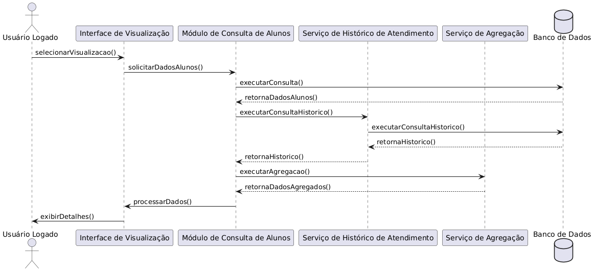
<sup>Fonte: Material produzido pelos autores (2024).</sup>
</div>

&nbsp;&nbsp;&nbsp;Este diagrama de sequência representa o fluxo para visualizar a lista de todos os alunos sob gestão, com detalhes como histórico de atendimento e informações gerais. A interação inicia com a solicitação feita por um usuário logado na interface de visualização, que aciona o módulo de consulta responsável por recuperar os dados dos alunos a partir do banco de dados. Adicionalmente, serviços específicos recuperam o histórico de atendimentos e agregam informações complementares, permitindo uma visualização detalhada e organizada.  
&nbsp;&nbsp;&nbsp;Relação com Requisitos:

- RF01: Registro e visualização do histórico dos atendimentos realizados para cada aluno.
- RF02: Exibição das informações do profissional responsável e dados gerais dos alunos.
- RNF02: Integridade dos dados.
- RNF07: Responsividade e usabilidade.

<div align="center">
<sub>Figura 15 - Diagrama de sequência UML da US03</sub> <br>
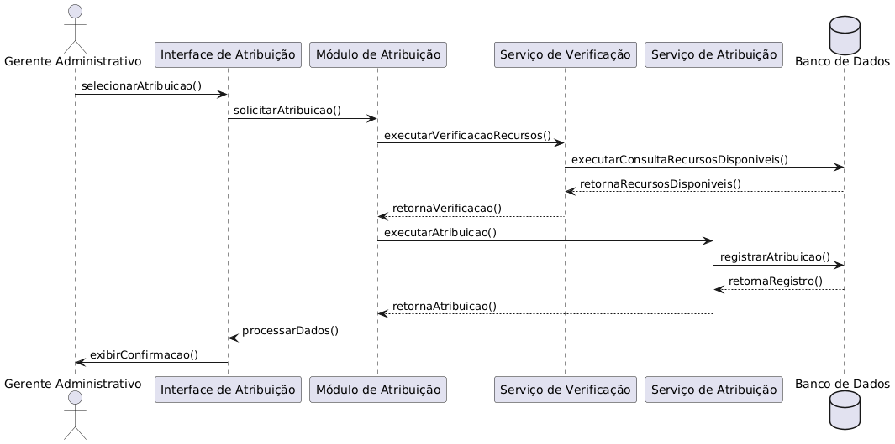
<sup>Fonte: Material produzido pelos autores (2024).</sup>
</div>

&nbsp;&nbsp;&nbsp;Este diagrama de sequência detalha o processo de atribuição de recursos, como tecnologias assistivas e profissionais, aos alunos. O fluxo inicia com o gerente administrativo acessando a interface de atribuição. Em seguida, o módulo de atribuição verifica a disponibilidade dos recursos por meio de um serviço dedicado, que consulta o banco de dados e retorna os recursos disponíveis. Após essa verificação, o sistema efetua a atribuição e registra a operação, gerando um log para auditoria.  
&nbsp;&nbsp;&nbsp;Relação com Requisitos:

- RF04: Atribuição de um profissional para o atendimento de um aluno.
- RF05: Registro da necessidade de equipamento especial, quando aplicável.
- RF07: Registro de logs de ações.
- RNF01: Compatibilidade com tecnologias assistivas.
- RNF02: Integridade dos dados.

<div align="center">
<sub>Figura 16 - Diagrama de sequência UML da US04</sub> <br>
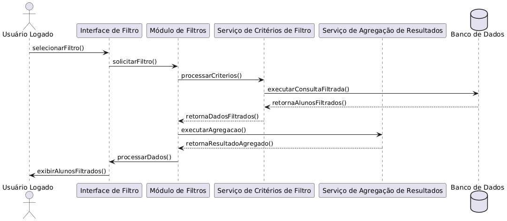
<sup>Fonte: Material produzido pelos autores (2024).</sup>
</div>

&nbsp;&nbsp;&nbsp;Este diagrama de sequência descreve o fluxo de filtragem dos alunos sob gestão. O usuário logado aciona a interface de filtro, onde insere os critérios desejados. Estes critérios são processados por um módulo de filtros, que executa uma consulta filtrada no banco de dados e, posteriormente, agrega e organiza os resultados para exibição. Dessa forma, o usuário recebe uma lista de alunos conforme os critérios especificados, facilitando a visualização e a tomada de decisões.  
&nbsp;&nbsp;&nbsp;Relação com Requisitos:

- Contribui para a gestão eficiente dos dados dos alunos.
- RNF06: Desempenho (consultas rápidas).
- RNF07: Responsividade da interface.

<div align="center">
<sub>Figura 17 - Diagrama de sequência UML da US05</sub> <br>
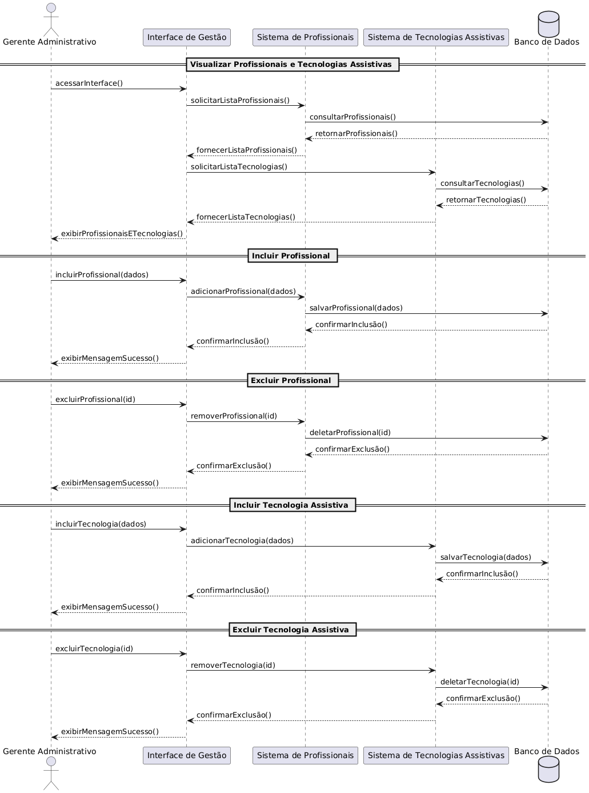
<sup>Fonte: Material produzido pelos autores (2024).</sup>
</div>

&nbsp;&nbsp;&nbsp;Este diagrama de sequência retrata o fluxo para a gestão de profissionais e tecnologias assistivas. O gerente administrativo, por meio de uma interface dedicada, pode visualizar, incluir ou excluir registros desses recursos. O fluxo envolve a solicitação dos dados, processamento pelo módulo de gestão e a atualização do banco de dados com as alterações realizadas. Todas as ações são registradas, garantindo rastreabilidade e segurança das operações.  
&nbsp;&nbsp;&nbsp;Relação com Requisitos:

- RF05: Inclusão e registro de necessidades relacionadas a tecnologias assistivas.
- RF06: Edição de registros dos alunos (quando aplicável, na parte de atualização de informações).
- RF07: Registro de logs de ações para auditoria.
- RNF02: Integridade dos dados.
- RNF01: Compatibilidade com tecnologias assistivas.

<div align="center">
<sub>Figura 18 - Diagrama de sequência UML da US06</sub> <br>
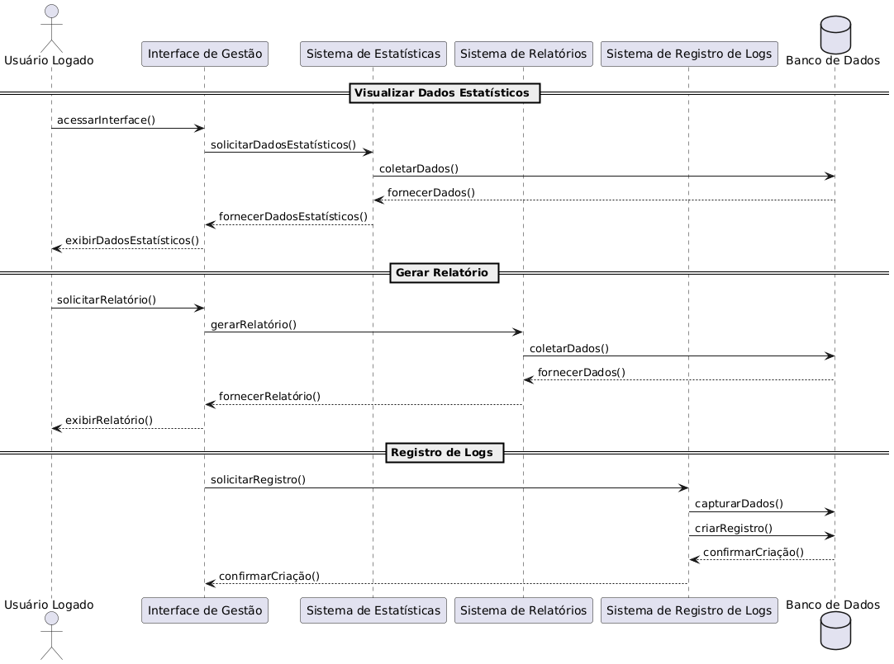
<sup>Fonte: Material produzido pelos autores (2024).</sup>
</div>

&nbsp;&nbsp;&nbsp;Este diagrama de sequência ilustra o fluxo para a visualização de dados estatísticos e a geração de relatórios. O usuário logado acessa a interface de visualização de estatísticas, que aciona um módulo especializado para consultar, agregar e processar os dados dos alunos a partir do banco de dados. Os dados são então transformados em gráficos e relatórios, permitindo análises detalhadas e a tomada de decisões baseadas em informações quantitativas.  
&nbsp;&nbsp;&nbsp;Relação com Requisitos:

Facilita a análise dos dados dos alunos e a geração de insights para a gestão.

- RNF06: Desempenho (consultas rápidas e eficientes).
- RNF07: Responsividade e usabilidade da interface.
- RNF02: Integridade dos dados.

# 6. Mapeamento Técnico de Infraestrutura e Implantação

&emsp; Esta seção apresenta a estratégia de implantação do sistema Incloud, detalhando a infraestrutura tecnológica planejada para suportar os requisitos funcionais e não funcionais do projeto. O mapeamento técnico aborda os componentes de hardware e software, suas interações e os ambientes de execução, mostrando como a aplicação será disponibilizada para atender às necessidades do Centro Paula Souza no gerenciamento de alunos com necessidades especiais.

## 6.1 Diagrama de Implantação da UML

<div align="center">
<sub>Figura 19 - Diagrama de Implantação</sub><br>
<br>
<sup>Fonte: Material produzido pelos autores (2025)</sup>
</div>

## 6.2 Justificativa das Escolhas de Implantação

&emsp; O diagrama de implantação ilustra a arquitetura técnica do sistema Incloud desenvolvido para o Centro Paula Souza, focado na gestão de alunos com necessidades especiais.

**Infraestrutura e Componentes**

- **VPC**: Toda a infraestrutura está alocada em uma Virtual Private Cloud (VPC), garantindo a proteção e segmentação da comunicação interna entre os componentes do sistema.

- **API**: Componente externo que fornece dados dos alunos PCD via API REST, comunicando-se com a AWS-EC2 através de HTTPS/REST, permitindo integração com os sistemas existentes do CPS (RNF09).

- **AWS-EC2**: Instância de computação na AWS que hospeda o banco MySQL em container Docker, escolhida por oferecer bom custo-benefício para a carga de trabalho prevista, facilitar a migração entre provedores e possuir servidores nacionais (RNF08).  
  *Evolução:* A comunicação entre a AWS-EC2 e os demais componentes (como o WebServer) foi atualizada para utilizar HTTPS, ao invés de TCP, garantindo maior segurança dos dados trafegados.

- **MySQL-db**: Banco de dados relacional implementado em container Docker para armazenar dados dos alunos, profissionais, atendimentos e tecnologias assistivas.  
  *Evolução:* O uso do MySQL em container atende ao RNF02 ao garantir integridade e isolamento dos dados. Recomenda-se avaliar a substituição por uma instância RDS para aumentar a robustez e facilitar a administração.

- **WebServer**: Servidor Node.js que hospeda a aplicação Incloud v1.1.0, responsável pela lógica de negócio e interface com o usuário.  
  *Evolução:* O fluxo de interação entre frontend, backend e Auth0 foi ajustado para que o backend valide os tokens JWT emitidos pelo Auth0, assegurando uma autenticação robusta sem alterar a estrutura básica do sistema.

- **Auth0**: Serviço de autenticação e autorização que implementa OAuth 2.0 para controle de acesso (RNF03).  
  *Evolução:* Além de gerenciar os diferentes níveis de acesso (gestores, assessores, profissionais), o Auth0 agora integra mecanismos para que o backend valide os tokens JWT, reforçando a segurança do acesso.

- **Firewall**: Dispositivo de segurança (AWS Security Group) configurado para permitir apenas tráfego HTTPS nas portas definidas, atuando como a primeira camada de defesa contra acessos não autorizados.

- **Cache (ex: Redis)**: *Sugestão:* Considerando que o RNF06 exige que o sistema responda a consultas padrão em até 5 segundos, recomenda-se avaliar a implementação de uma camada de cache (por exemplo, utilizando Redis) para otimizar o desempenho em cenários de alta carga, garantindo respostas rápidas e consistentes.

&emsp; Todos os componentes e nomenclaturas foram revisados e alinhados com o diagrama de componentes, garantindo que as definições estejam consistentes e o fluxo arquitetural seja claro.

**Relação com os Requisitos Não Funcionais (RNFs)**

&emsp; A arquitetura utiliza a AWS-EC2 como plataforma principal, mas foi projetada utilizando containers Docker para assegurar a portabilidade entre provedores. A escolha do MySQL para o banco de dados foi fundamentada na familiaridade da equipe do CPS com essa tecnologia e na sua capacidade de implementar regras de integridade para os dados sensíveis dos alunos (RNF02).  

&emsp; O protocolo HTTPS foi adotado em todos os pontos de comunicação – tanto externos quanto internos (por exemplo, entre a AWS-EC2 e o WebServer) – garantindo a confidencialidade e a segurança dos dados, conforme exigido pelo RNF03.  

&emsp; A integração do Auth0, com o backend validando os tokens JWT, reforça os mecanismos de autenticação e autorização, atendendo aos requisitos do RNF03.  

&emsp; Quanto ao RNF06, que estipula que o sistema deve responder a consultas padrão em até 5 segundos sob condições de carga típica, a arquitetura contempla práticas de desempenho para manter respostas rápidas e consistentes. Como estratégia complementar, sugere-se a implementação de cache (ex: Redis) para otimizar o processamento e reduzir a latência em cenários de alta demanda.

&emsp; A escalabilidade horizontal é possibilitada pelo uso de containers Docker, permitindo que novas instâncias da aplicação sejam criadas dinamicamente para manter a performance estável, especialmente durante períodos de alta demanda, como processos de matrícula.

&emsp; A redundância do banco de dados é assegurada pelo uso dos recursos nativos da AWS para replicação e backups automatizados, reforçando a resiliência contra falhas e a continuidade operacional.


## 6.3 Considerações sobre Desempenho e Segurança


&emsp; A arquitetura implementa camadas de proteção para a segurança dos dados sensíveis dos alunos com necessidades especiais. O firewall AWS Security Group atua como primeira barreira, restringindo o tráfego apenas às portas e protocolos necessários, enquanto toda comunicação externa utiliza HTTPS para proteger dados em trânsito. A autenticação via Auth0 fornece controle de acesso baseado em funções, garantindo que apenas usuários autorizados acessem informações conforme seu nível de permissão. O sistema de logs implementado registra todas as ações dos usuários (conforme RF07), permitindo auditoria completa das operações e facilitando a identificação de possíveis violações de acesso. A separação clara entre os componentes de aplicação e banco de dados em containers isolados reduz a superfície de ataque, atendendo aos requisitos de integridade (RNF02) e proteção contra vazamento de dados (RNF03).

# 7. Projeto Visual da Solução

## 7.1 Desenvolvimento de Wireframes

Nesta seção, são apresentados os wireframes desenvolvidos para as telas da nossa solução, que ilustram a estrutura básica e o fluxo de navegação inicial do sistema. Os wireframes foram projetados para oferecer uma visão clara das funcionalidades principais, mantendo simplicidade e organização, com elementos padronizados como a barra de navegação (navbar) presente em todas as telas. Abaixo, cada wireframe é descrito com detalhes sobre sua estrutura, interações propostas e justificativas para o layout escolhido, facilitando a compreensão do fluxo entre as telas.

Antes de visualizar os wireframes, é importante destacar que o fluxo de navegação inicia na homepage, que serve como ponto de partida para acessar as demais telas, como histórico de atendimentos, visualização de profissionais, relatórios e dashboard, lista de alunos e visualização individual de alunos. Além disso, uma tela de registro de atendimentos foi concebida para permitir o cadastro de novos atendimentos, conectando alunos e profissionais de forma dinâmica.

O primeiro wireframe refere-se à homepage.  
<div align="center">  
<sub>Figura 20 - Wireframe Homepage</sub><br>  
  
<sup>Fonte: Elaborado pelos autores (2025)</sup>  
</div>  
No wireframe da homepage, os espaços vazios indicam locais reservados para ícones que serão detalhados no mockup, representando os acessos às principais funcionalidades do sistema. A barra superior simboliza a navbar, um elemento fixo que permite retornar à homepage ou acessar o perfil do usuário. O layout centralizado foi escolhido para facilitar a navegação inicial, guiando o usuário de forma intuitiva às demais seções.

A seguir, é apresentado o wireframe do histórico de atendimentos.  
<div align="center">  
<sub>Figura 21 - Wireframe Histórico de Atendimentos</sub><br>  
  
<sup>Fonte: Elaborado pelos autores (2025)</sup>  
</div>  
O wireframe do histórico de atendimentos inclui uma barra de filtragem no topo, projetada para permitir a busca por atendimentos específicos, e uma área central que simboliza a exibição dos dados (como tipo de atendimento, data e profissionais envolvidos). A interação proposta é simples: o usuário filtra os dados e navega pelos registros, com a navbar garantindo retorno à homepage ou acesso ao perfil.

O próximo wireframe detalha a visualização de profissionais.  
<div align="center">  
<sub>Figura 22 - Wireframe Visualização de Profissionais</sub><br>  
  
<sup>Fonte: Elaborado pelos autores (2025)</sup>  
</div>  
Este wireframe representa a página de visualização de profissionais, com uma barra de filtragem no topo para buscar por nome, especialidade ou disponibilidade, e uma área de exibição de dados. O design prioriza a clareza na consulta de profissionais disponíveis, com a navbar mantendo a consistência de navegação.

A seguir, o wireframe de relatórios e dashboard é apresentado.  
<div align="center">  
<sub>Figura 23 - Wireframe Relatórios e Dashboard</sub><br>  
  
<sup>Fonte: Elaborado pelos autores (2025)</sup>  
</div>  
O wireframe de relatórios e dashboard exibe áreas reservadas para gráficos e indicadores numéricos, com uma barra de filtragem superior para refinar os dados por período ou tipo de atendimento. A proposta é oferecer uma visão analítica acessível, com a navbar facilitando o retorno ou acesso ao perfil.

O wireframe da lista de alunos é descrito em seguida.  
<div align="center">  
<sub>Figura 24 - Wireframe Lista de Alunos</sub><br>  
  
<sup>Fonte: Elaborado pelos autores (2025)</sup>  
</div>  
Este wireframe contém uma área para exibição de dados obtidos via API, como tecnologias assistivas utilizadas e profissionais designados. A interação permite listar e filtrar alunos, com a navbar como elemento padrão para navegação.

Por fim, o wireframe de visualização individual de alunos é apresentado.  
<div align="center">  
<sub>Figura 25 - Wireframe Visualização individual dos Alunos</sub><br>  
  
<sup>Fonte: Elaborado pelos autores (2025)</sup>  
</div>  
O wireframe de visualização individual exibe informações detalhadas de um aluno específico, acessado a partir da lista de alunos. A proposta é oferecer uma visão clara e editável de dados relevantes, com a navbar mantendo o padrão de navegação.

Além desses, uma tela de registro de atendimentos foi planejada (não exibida aqui como wireframe individual, mas implícita no fluxo), permitindo o cadastro de novos atendimentos e o "match" entre alunos e profissionais, integrando-se ao histórico e à lista de alunos.


## 7.2 Desenvolvimento de Mockups

Nesta seção, são exibidos os mockups das telas do nosso projeto, que refinam os wireframes com detalhes visuais mais próximos da interface final. Os mockups mantêm a estrutura e a navegação definidas anteriormente, incluindo a navbar como elemento padrão em todas as telas, e adicionam uma tela de registro de atendimentos para complementar o fluxo do sistema.

O primeiro mockup apresentado é o da homepage.  
<div align="center">  
<sub>Figura X - Mockup da Homepage</sub><br>  
  
<sup>Fonte: Elaborado pelos autores (2025)</sup>  
</div>  
Na homepage, quatro botões principais estão dispostos centralmente: o primeiro, no canto superior esquerdo, leva ao histórico de atendimentos; o segundo acessa a visualização de profissionais; o terceiro direciona a relatórios e dashboards; e o quarto exibe a lista de alunos. A navbar, no topo, inclui um ícone de casa para retornar à homepage e outro para o perfil do usuário, garantindo navegação consistente.

A seguir, é apresentado o mockup do histórico de atendimentos.  
<div align="center">  
<sub>Figura 33 - Mockup do Histórico de Atendimentos</sub><br>  
  
<sup>Fonte: Elaborado pelos autores (2025)</sup>  
</div>  
O mockup do histórico de atendimentos exibe uma tabela com colunas para tipo de atendimento, data, nome do aluno e profissional designado. A navbar, no topo, permite acesso ao perfil via ícone no canto superior direito. Uma barra de pesquisa e um ícone de filtro facilitam a busca, enquanto a paginação numérica, na base, organiza os registros. Uma seta de retorno, no canto superior direito, leva à homepage.

O próximo mockup é da visualização de profissionais.  
<div align="center">  
<sub>Figura 34 - Mockup Visualização de Profissionais</sub><br>  
  
<sup>Fonte: Elaborado pelos autores (2025)</sup>  
</div>  
Na visualização de profissionais, a tabela exibe nome, especialidade, atendimentos mensais e disponibilidade. A navbar mantém o acesso ao perfil, e uma barra de pesquisa com filtro refina os resultados. A paginação numérica organiza a lista, e a seta de retorno, no topo direito, leva à homepage.

O mockup de relatórios e dashboards é apresentado a seguir.  
<div align="center">  
<sub>Figura X - Mockup Relatórios e Dashboards</sub><br>  
  
<sup>Fonte: Elaborado pelos autores (2025)</sup>  
</div>  
Na página de relatórios, filtros refinam os dados por período, unidade, curso e necessidade especial. Quatro indicadores mostram total de alunos atendidos, atendimentos no período, uso de tecnologia assistiva e acompanhamento profissional. Espaços para gráficos detalham necessidades especiais, evolução de atendimentos, origem dos alunos e tecnologias assistivas. Um botão de exportação e a seta de retorno complementam a tela, com a navbar no topo.

O mockup da lista de alunos é descrito em seguida.  
<div align="center">  
<sub>Figura 36 - Mockup Lista de Alunos</sub><br>  
  
<sup>Fonte: Elaborado pelos autores (2025)</sup>  
</div>  
Na lista de alunos, a tabela exibe nome, tecnologia utilizada, profissional designado, último atendimento e status (🟡 em andamento, 🔴 pendente, 🟢 concluído). A barra de pesquisa e o filtro refinam os dados, com paginação na base e seta de retorno no topo direito. A navbar mantém o padrão.

Por fim, o mockup de visualização individual dos alunos é apresentado.  
<div align="center">  
<sub>Figura X - Mockup Visualização Individual dos Alunos</sub><br>  
  
<sup>Fonte: Elaborado pelos autores (2025)</sup>  
</div>  
Este mockup, exibido como pop-up da lista de alunos, detalha dados pessoais, informações do responsável e necessidades especiais. Permite editar profissionais responsáveis (podendo incluir múltiplos profissionais, já que um aluno pode ter mais de um atendimento) e tecnologias assistivas, com botões para salvar, cancelar ou retornar à lista.

Adicionalmente, uma tela de registro de atendimentos (não exibida como figura isolada aqui) foi incorporada ao fluxo, acessível a partir da homepage ou da lista de alunos, permitindo cadastrar novos atendimentos e associar alunos a múltiplos profissionais, refletindo a flexibilidade do sistema.


## 7.3 Guia Visual

&nbsp;&nbsp;&nbsp;&nbsp;O Design System da solução Incloud, em parceria com o Centro Paula Souza (CPS), foi desenvolvido para garantir uma experiência de usuário consistente, acessível e intuitiva. Ele define a estrutura visual do produto, padronizando cores, tipografia, espaçamentos e componentes interativos, além de reforçar a identidade da marca.

<div align="center">
<sub>Figura 38 - Guia de estilos</sub> <br>
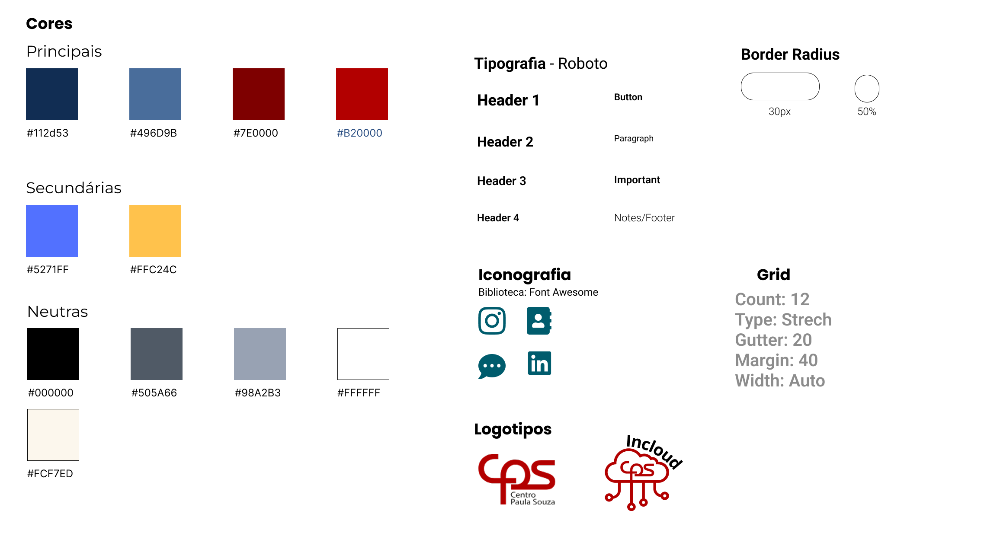
<sup>Fonte: Material produzido pelos autores (2024).</sup>
</div>

&nbsp;&nbsp;&nbsp;&nbsp;A base do sistema se apoia em um grid de 12 colunas, que permite flexibilidade e organização na disposição dos elementos na tela. Com margens externas de 40px e espaçamento interno (gutter) de 20px, o layout mantém um alinhamento uniforme e adaptável a diferentes resoluções, desde telas grandes até dispositivos móveis.

&nbsp;&nbsp;&nbsp;&nbsp;A identidade visual do CPS é refletida na paleta de cores escolhida estrategicamente pela equipe, que combina tons institucionais como azul escuro (#112D53), azul médio (#496D9B), bordô escuro (#7E0000) e vermelho CPS (#B20000), com cores secundárias como azul vibrante (#5271FF) e amarelo dourado (#FFC24C) para realce e diferenciação de elementos interativos. Tons neutros, como preto (#000000), cinza escuro (#505A66), cinza médio (#98A2B3), branco (#FFFFFF) e bege claro (#FCF7ED), garantem equilíbrio e acessibilidade visual para o usuário.

&nbsp;&nbsp;&nbsp;&nbsp;A tipografia escolhida é a Roboto, uma fonte moderna e legível que reforça a clareza da comunicação. Sua hierarquia organiza os textos de maneira funcional, com títulos destacados para botões e cabeçalhos principais, e tamanhos menores para legendas e rodapés.

&nbsp;&nbsp;&nbsp;&nbsp;Para ícones, a biblioteca Font Awesome (utilizada também pelo Centro Paula Souza em seus sites), oferece um conjunto padronizado de símbolos para navegação, redes sociais e funcionalidades interativas, tornando o design mais intuitivo e padronizado. Além disso, os botões e componentes seguem um border-radius de 30px para cantos arredondados e 50% para elementos circulares.

<div align="center">
<sub>Figura 39 - Espaçamento</sub> <br>
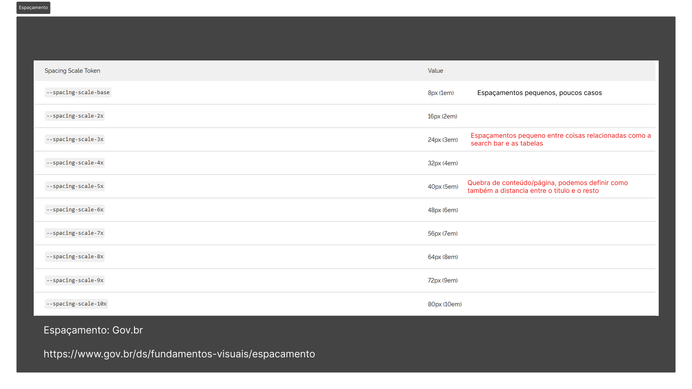
<sup>Fonte: Material produzido pelos autores (2024).</sup>
</div>

&nbsp;&nbsp;&nbsp;&nbsp;O espaçamento entre elementos respeita uma escala lógica, indo de 8px a 80px. Pequenos espaçamentos são usados para agrupar conteúdos relacionados, enquanto espaços maiores ajudam a criar divisões visuais entre seções importantes.

<div align="center">
<sub>Figura 40 - Logotipo</sub> <br>
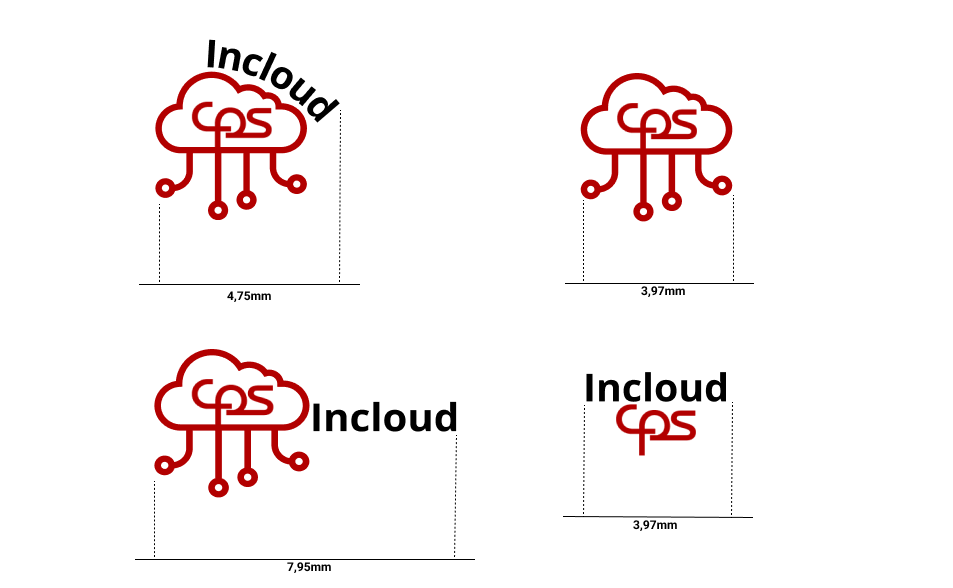
<sup>Fonte: Material produzido pelos autores (2024).</sup>
</div>

&nbsp;&nbsp;&nbsp;&nbsp;O logotipo do Incloud, adaptável a diferentes tamanhos e proporções, mantém sua legibilidade e identidade em diversas aplicações, desde telas grandes até interfaces compactas. Sua presença no produto reforça a conexão com o CPS, garantindo reconhecimento da marca.

&nbsp;&nbsp;&nbsp;&nbsp;A experiência do usuário também foi projetada com acessibilidade em mente, incluindo alto contraste para leitura, tamanhos de fonte responsivos, ícones descritivos e compatibilidade com leitores de tela. Isso torna o sistema inclusivo para diferentes públicos. Além da padronização, o design incentiva a colaboração por meio de botões de ação visíveis, cores que destacam notificações importantes e interfaces intuitivas, promovendo interatividade. Elementos visuais dinâmicos garantem flexibilidade para diferentes contextos, sem perder a identidade da marca.
&nbsp;&nbsp;&nbsp;&nbsp;O Design System da solução Incloud, em parceria com o Centro Paula Souza (CPS), foi desenvolvido para garantir uma experiência de usuário consistente, acessível e intuitiva. Ele define a estrutura visual do produto, padronizando cores, tipografia, espaçamentos e componentes interativos, além de reforçar a identidade da marca.

<div align="center">
<sub>Figura 41 - Guia de estilos</sub> <br>

<sup>Fonte: Material produzido pelos autores (2024).</sup>
</div>

&nbsp;&nbsp;&nbsp;&nbsp;A base do sistema se apoia em um grid de 12 colunas, que permite flexibilidade e organização na disposição dos elementos na tela. Com margens externas de 40px e espaçamento interno (gutter) de 20px, o layout mantém um alinhamento uniforme e adaptável a diferentes resoluções, desde telas grandes até dispositivos móveis.

&nbsp;&nbsp;&nbsp;&nbsp;A identidade visual do CPS é refletida na paleta de cores escolhida estrategicamente pela equipe, que combina tons institucionais como azul escuro (#112D53), azul médio (#496D9B), bordô escuro (#7E0000) e vermelho CPS (#B20000), com cores secundárias como azul vibrante (#5271FF) e amarelo dourado (#FFC24C) para realce e diferenciação de elementos interativos. Tons neutros, como preto (#000000), cinza escuro (#505A66), cinza médio (#98A2B3), branco (#FFFFFF) e bege claro (#FCF7ED), garantem equilíbrio e acessibilidade visual para o usuário.

&nbsp;&nbsp;&nbsp;&nbsp;A tipografia escolhida é a Roboto, uma fonte moderna e legível que reforça a clareza da comunicação. Sua hierarquia organiza os textos de maneira funcional, com títulos destacados para botões e cabeçalhos principais, e tamanhos menores para legendas e rodapés.

&nbsp;&nbsp;&nbsp;&nbsp;Para ícones, a biblioteca Font Awesome (utilizada também pelo Centro Paula Souza em seus sites), oferece um conjunto padronizado de símbolos para navegação, redes sociais e funcionalidades interativas, tornando o design mais intuitivo e padronizado. Além disso, os botões e componentes seguem um border-radius de 30px para cantos arredondados e 50% para elementos circulares.

<div align="center">
<sub>Figura 42 - Espaçamento</sub> <br>

<sup>Fonte: Material produzido pelos autores (2024).</sup>
</div>

&nbsp;&nbsp;&nbsp;&nbsp;O espaçamento entre elementos respeita uma escala lógica, indo de 8px a 80px. Pequenos espaçamentos são usados para agrupar conteúdos relacionados, enquanto espaços maiores ajudam a criar divisões visuais entre seções importantes.

<div align="center">
<sub>Figura 43 - Logotipo</sub> <br>

<sup>Fonte: Material produzido pelos autores (2024).</sup>
</div>

&nbsp;&nbsp;&nbsp;&nbsp;O logotipo do Incloud, adaptável a diferentes tamanhos e proporções, mantém sua legibilidade e identidade em diversas aplicações, desde telas grandes até interfaces compactas. Sua presença no produto reforça a conexão com o CPS, garantindo reconhecimento da marca.

&nbsp;&nbsp;&nbsp;&nbsp;A experiência do usuário também foi projetada com acessibilidade em mente, incluindo alto contraste para leitura, tamanhos de fonte responsivos, ícones descritivos e compatibilidade com leitores de tela. Isso torna o sistema inclusivo para diferentes públicos. Além da padronização, o design incentiva a colaboração por meio de botões de ação visíveis, cores que destacam notificações importantes e interfaces intuitivas, promovendo interatividade. Elementos visuais dinâmicos garantem flexibilidade para diferentes contextos, sem perder a identidade da marca.

# 8. Desenvolvimento do Projeto

&emsp; A seção 8 descreve o desenvolvimento do projeto, abrangendo desde a organização e estruturação do código até o desenvolvimento de funcionalidades e a aplicação de testes. Inicia com a arquitetura de codificação, abordando a estrutura de diretórios, as tecnologias utilizadas no backend e frontend, além dos padrões seguidos para garantir a qualidade do código. Em seguida, detalha o desenvolvimento das funcionalidades nas Sprints, a execução de testes unitários e de integração, e a geração de documentações automáticas, proporcionando uma visão completa do processo de desenvolvimento.

## 8.1 Arquitetura de Codificação e Estrutura de Diretórios

### 8.1.1 Estrutura de Diretórios

&emsp; O projeto mantém uma estrutura modular organizada para separar as responsabilidades entre backend e frontend. Abaixo está a estrutura principal de diretórios adotada:

```plaintext
├── backend/
│   ├── src/
│   │   ├── config/
│   │   ├── controllers/
│   │   ├── models/
│   │   ├── routers/
│   │   ├── app.ts
│   │   ├── index.ts
│   ├── package.json
│   ├── tsconfig.json
├── front/
│   ├── public/
│   ├── src/
│   │   ├── app/
│   │   │   ├── components/
│   │   │   ├── pages/
│   │   │   ├── app.component.css
│   │   │   ├── app.component.html
│   │   │   ├── app.component.spec.ts
│   │   │   ├── app.component.ts
│   │   │   ├── app.config.ts
│   │   │   ├── app.routes.ts
│   │   ├── index.html
│   │   ├── main.ts
│   │   ├── styles.css
│   ├── angular.json
│   ├── package.json
├── README.md
├── .gitignore
```

### 8.1.2 Arquitetura de Codificação

&emsp; O projeto adota uma arquitetura baseada em **separação de responsabilidades**, utilizando padrões como **MVC (Model-View-Controller)** no backend e uma estrutura modular no frontend.

#### Backend (Node.js + TypeScript)

- **config/**: Configurações do sistema.
- **controllers/**: Lógica de negócios e manipulação de requisições.
- **models/**: Definição de modelos e esquemas de dados.
- **routers/**: Rotas da aplicação e mapeamento para os controladores.

#### Frontend (Angular + TypeScript)

- **public/**: Arquivos estáticos.
- **src/app/**: Contém os módulos principais, incluindo páginas e componentes.
- **styles.css**: Estilização global do frontend.

#### Padrões de Codificação

- **Nomeação**:
  - Variáveis e funções: camelCase (`minhaVariavel`, `calcularTotal()`).
  - Classes e interfaces: PascalCase (`UsuarioService`, `IUsuario`).
  - Constantes: UPPER_CASE (`API_URL`, `TOKEN_EXPIRATION`).
- **Formatação**:
  - Uso do ESLint e Prettier para manter a padronização do código.
  - Indentação de 2 espaços.
- **Comentários**:
  - Código deve ser autoexplicativo, mas comentários devem ser adicionados em trechos complexos.

#### Representação Visual

&emsp; A representação visual abaixo ilustra a interação entre backend e frontend:

```plaintext
+------------------+       +--------------------+       +------------------+
|  Frontend (UI)  | <---> |  Backend (API)     | <---> |  Database        |
|  Angular        |       |  Node.js + TS      |       |  SQL / NoSQL     |
+------------------+       +--------------------+       +------------------+
          |                          |                           |
          v                          v                           v
+-------------------+       +------------------+        +------------------+
|  Public Assets   |       |  Config / Auth   |        |  Auth0, JWT      |
|  Static Files    |       |  JWT, Configs    |        |  Tokens          |
+-------------------+       +------------------+        +------------------+
```

## 8.2 Desenvolvimento de Features

## 8.2.1 Sprint 3

&emsp; Durante a implementação das features da Sprint 3 relacionadas ao sistema, utilizamos Angular e TypeScript no frontend, alinhados aos padrões de arquitetura previamente definidos.

## Features Desenvolvidas:

- Tela de Alunos: Interface desenvolvida para visualização e edição das informações do aluno, com campos somente leitura e editáveis seguindo os padrões de UI definidos. Implementamos classes CSS específicas para diferenciação visual, mantendo uma experiência clara e intuitiva.
- Tela de Alunos Cadastrados: Tabela dinâmica criada para gerenciamento dos alunos cadastrados, permitindo seleção em massa, ordenação e visualização clara do status atual dos alunos (Pendente, Em andamento, Concluído), destacando a utilização consistente dos estilos definidos.
- Tela de Estatísticas de Atendimento: Desenvolvida uma tela para visualização de métricas e gráficos sobre os atendimentos realizados. Implementamos filtros interativos por período, unidade, tipo de curso e necessidade especial. Além disso, incorporamos cards informativos para gráficos futuros, visando uma experiência informativa e agradável visualmente.
- Tela de Histórico de Atendimentos: Implementada uma interface para visualização detalhada do histórico dos atendimentos, com tabela dinâmica que permite ordenação e busca rápida por atendimentos específicos.
- Tela Home: Estruturada uma tela inicial que centraliza o acesso rápido às principais funcionalidades, como Histórico de Atendimentos, Lista de Alunos, Estatísticas e Profissionais. Utilizamos componentes estilizados e ícones para fácil reconhecimento e navegação.
- Criação do arquivo database.ts: Responsável pela conexão e configuração do banco de dados, definindo os parâmetros de conexão e regras de persistência.
- Criação de Controllers: Criação de Controllers para a tabela Aluno, Atendimento e Funcionario. Gerenciando as requisições e respostas HTTP, aplicando a lógica de negócio.
- Criação de Models: Criação de Models para todas as tabelas do banco de dados, definindo as entidades e suas relações.
- Criação de Rotas: Definição de endpoints para operações com as tabelas alunos, atendimento e funcionarios.
- Atribuir profissional para um aluno: Desenvolvido previamente parte do código que atribui um funcionário para um aluno já no frontend, sendo possível visualizar e selecionar quais são os funcionários presentes na tabela do banco de dados.

## Desvios identificados:

- Até o momento, não houve desvios significativos do plano original. Todas as implementações estão alinhadas aos requisitos definidos previamente.

## Tecnologias utilizadas:

- Angular e Typescript para o desenvolvimento frontend.
- Componentes modulares reutilizáveis e estrutura clara seguindo o padrão arquitetural.
- CSS estruturado com variáveis globais para cores, sombras, transições e responsividade consistente entre as telas.

## Próximos passos:

- Implementar funcionalidades completas para gráficos e relatórios exportáveis.
- Realizar os testes de usabilidade e feedback para melhorias incrementais.
- Puxar os dados diretamente da API.
- Fazer a integração completa do backend em todas funcionalidades do front existentes.
- Desenvolver a tela de profissionais e de login, já com autenticação.


### Vídeo da Aplicação
&emsp;Neste vídeo é demonstrado como o sistema está funcionando de forma local com as features implementadas e a visualização do terminal.

<div align="center">
  <sub>Video 01 - Vídeo da Solução</sub><br>
  <video width="640" height="360" controls>
    <source src="./img/video/videoapp.mp4" type="video/mp4">
  </video><br>
  <sup>Fonte: Material produzido pelos autores (2024)</sup>
</div>

## 8.2.2 Sprint 4

&emsp; Durante a implementação das features da Sprint 4 relacionadas ao sistema, utilizamos Angular e TypeScript no frontend, e utilizamos Node.Js e TypeScript no backend alinhados aos padrões de arquitetura previamente definidos.

## Features Desenvolvidas:

- Integração do Banco de Dados com o Frontend: Implementamos a conexão entre o backend e o frontend, permitindo a visualização dos dados armazenados diretamente na interface do usuário. Garantimos que os dados carregados refletem as informações em tempo real do banco.

- Criação do Rollback no Banco de Dados: Implementamos mecanismos de rollback para garantir a integridade dos dados em caso de falhas nas transações, assegurando que alterações incorretas possam ser desfeitas de forma segura.

- Hospedagem do Banco de Dados no Google Cloud: Migramos o banco de dados para a infraestrutura do Google Cloud, garantindo maior escalabilidade, segurança e disponibilidade para o sistema.

- Otimização da Comunicação Backend-Frontend: Ajustamos a estrutura de requisições para melhorar a eficiência da troca de dados entre as camadas do sistema, reduzindo o tempo de carregamento e otimizando a experiência do usuário.

- Teste e Validação da Visualização de Dados: Realizamos testes para garantir que os dados recuperados do banco estejam sendo exibidos corretamente no frontend, validando os fluxos de navegação.

## Desvios identificados:

- Até o momento, houve um desvio do plano original, pois foi necessário deixar de usar a API da sala que estava prevista para utilização. No entanto, o restante das implementações está alinhado aos requisitos definidos previamente.

## Tecnologias utilizadas:

- Angular e Typescript para o desenvolvimento frontend.
- Componentes modulares reutilizáveis e estrutura clara seguindo o padrão arquitetural.
- CSS estruturado com variáveis globais para cores, sombras, transições e responsividade consistente entre as telas.
- Node.Js e Typescript para o desenvolvimento backend.

## Próximos passos:

- Implementar funcionalidades completas para gráficos e relatórios exportáveis.
- Desenvolver a feature de atribuir um profissional ao aluno.
- Desenvolver a tela de profissionais e de login, já com autenticação.
- Desenvolver uma feature para criação de novos profissionais


### Video da Aplicação
&emsp;[Neste vídeo](https://youtu.be/RkQiEUL5ixU) é demonstrado como o sistema está funcionando de forma local com as features implementadas e a visualização do terminal.

<div align="center">
  <sub>Video 02 - Vídeo da Solução Sprint 4</sub><br>
  <video width="640" height="360" controls>
    <source src="./img/video/video-sprint4.mp4" type="video/mp4">
  </video><br>
  <sup>Fonte: Material produzido pelos autores (2024)</sup>
</div>

## 8.2.3 Sprint 5

&emsp; Durante a Sprint 5, avançamos significativamente na implementação de funcionalidades essenciais para o sistema, mantendo a arquitetura estabelecida e utilizando Angular e TypeScript no frontend, e Node.js com TypeScript no backend. As novas features entregues ampliam as possibilidades de interação dos usuários e aumentam a robustez da aplicação, assim como atende os requisitos estabelecidos pelo cliente.

## Features desenvolvidas:

- Tela de Login e Logout: Desenvolvemos a tela de login com autenticação integrada ao backend, permitindo acesso seguro ao sistema. Também implementamos a funcionalidade de logout, garantindo o encerramento de sessões de forma eficiente.

- Adição de Atendimentos: Criamos a funcionalidade que permite cadastrar novos atendimentos, vinculando-os a alunos específicos e registrando dados essenciais de acompanhamento.

- Adição de Profissionais: Implementamos a adição de novos profissionais diretamente pela interface do sistema, com integração ao banco de dados e validações de campos.

- Atribuição de Tecnologia Assistiva no Formulário: Adicionamos a opção de selecionar tecnologias assistivas no formulário de criação de atendimentos, tornando o cadastro mais completo e aderente às necessidades dos alunos.

- Criação de Alunos: Implementamos a tela e o fluxo completo para o cadastro de novos alunos, com campos essenciais como nome, escola, e dados de contato.

- Exportação de Relatórios em PDF: Criamos a funcionalidade para exportar relatórios em formato PDF, permitindo que usuários tenham registros físicos ou digitais das informações dos gráficos do sistema.

- Atribuição de Profissional ao Aluno: Desenvolvemos a lógica para vincular um profissional a um aluno, estabelecendo uma conexão entre os dados que será essencial para o acompanhamento.

- Gráficos Integrados: Gráficos que representam visualmente os dados armazenados, facilitando a análise de atendimentos, uso de tecnologias assistivas e alocação de profissionais.

- Nuvem: As funcionalidades implementadas foram adaptadas e testadas para funcionamento em ambiente de nuvem, garantindo escalabilidade e acessibilidade.

- Responsividade e Acessibilidade: A aplicação é totalmente escalável e adaptável a diversos dispositivos, além de suportar leitores de tela como o NVDA e ser totalmente navegável pelo teclado.

## Desvios identificados:

- Não foram identificados desvios significativos nesta sprint. Todas as funcionalidades planejadas foram entregues dentro do prazo e com qualidade validada.

## Próximos passos:

- Implementar filtros de busca na tela de atendimentos: Esta funcionalidade permitirá que os usuários encontrem registros específicos de atendimentos com base em critérios como data, tipo de necessidade especial, profissional responsável, etc. Isso melhorará significativamente a usabilidade quando o sistema tiver muitos registros.

- Expandir os tipos de relatórios exportáveis: Atualmente, o sistema pode oferecer relatórios básicos, mas há planos para adicionar formatos mais especializados ou personalizáveis para diferentes finalidades (relatórios para coordenação, para acompanhamento familiar, etc.).

- Implementar filtros na tela de estatísticas: Similar ao primeiro item, mas focado na visualização de dados estatísticos. Permitirá análises mais granulares dos dados, como filtrar estatísticas por período, por tipo de atendimento, por unidade escolar, etc.

- Realizar a completa implementação da API: A conclusão da API é fundamental para garantir a integração com outros sistemas e a expansão das funcionalidades do projeto.

### Video da Aplicação
&emsp;[Neste vídeo](https://drive.google.com/file/d/1Zyr6YcZI6lL92EKaZ2Ck-VVqyUlN3jg7/view?usp=sharing) é demonstrado como o sistema final está funcionando já na nuvem, com as features implementadas e a visualização do terminal.

<div align="center">
  <sub>Vídeo 03 - Vídeo da Solução Sprint 5</sub><br>
  <video width="640" height="360" controls>
    <source src="./img/video/video-sprint5.mp4" type="video/mp4">
  </video><br>
  <sup>Fonte: Material produzido pelos autores (2024)</sup>
</div>


## 8.3 Testes Unitários e de Integração

### Testes Unitários

&emsp;Os testes unitários desempenham um papel fundamental na validação da lógica do sistema, garantindo que cada parte funcione como esperado. No contexto deste projeto, os testes foram criados para verificar o comportamento de diferentes modelos e controllers, cobrindo as principais operações de manipulação de dados. A estrutura dos testes foi organizada de forma modular, como pode ser visto na pasta models, onde cada arquivo está associado a um modelo específico, permitindo fácil manutenção e expansão futura. 

#### Estratégia para Testes Unitários

&emsp;A estratégia adotada para testes unitários no projeto envolve a criação de testes isolados para cada funcionalidade dos modelos e controllers. Utilizamos Jest como framework de teste e mockamos as dependências necessárias para garantir que os testes sejam independentes e não afetem o banco de dados real.

#### Modelos
1. **Aluno.ts**: Testamos a criação, busca por ID, busca de todos os alunos, atualização e exclusão.

2. **Atendimento.ts**: Testamos a criação, busca por ID, busca de todos os atendimentos, atualização e exclusão.

3. **Autenticacao.ts**: Testamos a criação, busca por ID, busca de todos os registros, atualização e exclusão.

4. **AuxiliarAluno.ts**: Testamos a criação, busca por ID, busca de todos os relacionamentos e exclusão.

5. **AuxiliarDeAcompanhamento.ts**: Testamos a criação, busca por ID, busca de todos os auxiliares, atualização e exclusão.

6. **Funcionario.ts**: Testamos a criação, busca por ID, busca de todos os funcionários, atualização e exclusão.

7. **LogDeAcoes.ts**: Testamos a criação, busca por ID, busca de todos os registros e exclusão.

8. **NecessidadeEspecial.ts**: Testamos a criação, busca por ID, busca de todas as necessidades especiais, atualização e exclusão.

9. **NecessidadeEspecialAluno.ts**: Testamos a criação, busca por ID, busca de todos os relacionamentos e exclusão.

10. **TecnologiaAluno.ts**: Testamos a criação, busca por ID, busca de todos os relacionamentos e exclusão.

11. **TecnologiaAssistiva.ts**: Testamos a criação, busca por ID, busca de todas as tecnologias assistivas, atualização e exclusão.

#### Controllers

1. **AlunoController.ts**: Testamos a listagem de alunos, busca por ID, criação, atualização e exclusão.
2. **FuncionarioController.ts**: Testamos a listagem de funcionários, busca por ID, criação, atualização e exclusão.
3. **AtendimentoController.ts**: Testamos a listagem de atendimentos, busca por ID, criação, atualização e exclusão.

### Implementação dos Testes

&emsp;Os testes foram implementados usando Jest, com mocks para as dependências do banco de dados. Isso permite que os testes sejam executados rapidamente e sem afetar o ambiente de produção.

### Cobertura de Testes

&emsp;A cobertura de testes foi ampla, abrangendo todos os métodos dos modelos e controllers. Cada teste foi projetado para verificar diferentes cenários, incluindo:

- **Sucesso**: Verificar se as operações são realizadas corretamente.
- **Falha**: Verificar como o sistema lida com erros, como parâmetros inválidos ou registros inexistentes.
- **Bordas**: Testar os limites dos parâmetros, como valores mínimo e máximo.

### Resultados Obtidos

&emsp;Os resultados dos testes indicam que as funcionalidades estão funcionando conforme o esperado. Todos os testes passaram, o que sugere uma boa cobertura e robustez do código.

### Observações

- **Cobertura de 100%**: Todos os métodos dos modelos e controllers foram testados.
- **Testes de erro**: Os testes de erro mostraram que o sistema lida corretamente com situações de falha.
- **Desempenho**: Os testes foram rápidos e não afetaram o desempenho do sistema.

&emsp;Essa estratégia de testes unitários garantiu que o projeto seja robusto e confiável, permitindo que novas funcionalidades sejam adicionadas sem comprometer a estabilidade do sistema existente.

# Visão Geral das Alterações na Sprint 4  
Na Sprint 4, realizamos diversas melhorias e correções nos testes unitários do projeto, focando principalmente na correção de problemas de tipagem, melhoria da consistência dos testes e ampliação da cobertura de testes para novos métodos implementados.  

## Principais Alterações  

### 1. Correção de Tipagem em Testes de Aluno  
Um dos principais problemas corrigidos foi a inconsistência de tipos no teste do modelo Aluno. Especificamente:  

- Substituímos o valor string `'Sim'` por um valor booleano `true` no parâmetro `necessita_tecnologia_assistiva`, garantindo compatibilidade com a assinatura do método.  
- Essa correção foi crucial para resolver erros de compilação TypeScript que impediam a execução dos testes.  

### 2. Correção nos Testes de Atendimento  
Identificamos e corrigimos problemas nos testes do modelo Atendimento:  

- Atualizamos os testes para o método `findAllComRelacionamentos` para lidar com a formatação SQL real utilizada pelo método.  
- Substituímos a verificação de string exata por `expect.any(String)` para tornar os testes mais resilientes a mudanças na formatação da consulta SQL.  

### 3. Implementação de Testes para Novos Métodos  
Adicionamos testes para métodos que não estavam sendo testados anteriormente:  

- Implementamos testes para o método `updateTecnologiaAluno` no controller de **TecnologiaAluno**.  
- Adicionamos testes para o método `atribuirProfissional` no controller de **Atendimento**.  

### 4. Correção de Parâmetros de Teste  
Corrigimos os parâmetros passados nos testes para garantir que correspondam exatamente ao que é esperado pelos métodos:  

- Adicionamos o parâmetro `mockNext` as `NextFunction` em chamadas de métodos que utilizam o wrapper `asyncHandler`.  
- Corrigimos os arrays de parâmetros em várias chamadas de `pool.execute` para garantir que os parâmetros sejam passados corretamente.  

### 5. Melhoria na Estrutura dos Testes  
Melhoramos a estrutura geral dos testes para torná-los mais consistentes e fáceis de manter:  

- Padronizamos a forma como os **mocks** são definidos e utilizados.  
- Melhoramos a organização dos blocos de teste para seguir uma estrutura lógica.  
- Adicionamos **comentários explicativos** para facilitar o entendimento do código.  

## Impacto das Alterações  
As alterações realizadas na Sprint 4 tiveram um impacto significativo na qualidade e confiabilidade dos testes:  

- **Maior Estabilidade**: Corrigimos erros que impediam a execução dos testes, garantindo que todos os testes possam ser executados sem falhas.  
- **Melhor Cobertura**: Aumentamos a cobertura de testes para incluir métodos que não estavam sendo testados anteriormente.  
- **Maior Consistência**: Padronizamos a forma como os testes são escritos, tornando o código mais fácil de entender e manter.  
- **Melhor Detecção de Erros**: Os testes agora são mais precisos na detecção de problemas, garantindo que o código funcione conforme o esperado.  

## Conclusão  
As melhorias implementadas na **Sprint 4** fortaleceram significativamente nossa suite de testes, garantindo que o sistema continue funcionando corretamente à medida que novas funcionalidades são adicionadas. A correção de problemas de tipagem e a ampliação da cobertura de testes são passos importantes para manter a qualidade e a confiabilidade do código.  

# 8.3.1 Alterações Necessárias nos Testes

Com base na análise dos logs de erro dos testes, identifiquei várias questões que precisam ser corrigidas para garantir o funcionamento adequado da suite de testes. Abaixo estão as principais alterações necessárias:


## Problemas de Tipagem

### Model Aluno
- Corrigir incompatibilidade de tipo no parâmetro `dataNascimento` — está sendo passado como `Date` quando deveria ser `string`.
- Implementar o método `findByNecessidade` que está sendo chamado nos testes, mas não existe no modelo.

### Model NecessidadeEspecialAluno
- Corrigir o erro de importação — está usando import default quando deveria usar import nomeado.
- Atualizar todos os testes que utilizam este modelo para usar a importação correta.

### Model AuxiliarDeAcompanhamento
- Adicionar verificação de nulo para `auxiliar.id_auxiliar` na linha 270 para evitar o erro `TS18047`.


## Problemas de Implementação

### Controllers de API Externa
- Atualizar os endpoints nos testes de `institutionController`, `courseController` e `statsController` para usar o prefixo `/api/v1/` conforme implementado.

### AuxiliarDeAcompanhamentoController
- Corrigir o retorno do método `getAuxiliarById` para retornar o primeiro item do array em vez do array completo.
- Implementar corretamente o tratamento de erro 404 quando o auxiliar não for encontrado.

### AtendimentoController
- Corrigir a implementação do método `createAtendimento` para validar corretamente os parâmetros.
- Atualizar as mensagens de erro para corresponder às verificadas nos testes.

### AuxiliarAlunoController
- Implementar o método `deleteByAlunoAndAuxiliar` que está sendo chamado nos testes.
- Corrigir o código de status HTTP para `404` em vez de `500` quando a associação não for encontrada.

### AlunoController
- Corrigir o método `updateAluno` para lidar corretamente com a função `clearAuxiliares`.
- Implementar o método `delete` no modelo Aluno que está sendo chamado nos testes.


## Problemas de Estrutura de Teste

### Model AuxiliarAluno
- Atualizar a consulta SQL esperada nos testes para corresponder à implementação real.

### Testes de Controllers
- Ajustar as expectativas de retorno para corresponder ao formato real dos dados (objeto vs array).
- Corrigir os mocks para simular corretamente o comportamento das funções dependentes.


## Recomendações Gerais

### Padronização de Erros
- Implementar um sistema consistente de códigos de erro HTTP em todos os controllers.
- Padronizar as mensagens de erro para facilitar o teste e a depuração.

### Melhoria de Mocks
- Revisar todos os mocks para garantir que simulem corretamente o comportamento das dependências.
- Implementar mocks mais robustos para o pool de conexão do banco de dados.

### Refatoração de Testes
- Considerar a criação de funções auxiliares para reduzir a duplicação de código nos testes.
- Implementar fixtures para dados de teste comuns.

---

Estas alterações são essenciais para garantir que a suite de testes funcione corretamente e forneça uma cobertura adequada do código da aplicação.

## 8.4 Documentações automáticas


# 9. Planejamento e Execução de Testes

Esta seção detalha como os testes foram planejados e executados para garantir que o sistema atenda aos requisitos funcionais e não funcionais definidos no projeto. Cada teste foi desenvolvido para validar as funcionalidades do sistema, desde operações básicas até aspectos mais complexos, como desempenho, segurança e acessibilidade. O foco está em verificar se as entradas fornecidas pelo usuário resultam nas saídas esperadas e se o sistema se comporta conforme as especificações técnicas e as expectativas dos usuários. Para isso, utilizamos uma abordagem estruturada, com cenários de teste que cobrem tanto situações ideais quanto possíveis falhas ou entradas inválidas. Além disso, foi implementada uma matriz de rastreabilidade para assegurar que todos os requisitos documentados fossem contemplados nos casos de teste, proporcionando uma cobertura completa e alinhada aos objetivos do projeto.

## 9.1 Testes Funcionais

Os testes de requisitos funcionais foram planejados para avaliar as ações, operações e tarefas que o sistema deve executar, verificando se as funcionalidades implementadas estão de acordo com as especificações definidas. Cada teste foi estruturado para validar as funções e comportamentos do sistema, assegurando que as entradas fornecidas resultem nas saídas esperadas e que as funcionalidades estejam alinhadas aos objetivos do negócio e às expectativas dos usuários.

## 9.1.1 Planejamento

### **RF01 - Registro do Histórico de Atendimentos**
### Objetivo do Teste
Verificar se o sistema registra corretamente o histórico de atendimentos, incluindo data, tipo e comentários. Além de garantir que o sistema valide o formato dos campos, como data e hora, e respeite limites de tamanho para campos de texto.

### Cenários de Teste
**Cenário Positivo**: O usuário registra um atendimento para um aluno, fornecendo todos os detalhes (data, tipo e comentários), e o sistema registra corretamente o atendimento.
  - **Passos**:
    1. O usuário acessa o perfil de um aluno.
    2. Preenche os campos de atendimento (data no formato correto, tipo e comentários).
    3. Confirma o registro.
  - **Resultado Esperado**: O histórico do aluno é atualizado com o novo atendimento.

**Cenário Positivo - Comentário de Tamanho Máximo**: O usuário registra um atendimento com um comentário de tamanho máximo permitido.
  - **Passos**:
    1. O usuário acessa o perfil de um aluno.
    2. Preenche os campos de atendimento, incluindo um comentário com exatamente o tamanho máximo permitido.
    3. Confirma o registro.
  - **Resultado Esperado**: O sistema aceita o comentário e registra o atendimento corretamente.

**Cenário Negativo - Formato Inválido de Data**: O usuário tenta registrar um atendimento com uma data em formato inválido.
  - **Passos**:
    1. O usuário acessa o perfil de um aluno.
    2. Preenche os campos de atendimento, inserindo uma data em formato inválido (ex: "30/02/2023").
    3. Tenta salvar o registro.
  - **Resultado Esperado**: O sistema exibe uma mensagem de erro indicando que o formato da data é inválido.

**Cenário Negativo - Comentário Excedendo Limite de Caracteres**: O usuário tenta registrar um atendimento com um comentário que excede o limite máximo permitido.
  - **Passos**:
    1. O usuário acessa o perfil de um aluno.
    2. Preenche os campos de atendimento, incluindo um comentário com que excede o limite de caracteres.
    3. Tenta salvar o registro.
  - **Resultado Esperado**: O sistema exibe uma mensagem de erro informando que o comentário excede o limite máximo de caracteres permitidos.

**Cenário Negativo - Campos Obrigatórios Não Preenchidos**: O usuário tenta registrar um atendimento sem preencher um dos campos obrigatórios.
  - **Passos**:
    1. O usuário acessa o perfil de um aluno.
    2. Preenche parcialmente os campos de atendimento e tenta salvar.
  - **Resultado Esperado**: O sistema exibe uma mensagem de erro indicando que todos os campos são obrigatórios.

### Cobertura
- Verificação do processo de cadastro e atualização de informações no perfil do aluno.
- Validação de campos obrigatórios.
- Teste de formatação de campos, como data e hora.
- Teste de limites de tamanho para campos de texto (ex: comentários).

### **RF02 - Exibição do Profissional Responsável pelo Atendimento**
### Objetivo do Teste
Validar se o sistema exibe corretamente o nome do profissional responsável pelo atendimento de um aluno.

### Cenários de Teste

**Cenário Positivo**: O aluno possui um profissional atribuído e o sistema exibe o nome correto.
  - **Passos**:
    1. O usuário acessa o perfil de um aluno.
    2. Verifica o campo de profissional responsável.
  - **Resultado Esperado**: O nome do profissional designado é exibido corretamente.

**Cenário Negativo**: O aluno não tem profissional designado, e o sistema exibe uma mensagem informando a falta de atribuição.
  - **Passos**:
    1. O usuário acessa o perfil de um aluno sem profissional atribuído.
    2. Verifica o campo de profissional responsável.
  - **Resultado Esperado**: O sistema exibe uma mensagem indicando que nenhum profissional foi designado.

### Cobertura
- Verificação da exibição de informações no perfil do aluno.
- Tratamento de falta de dados (profissional não atribuído).

### **RF03 - Registro de Alunos PCD**
### Objetivo do Teste
Garantir que o sistema registre corretamente alunos com necessidades especiais (PCD) e suas informações, validando também o formato dos campos e limites de tamanho.

### Cenários de Teste

**Cenário Positivo**: O usuário cadastra um aluno com necessidades especiais, incluindo todos os dados relevantes.
  - **Passos**:
    1. O usuário acessa a funcionalidade de registro de alunos.
    2. Preenche todos os campos obrigatórios, incluindo informações sobre necessidades especiais.
    3. Confirma o cadastro.
  - **Resultado Esperado**: O aluno PCD é registrado corretamente, e os dados ficam disponíveis no banco de dados.

**Cenário Positivo - Formato Válido de Data**: O usuário cadastra um aluno PCD fornecendo uma data válida (ex: "15/10/2023") para um campo de data, como a data de nascimento.
  - **Passos**:
    1. O usuário acessa a funcionalidade de registro de alunos.
    2. Preenche os campos obrigatórios, incluindo uma data válida no formato correto.
    3. Confirma o cadastro.
  - **Resultado Esperado**: O sistema aceita a data e registra o aluno corretamente.

**Cenário Negativo - Formato Inválido de Data**: O usuário tenta cadastrar um aluno PCD fornecendo uma data em formato inválido (ex: "30/02/2023").
  - **Passos**:
    1. O usuário acessa a funcionalidade de registro de alunos.
    2. Preenche os campos obrigatórios, mas insere uma data inválida.
    3. Tenta salvar o cadastro.
  - **Resultado Esperado**: O sistema exibe uma mensagem de erro indicando que o formato da data é inválido.

**Cenário Negativo - Campo de Comentário Excedendo Limite de Caracteres**: O usuário tenta cadastrar um aluno PCD com um comentário sobre necessidades especiais que excede o limite máximo permitido.
  - **Passos**:
    1. O usuário acessa a funcionalidade de registro de alunos.
    2. Preenche os campos obrigatórios, incluindo um comentário excedendo o limite caracteres.
    3. Tenta salvar o cadastro.
  - **Resultado Esperado**: O sistema exibe uma mensagem de erro informando que o comentário excede o limite máximo de caracteres permitidos.

**Cenário Negativo - Campos Obrigatórios Não Preenchidos**: O usuário tenta cadastrar um aluno sem preencher as informações de necessidades especiais.
  - **Passos**:
    1. O usuário acessa a funcionalidade de registro de aluno.
    2. Preenche parcialmente as informações de necessidades especiais e tenta salvar.
  - **Resultado Esperado**: O sistema exibe um erro indicando que as informações sobre necessidades especiais são obrigatórias.

### Cobertura
- Validação de todos os campos obrigatórios.
- Garantia de que as informações de alunos PCD são corretamente registradas no banco de dados.
- Teste de formatação de campos, como datas, e limites de tamanho para campos de texto (ex: comentários).

### **RF04 - Atribuição de Profissional para Atendimento**
### Objetivo do Teste
Validar se o sistema permite a atribuição correta de um profissional ao aluno para atendimento.

### Cenários de Teste

**Cenário Positivo**: O coordenador atribui um profissional ao aluno e a atribuição é registrada corretamente no sistema.
  - **Passos**:
    1. O usuário acessa o perfil de um aluno.
    2. Seleciona um profissional disponível e confirma a atribuição.
  - **Resultado Esperado**: O profissional é associado corretamente ao aluno.

**Cenário Negativo**: O coordenador tenta atribuir um profissional já designado para outro aluno.
  - **Passos**:
    1. O usuário tenta atribuir um profissional já ocupado a outro aluno.
  - **Resultado Esperado**: O sistema exibe um erro indicando que o profissional já está atribuído a outro aluno.

### Cobertura
- Teste de atribuição de profissionais.
- Tratamento de erro para a sobrecarga de profissionais.

### **RF05 - Registro de Equipamento Especial para Aluno**
### Objetivo do Teste
Garantir que o sistema permita registrar e salvar a necessidade de equipamentos especiais para o aluno, validando também o formato dos campos e limites de tamanho.

### Cenários de Teste

**Cenário Positivo**: O usuário registra a necessidade de um equipamento especial para um aluno, e o dado é salvo corretamente.
  - **Passos**:
    1. O usuário acessa o perfil do aluno.
    2. Preenche os dados sobre equipamentos especiais necessários (ex: descrição válida, data no formato correto).
    3. Confirma o registro.
  - **Resultado Esperado**: A informação sobre o equipamento necessário é registrada no sistema.

**Cenário Positivo - Formato Válido de Data**: O usuário registra um equipamento especial fornecendo uma data válida (ex: "15/10/2023") para um campo de data, como a data de solicitação ou entrega.
  - **Passos**:
    1. O usuário acessa o perfil do aluno.
    2. Preenche os campos obrigatórios, incluindo uma data válida no formato correto.
    3. Confirma o registro.
  - **Resultado Esperado**: O sistema aceita a data e registra o equipamento corretamente.

**Cenário Negativo - Formato Inválido de Data**: O usuário tenta registrar um equipamento especial com uma data em formato inválido (ex: "30/02/2023").
  - **Passos**:
    1. O usuário acessa o perfil do aluno.
    2. Preenche os campos obrigatórios, mas insere uma data inválida.
    3. Tenta salvar o registro.
  - **Resultado Esperado**: O sistema exibe uma mensagem de erro indicando que o formato da data é inválido.

**Cenário Negativo - Campo de Comentário Excedendo Limite de Caracteres**: O usuário tenta registrar um equipamento especial com um comentário descritivo que excede o limite máximo permitido.

  - **Passos**:
    1. O usuário acessa o perfil do aluno.
    2. Preenche os campos obrigatórios, incluindo um comentário com mais caracteres que o permitido.
    3. Tenta salvar o registro.
  - **Resultado Esperado**: O sistema exibe uma mensagem de erro informando que o comentário excede o limite máximo de caracteres permitidos.

**Cenário Negativo**: O usuário tenta registrar informações de equipamentos sem preencher todos os campos obrigatórios.
  - **Passos**:
    1. O usuário tenta salvar um registro de equipamento sem preencher todos os dados obrigatórios.
  - **Resultado Esperado**: O sistema exibe uma mensagem de erro informando que todos os campos são obrigatórios.

### Cobertura
- Teste de registro de equipamentos especiais.
- Verificação de campos obrigatórios.
- Teste de formatação de campos, como datas, e limites de tamanho para campos de texto (ex: comentários).

### **RF06 - Edição do Registro de Tecnologia Assistiva**
### Objetivo do Teste
Verificar se o sistema permite a edição das informações relacionadas à tecnologia assistiva para alunos, validando também o formato dos campos e limites de tamanho.

### Cenários de Teste

**Cenário Positivo**: O usuário edita as informações de tecnologia assistiva para um aluno e as mudanças são registradas corretamente.
  - **Passos**:
    1. O usuário acessa o perfil do aluno.
    2. Altera os dados relacionados à tecnologia assistiva (ex: descrição válida, data no formato correto).
    3. Confirma a edição.
  - **Resultado Esperado**: As alterações são registradas corretamente no sistema.

**Cenário Positivo - Formato Válido de Data**: O usuário edita as informações de tecnologia assistiva fornecendo uma data válida (ex: "15/10/2023") para um campo de data, como a data de implementação ou atualização.
  - **Passos**:
    1. O usuário acessa o perfil do aluno.
    2. Preenche os campos obrigatórios, incluindo uma data válida no formato correto.
    3. Confirma a edição.
  - **Resultado Esperado**: O sistema aceita a data e registra as alterações corretamente.

**Cenário Negativo - Formato Inválido de Data**: O usuário tenta editar as informações de tecnologia assistiva com uma data em formato inválido (ex: "30/02/2023").
  - **Passos**:
    1. O usuário acessa o perfil do aluno.
    2. Preenche os campos obrigatórios, mas insere uma data inválida.
    3. Tenta salvar as alterações.
  - **Resultado Esperado**: O sistema exibe uma mensagem de erro indicando que o formato da data é inválido.

**Cenário Negativo - Campo de Comentário Excedendo Limite de Caracteres**: O usuário tenta editar as informações de tecnologia assistiva com um comentário descritivo que excede o limite máximo permitido.
  - **Passos**:
    1. O usuário acessa o perfil do aluno.
    2. Preenche os campos obrigatórios, incluindo um comentário excedendo o limite de caracteres.
    3. Tenta salvar as alterações.
  - **Resultado Esperado**: O sistema exibe uma mensagem de erro informando que o comentário excede o limite máximo de caracteres permitidos.

**Cenário Negativo**: O usuário tenta editar dados sem permissão de edição.
  - **Passos**:
    1. O usuário tenta editar dados de um aluno para o qual não possui permissão de edição.
  - **Resultado Esperado**: O sistema exibe uma mensagem de erro informando que o usuário não tem permissão para editar.

### Cobertura
- Teste de edição de dados com verificação de permissões.
- Validação de formatação de campos, como datas, e limites de tamanho para campos de texto (ex: comentários).
- Garantia de que as alterações são registradas corretamente no histórico.

### **RF07 - Registro de Logs de Ações**
### Objetivo do Teste
Validar se o sistema registra corretamente os logs das ações realizadas pelos usuários.

### Cenários de Teste

**Cenário Positivo**: O usuário realiza uma ação (como editar ou excluir) e o sistema registra a ação no log corretamente.
  - **Passos**:
    1. O usuário realiza uma ação relevante (edição, exclusão).
    2. O sistema gera o log com as informações do usuário e dados alterados.
  - **Resultado Esperado**: A ação é registrada no log corretamente.

**Cenário Negativo**: O usuário realiza uma ação sem estar autenticado.
  - **Passos**:
    1. O usuário tenta realizar uma ação sem login.
  - **Resultado Esperado**: O sistema não permite a ação e solicita o login.

### Cobertura
- Teste de registro e rastreamento de ações dos usuários.
- Verificação de restrições de ações sem autenticação.

### Cobertura
- Teste de edição de dados com verificação de permissões.
- Validação de alteração e registro de histórico.

### **RF08 - Autenticação**
### Objetivo do Teste
Validar se o sistema realiza corretamente a autenticação e define os níveis de acesso de acordo com o perfil do usuário.

### Cenários de Teste

**Cenário Positivo**: O usuário insere login e senha válidos e o sistema valida as credenciais e define o nível de acesso.
  - **Passos**:
    1. O usuário insere login e senha na tela de autenticação.
    2. O sistema valida as credenciais e autentica o usuário.
    3. O sistema define o nível de acesso correspondente ao perfil do usuário.
  - **Resultado Esperado**: O sistema permite o acesso ao sistema conforme o nível de permissão do usuário.

 **Cenário Negativo**: O usuário insere credenciais inválidas.
  - **Passos**:
    1. O usuário insere login e senha incorretos.
  - **Resultado Esperado**: O sistema não permite o acesso e solicita correção das credenciais.

### Cobertura
- Teste de validação das credenciais de login e verificação de níveis de acesso.
- Verificação da segurança na autenticação, impedindo o acesso com credenciais inválidas.

### **RF09 - Dashboard de Monitoramento de Alunos e Atendimentos**
### Objetivo do Teste
Validar se o sistema exibe corretamente o dashboard com informações atualizadas sobre alunos e atendimentos.

### Cenários de Teste

**Cenário Positivo**: O usuário acessa o dashboard e visualiza informações atualizadas sobre alunos e atendimentos.
  - **Passos**:
    1. O usuário acessa a funcionalidade de “Dashboard”.
    2. O sistema coleta as informações do banco de dados e exibe os gráficos.
  - **Resultado Esperado**: O usuário visualiza informações atualizadas sobre os alunos e o status dos atendimentos em tempo real.

- **Cenário Negativo**: O usuário tenta acessar o dashboard sem permissão de acesso.
  - **Passos**:
    1. O usuário tenta acessar o dashboard sem ter os privilégios necessários.
  - **Resultado Esperado**: O sistema impede o acesso e exibe uma mensagem de erro ou solicita a correção das permissões.

### Cobertura
- Teste de visualização do dashboard com dados em tempo real.
- Verificação das permissões de acesso ao dashboard.

### **RF10 - Dashboard com Estatísticas de Atendimento**
### Objetivo do Teste
Validar se o sistema exibe corretamente as estatísticas de atendimento com base nos filtros selecionados.

### Cenários de Teste

**Cenário Positivo**: O usuário acessa a tela de "Estatísticas", aplica filtros e visualiza os gráficos gerados.
  - **Passos**:
    1. O usuário acessa a tela de "Estatísticas".
    2. O usuário seleciona os filtros desejados (ex: período, unidade, tipo de curso).
    3. O sistema processa as informações e exibe os gráficos com as métricas.
  - **Resultado Esperado**: O usuário visualiza as estatísticas atualizadas e pode exportar relatórios, se necessário.

**Cenário Negativo**: O usuário tenta acessar as estatísticas sem permissão.
  - **Passos**:
    1. O usuário tenta acessar a funcionalidade de "Estatísticas" sem ter a permissão necessária.
  - **Resultado Esperado**: O sistema bloqueia o acesso e solicita a correção das permissões.

### Cobertura
- Teste de visualização das estatísticas e gráficos.
- Verificação das permissões de acesso à funcionalidade de estatísticas.
- Teste de filtros e geração de relatórios.

## 9.1.2 Resultados

| Requisito Funcional | Teste Realizado | Resultado (Aprovado/Reprovado) | Tempo de Execução | Observações |
|---------------------|----------------|--------------------------------|-------------------|-------------|
| **RF01: Registro do Histórico de Atendimentos** | Cadastro de atendimento completo | Aprovado | 5 min | O histórico do aluno foi atualizado corretamente. |
|  | Tentativa de cadastro incompleto | Aprovado | 3 min | O sistema exibiu uma mensagem de erro informando que todos os campos são obrigatórios. |
| **RF02: Exibição do Profissional Responsável pelo Atendimento** | Exibição de profissional atribuído | Aprovado | 4 min | O nome do profissional foi exibido corretamente. |
|  | Aluno sem profissional atribuído | Aprovado | 3 min | O sistema exibiu corretamente a mensagem indicando que nenhum profissional foi designado. |
| **RF03: Registro de Alunos PCD** | Cadastro completo de aluno PCD | Aprovado | 6 min | O aluno PCD foi registrado corretamente e os dados ficaram disponíveis no banco de dados. |
|  | Cadastro incompleto de aluno PCD | Aprovado | 4 min | O sistema exibiu um erro informando que os campos sobre necessidades especiais são obrigatórios. |
| **RF04: Atribuição de Profissional para Atendimento** | Atribuição bem-sucedida de profissional | Aprovado | 5 min | O profissional foi vinculado corretamente ao atendimento do aluno. |
|  | Tentativa de atribuição com dados inválidos | Aprovado | 3 min | O sistema exibiu mensagem de erro ao identificar inconsistência nos dados. |
| **RF05: Registro de Equipamento Especial para Aluno** | Registro completo de equipamento especial | Aprovado | 5 min | A informação foi registrada corretamente no sistema. |
|  | Registro incompleto de equipamento especial | Aprovado | 3 min | O sistema exibiu uma mensagem de erro informando que todos os campos são obrigatórios. |
| **RF06: Edição do Registro de Tecnologia Assistiva** | Edição de informações com permissão | Aprovado | 5 min | As alterações foram registradas corretamente no sistema. |
|  | Tentativa de edição sem permissão | Aprovado | 4 min | O sistema exibiu uma mensagem de erro informando que o usuário não tem permissão para editar. |
| **RF07: Registro de Logs de Ações** | Registro de ação realizada por usuário autenticado | Aprovado | 4 min | As ações foram registradas corretamente no log. |
|  | Tentativa de registrar ação sem autenticação | Aprovado | 3 min | O sistema bloqueou a operação e não gerou log. |
| **RF08: Autenticação e Níveis de Acesso** | Login com credenciais válidas | Aprovado | 2 min | Usuário autenticado com sucesso. |
|  | Acesso a rota protegida com nível de acesso incorreto | Aprovado | 3 min | O sistema bloqueou o acesso conforme esperado. |
| **RF09: Dashboard de Monitoramento de Alunos e Atendimentos** | Visualização do dashboard com dados válidos | Aprovado | 4 min | Dashboard exibiu corretamente os indicadores de alunos e atendimentos. |
|  | Filtro por período de atendimento | Aprovado | 3 min | Os dados foram atualizados corretamente com base no filtro selecionado. |


&emsp; Teste do requisito funcional 01 de registro do histórico de atendimentos, como também testa o requisito 02 da exibição de profissional responsável pelo atendimento.

<div align="center">
  <sub>Figura 44 - Historico de atendimentos</sub> <br>
  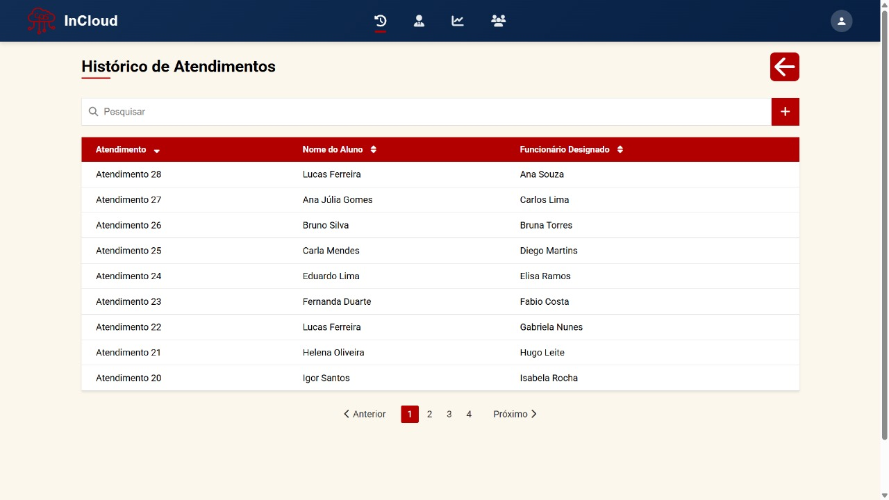
<sup>Fonte: Material produzido pelos autores (2024).</sup>
</div>

&emsp; Teste do requisito 03 de registro de alunos PCD

<div align="center">
  <sub>Figura 45 - Registro de alunos</sub> <br>
  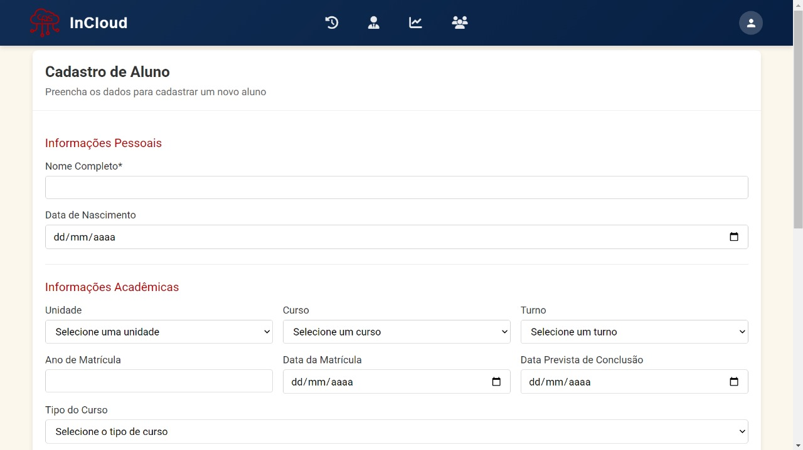
<sup>Fonte: Material produzido pelos autores (2024).</sup>
</div>

<div align="center">
  <sub>Figura 46 - Registro de alunos parte 2</sub> <br>
  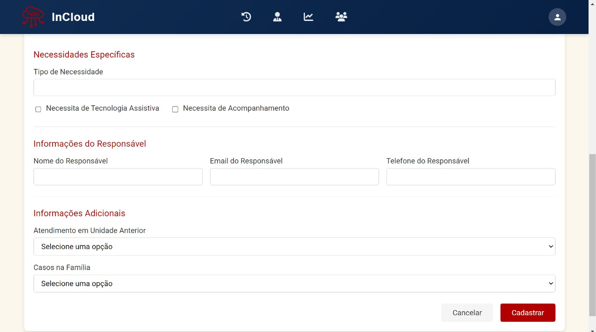
<sup>Fonte: Material produzido pelos autores (2024).</sup>
</div>

&emsp; Teste do requisito 04 atribuindo profissional para atendimento.

<div align="center">
  <sub>Figura 47 - Atribuição de profissional</sub> <br>
  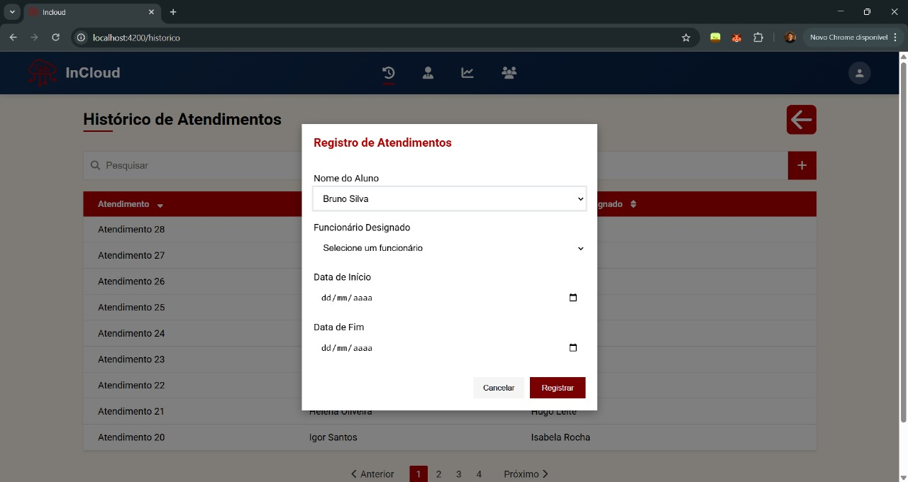
<sup>Fonte: Material produzido pelos autores (2024).</sup>
</div>

&emsp; Teste do requisito de registro de equipamento especial para aluno 05 e teste de edição do registro de tecnologia assistiva

<div align="center">
  <sub>Figura 48 - Equipamentos especiais e tecnologias assistivas</sub> <br>
  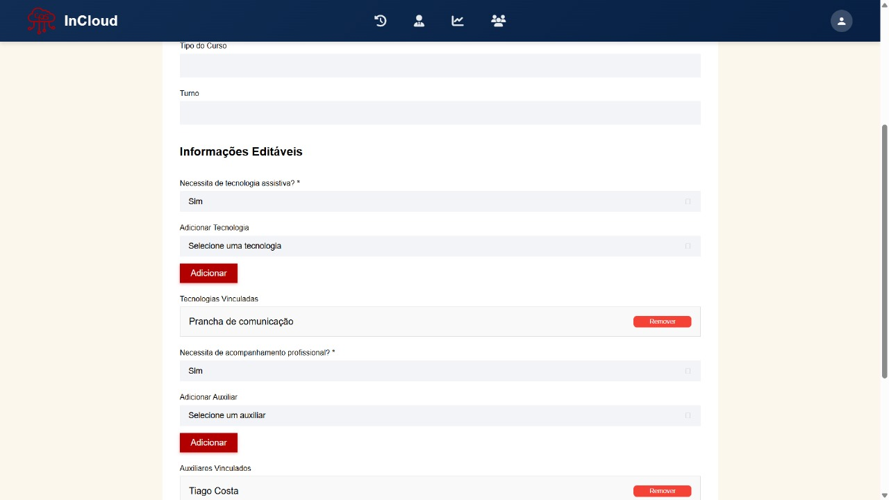
<sup>Fonte: Material produzido pelos autores (2024).</sup>
</div>

&emsp; Teste de autenticação do requisito 08

<div align="center">
  <sub>Figura 49 - Autenticação</sub> <br>
  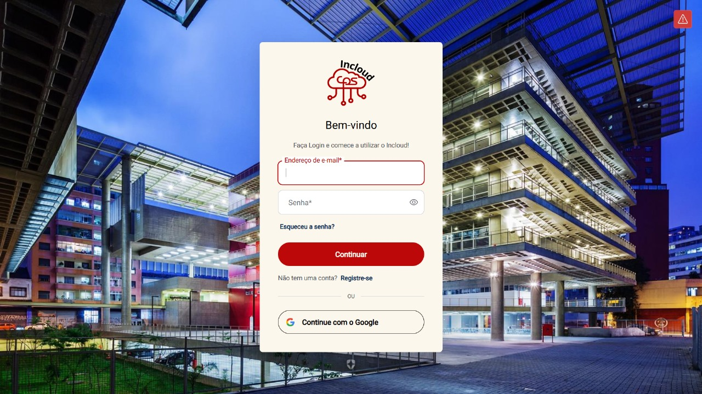
<sup>Fonte: Material produzido pelos autores (2024).</sup>
</div>

&emsp; Teste do requisito funcional de dashboard de monitoramento de alunos e atendimentos

<div align="center">
  <sub>Figura 50 - Dashboard</sub> <br>
  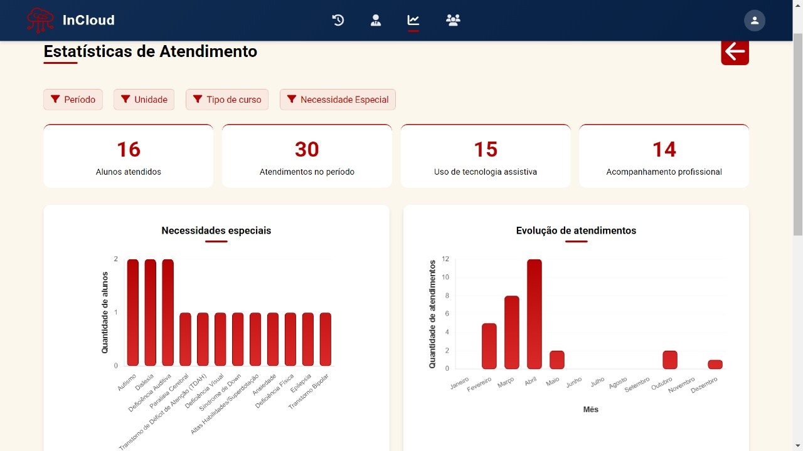
<sup>Fonte: Material produzido pelos autores (2024).</sup>
</div>

## 9.2 Testes de Requisitos não funcionais

## 9.2.1 Testes de RNFs

Os testes de requisitos não funcionais foram planejados para avaliar aspectos críticos do sistema que vão além das funcionalidades, como segurança, desempenho, usabilidade e portabilidade. Cada teste foi estruturado para verificar a conformidade com os RNFs definidos segundo a ISO 25010.

### Perfis dos Avaliadores

**Especialista em Segurança**  
- Profissional com experiência em testes de penetração e análise de vulnerabilidades.  
- **Objetivo:** Avaliar os aspectos de segurança e proteção de dados do sistema.

**Especialista em Desempenho**  
- Engenheiro com experiência em testes de carga e otimização de sistemas.  
- **Objetivo:** Verificar se o sistema atende aos requisitos de tempo de resposta e eficiência.

**Especialista em Acessibilidade**  
- Profissional com conhecimento em tecnologias assistivas e diretrizes WCAG.  
- **Objetivo:** Avaliar a compatibilidade do sistema com tecnologias assistivas.

**Desenvolvedor Full-Stack**  
- Desenvolvedor com experiência em múltiplas plataformas e provedores de nuvem.  
- **Objetivo:** Testar a modularidade do código e portabilidade entre ambientes.

**Usuário Final com Deficiência**  
- Pessoa com deficiência visual ou motora que utiliza tecnologias assistivas.  
- **Objetivo:** Validar a experiência real de uso do sistema com tecnologias assistivas.


## 9.2.2 Planejamento


### Teste de Compatibilidade com Tecnologias Assistivas (RNF01)

**Preparação:**  
- Configurar ambiente com leitor de tela NVDA ou JAWS.  
- Preparar lista de verificação baseada nas diretrizes WCAG 2.1.

**Execução:**  
1. O avaliador deverá navegar por todas as telas do sistema utilizando apenas o teclado.  
2. Verificar se todos os elementos interativos são anunciados corretamente pelo leitor de tela.  
3. Testar o contraste de cores em diferentes condições de iluminação.  
4. Verificar se há alternativas textuais para elementos não-textuais.

**Critérios avaliados:**  
- **Acessibilidade:** O sistema é navegável por teclado? O leitor de tela identifica todos os elementos?  
- **Conformidade:** O sistema atende às diretrizes WCAG 2.1 nível AA?

---

### Teste de Integridade de Dados (RNF02)

**Preparação:**  
- Configurar ambiente de teste com dados representativos, incluindo registros de alunos, atendimentos e profissionais.  
- Preparar scripts automatizados para simular operações concorrentes, como leitura, escrita e exclusão de dados.  
- Garantir que backups dos dados iniciais estejam disponíveis para restauração após cada ciclo de teste.

**Execução:**  
1. **Realizar operações simultâneas de leitura e escrita no banco de dados:**  
   - Utilizar ferramentas como JMeter ou scripts personalizados em Python para simular múltiplos usuários acessando e modificando os dados ao mesmo tempo.  
   - Exemplo: Simular 50 usuários tentando atualizar o status de atendimento de um aluno enquanto outros 50 consultam o histórico do mesmo aluno.  

2. **Simular falhas durante transações críticas (queda de energia, falha de rede):**  
   - Durante uma transação crítica, como a criação de um novo registro de aluno PCD, interromper abruptamente a conexão com o banco de dados ou desligar o servidor temporariamente.  
   - Utilizar ferramentas de monitoramento para verificar se o sistema detecta a falha e recupera os dados consistentemente após a retomada da conexão.  

3. **Tentar injetar dados malformados ou maliciosos:**  
   - Criar scripts que enviem entradas inválidas ou maliciosas ao sistema, como strings excessivamente longas, caracteres especiais não permitidos ou comandos SQL maliciosos.  
   - Exemplo: Tentar inserir um comentário de 10.000 caracteres em um campo limitado a 2000 caracteres ou enviar uma query SQL via formulário para testar vulnerabilidades de injeção.  

4. **Verificar a integridade dos dados após cada cenário de teste:**  
   - Após cada cenário, executar consultas diretamente no banco de dados para verificar se os dados estão consistentes e íntegros.  
   - Validar se as transações incompletas foram revertidas corretamente e se os dados mal formados foram rejeitados.  
   - Utilizar ferramentas de auditoria de banco de dados para identificar possíveis inconsistências ou violações de restrições.

**Critérios avaliados:**  
- **Segurança:** O sistema rejeita entradas maliciosas ou malformadas?  
- **Consistência:** As transações críticas são finalizadas corretamente ou revertidas em caso de falhas?

---

### **Teste de Prevenção de Vazamento de Dados (RNF03)**

**Preparação:**  
- Configurar ferramentas de análise de tráfego de rede, como Wireshark ou Burp Suite.  
- Preparar scripts automatizados para simular tentativas de acesso não autorizado.  
- Garantir que logs de auditoria estejam habilitados no sistema para registrar todas as tentativas de acesso.

**Execução:**  
1. **Tentar acessar dados sem autenticação adequada:**  
   - Simular uma requisição direta a endpoints do sistema sem fornecer credenciais válidas.  
   - Exemplo: Acessar uma API ou rota protegida utilizando um token inválido ou omitindo completamente a autenticação.  
   - Verificar se o sistema bloqueia o acesso e registra a tentativa no log de auditoria.

2. **Analisar o tráfego de rede para verificar se dados sensíveis estão criptografados:**  
   - Utilizar ferramentas como Wireshark para capturar o tráfego entre o cliente e o servidor durante operações críticas (ex: login, consulta de dados sensíveis).  
   - Verificar se os dados transmitidos estão criptografados (ex: uso de HTTPS/TLS) e se informações sensíveis (como senhas ou números de documentos) não estão expostas em texto claro.

3. **Verificar se logs contêm informações sensíveis:**  
   - Realizar operações no sistema que gerem logs (ex: login, edição de perfil).  
   - Analisar os logs gerados para garantir que não contenham dados sensíveis, como senhas, números de CPF ou informações médicas.  

4. **Testar a expiração de sessões e tokens de acesso:**  
   - Simular cenários onde o usuário permanece inativo por um período prolongado ou utiliza um token expirado.  
   - Exemplo: Manter uma sessão aberta por mais de 30 minutos sem atividade e tentar realizar uma operação após esse período.  
   - Verificar se o sistema invalida automaticamente a sessão ou token e solicita nova autenticação.

**Critérios avaliados:**  
- **Segurança:** Dados sensíveis estão protegidos em repouso e em trânsito?  
- **Auditoria:** Tentativas de acesso não autorizado são registradas nos logs?  
- **Conformidade:** O sistema atende aos requisitos de privacidade e segurança de dados?

---

### **Teste de Facilidade de Aprendizado (RNF04)**

**Preparação:**  
- Recrutar 5 usuários sem experiência prévia com o sistema, preferencialmente com perfis semelhantes aos usuários finais (ex: coordenadores, professores ou atendentes).  
- Preparar uma lista de tarefas básicas a serem executadas no sistema, como:  
  - Cadastrar um novo aluno PCD.  
  - Consultar o histórico de atendimentos de um aluno específico.  
  - Gerar um relatório simples sobre os atendimentos realizados.  
- Configurar um ambiente controlado para observação, incluindo ferramentas de gravação de tela e formulários para registrar feedback dos usuários.

**Execução:**  
1. **Apresentação inicial do sistema:**  
   - Apresentar o sistema ao usuário sem fornecer instruções detalhadas ou tutoriais prévios.  
   - Permitir que o usuário explore a interface por 2 minutos antes de iniciar as tarefas.  

2. **Execução das tarefas básicas:**  
   - **Tarefa 1: Cadastrar um novo aluno PCD**  
     - Cronometrar o tempo que o usuário leva para localizar o formulário de cadastro, preencher os campos obrigatórios e salvar o registro.  
     - Observar se o usuário identifica intuitivamente onde encontrar o formulário e como preencher os campos.  
   - **Tarefa 2: Consultar o histórico de atendimentos de um aluno específico**  
     - Cronometrar o tempo que o usuário leva para acessar o perfil do aluno e visualizar o histórico de atendimentos.  
     - Registrar pontos de hesitação ou confusão durante a navegação.  
   - **Tarefa 3: Gerar um relatório simples sobre os atendimentos realizados**  
     - Cronometrar o tempo que o usuário leva para localizar a funcionalidade de geração de relatórios, aplicar filtros básicos (ex: período) e exportar o relatório.  
     - Observar se o usuário consegue identificar os botões e opções necessárias sem orientação externa.  

3. **Identificação de pontos de confusão e hesitação:**  
   - Durante a execução das tarefas, registrar em um formulário observações sobre:  
     - Onde o usuário hesitou ou demonstrou dificuldade.  
     - Quais elementos da interface causaram confusão (ex: ícones pouco claros, textos ambíguos).  
     - Se o usuário precisou pedir ajuda ou tentou ações repetidas sem sucesso.  

4. **Coleta de feedback qualitativo:**  
   - Após a conclusão das tarefas, realizar uma breve entrevista com o usuário para coletar feedback sobre a experiência.  
   - Perguntas sugeridas:  
     - "O que você achou mais difícil durante as tarefas?"  
     - "Houve algo na interface que te confundiu ou pareceu fora de lugar?"  
     - "Você sentiu que o sistema era fácil de aprender? Por quê?"  

**Critérios avaliados:**  
- **Aprendizabilidade:** O usuário consegue aprender a usar o sistema em até **10 minutos**?  
- **Intuitividade:** A interface é autoexplicativa e permite a execução das tarefas sem instruções detalhadas?  
- **Experiência do Usuário:** O sistema proporciona uma experiência fluida e minimiza pontos de confusão ou hesitação?

---

### **Teste de Modularidade do Código (RNF05)**

**Preparação:**  
- Configurar um ambiente de desenvolvimento com ferramentas de análise de código, como SonarQube ou ESLint, para avaliar a qualidade e modularidade do código.  
- Selecionar módulos específicos do sistema para modificação, priorizando aqueles que são críticos ou frequentemente alterados (ex: módulo de cadastro de alunos, módulo de relatórios).  
- Garantir que testes automatizados estejam configurados para validar as funcionalidades após alterações.

**Execução:**  
1. **Realizar alterações em um módulo específico do sistema:**  
   - Escolher um módulo bem definido (ex: módulo de cadastro de alunos) e implementar uma nova funcionalidade ou modificar uma existente.  
   - Exemplo: Adicionar um campo opcional "Necessidades Especiais" ao formulário de cadastro de alunos.  
   - Registrar quais arquivos e componentes foram alterados durante o processo.  

2. **Verificar se outros módulos foram afetados:**  
   - Executar testes automatizados em todos os módulos do sistema para identificar possíveis impactos colaterais.  
   - Utilizar ferramentas de cobertura de código (ex: Jest ou JaCoCo) para garantir que todas as partes do sistema ainda estão funcionando conforme o esperado.  
   - Observar se houve necessidade de alterar outros módulos para acomodar a mudança no módulo inicial.  

3. **Adicionar uma nova funcionalidade com mínimo impacto:**  
   - Implementar uma funcionalidade simples em um módulo isolado (ex: adicionar um filtro de data nos relatórios).  
   - Verificar se a nova funcionalidade pode ser adicionada sem exigir grandes alterações em outros módulos.  
   - Avaliar se a modularidade do código permite que a nova funcionalidade seja desenvolvida de forma independente.  

4. **Executar testes automatizados após as alterações:**  
   - Executar todos os testes unitários, de integração e de interface do sistema.  
   - Verificar se os testes continuam passando após as alterações e se nenhum novo erro foi introduzido.  
   - Documentar quaisquer falhas ou inconsistências encontradas durante a execução dos testes.  

**Critérios avaliados:**  
- **Manutenibilidade:** As alterações realizadas afetaram apenas o módulo modificado, sem impactar outros módulos?  
- **Testabilidade:** Os testes automatizados continuam passando após as mudanças, garantindo a integridade do sistema?  
- **Modularidade:** O código é organizado de forma que novas funcionalidades possam ser adicionadas com mínimo impacto?

---


### **Teste de Tempo de Resposta (RNF06)**

**Preparação:**  
- Configurar ferramentas de teste de carga, como JMeter, Gatling ou Apache Benchmark, para simular consultas e medir o tempo de resposta.  
- Preparar um conjunto de consultas representativas, incluindo:  
  - Consulta de perfil de aluno.  
  - Listagem de atendimentos realizados em um período específico.  
  - Geração de relatórios básicos.  
- Garantir que o ambiente de teste esteja configurado com condições semelhantes às de produção (ex: volume de dados, número de usuários simultâneos).  

**Execução:**  
1. **Executar consultas padrão em condições normais e medir o tempo de resposta:**  
   - Simular uma única requisição para cada consulta representativa (ex: acessar o perfil de um aluno).  
   - Medir o tempo de resposta utilizando as ferramentas de teste de carga.  
   - Registrar o tempo médio de resposta para cada tipo de consulta.  

2. **Aumentar gradualmente a carga de usuários simultâneos:**  
   - Iniciar com 10 usuários simultâneos realizando as mesmas consultas.  
   - Aumentar gradualmente a carga para 50, 100 e 200 usuários simultâneos.  
   - Monitorar o tempo de resposta em cada nível de carga e registrar os resultados.  

3. **Monitorar o tempo de resposta sob diferentes cargas:**  
   - Considera-se como hipótese inicial que o sistema deve manter o tempo de resposta em até 2 segundos por consulta em condições normais.  
   - Essa hipótese será validada com base nos testes realizados e poderá ser ajustada conforme os resultados e o feedback dos usuários.  
   - Identificar o ponto em que o desempenho começa a degradar (ex: aumento significativo no tempo de resposta ou falhas nas requisições).  
   - Registrar o número máximo de usuários simultâneos suportados antes da degradação.  

4. **Identificar o ponto de degradação do desempenho:**  
   - Analisar os logs do sistema e métricas de desempenho (ex: uso de CPU, memória e banco de dados) durante os testes de carga.  
   - Identificar gargalos ou problemas específicos que causam a degradação do desempenho.  
   - Documentar quaisquer erros ou timeouts ocorridos durante os testes.  

**Critérios avaliados:**  
- **Eficiência:** A hipótese é que as consultas padrão sejam processadas em até 2 segundos em condições normais.  
- **Escalabilidade:** O sistema deve buscar manter desempenho aceitável sob carga crescente (ex: até 200 usuários simultâneos).  
- **Resiliência:** Avalia-se se o sistema apresenta degradação gradual ou falhas abruptas ao atingir o limite de capacidade.  

---


### **Teste de Responsividade em Diversos Dispositivos (RNF07)**

**Preparação:**  
- Selecionar dispositivos com diferentes tamanhos de tela e resoluções, incluindo:  
  - Smartphone (ex: iPhone 12, resolução 390x844 pixels).  
  - Tablet (ex: iPad Air, resolução 1668x2224 pixels).  
  - Desktop (resolução padrão de 1920x1080 pixels).  
- Preparar uma lista de verificação de elementos responsivos, como menus, botões, tabelas e gráficos.  
- Configurar ferramentas de teste, como BrowserStack ou Chrome DevTools, para simular diferentes dispositivos e orientações (retrato e paisagem).

**Execução:**  
1. **Acessar todas as telas do sistema em cada dispositivo:**  
   - Navegar por todas as principais funcionalidades do sistema (ex: cadastro de alunos, dashboard, relatórios) em cada dispositivo selecionado.  
   - Registrar screenshots ou vídeos para documentar o comportamento visual em diferentes tamanhos de tela.  

2. **Verificar se o layout se adapta corretamente:**  
   - Observar se os elementos da interface (menus, botões, textos) se ajustam adequadamente ao tamanho da tela.  
   - Exemplo: Verificar se menus longos são convertidos em menus "hambúrguer" em telas menores ou se tabelas grandes são substituídas por versões compactas.  
   - Identificar qualquer sobreposição, corte de texto ou desalinhamento visual.  

3. **Testar interações específicas de cada dispositivo:**  
   - Em dispositivos móveis:  
     - Testar a navegação por toque (ex: deslizar, clicar em botões pequenos).  
     - Verificar se os gestos (ex: zoom, rolagem) funcionam corretamente.  
   - Em desktops:  
     - Testar a navegação com mouse e teclado (ex: hover em menus, uso de atalhos).  
   - Registrar quaisquer problemas de usabilidade específicos de cada dispositivo.  

4. **Validar a usabilidade em cada formato de tela:**  
   - Simular cenários reais de uso, como:  
     - Acessar o perfil de um aluno em um smartphone enquanto está em movimento.  
     - Gerar um relatório no tablet durante uma reunião.  
   - Avaliar se a experiência do usuário é consistente e fluida em todos os dispositivos.  

**Critérios avaliados:**  
- **Adaptabilidade:** O layout se ajusta adequadamente a diferentes tamanhos de tela?  
- **Usabilidade:** A experiência do usuário é consistente e satisfatória em todos os dispositivos?  
- **Responsividade:** Os elementos da interface respondem corretamente às interações específicas de cada dispositivo?


---

### **Teste de Independência de Provedor (RNF08)**

**Preparação:**  
- Configurar ambientes equivalentes em diferentes provedores de nuvem, como AWS, Azure e Google Cloud Platform (GCP).  
- Preparar scripts de implantação automatizados (ex: usando Terraform ou Docker) para garantir que a infraestrutura seja replicada de forma consistente em cada provedor.  
- Documentar todas as dependências específicas de provedor utilizadas no sistema, como serviços de banco de dados gerenciados (ex: RDS na AWS, Cosmos DB no Azure).

**Execução:**  
1. **Implantar o sistema em um provedor inicial:**  
   - Escolher um provedor de nuvem (ex: AWS) e implantar o sistema utilizando os scripts de implantação preparados.  
   - Verificar se todas as funcionalidades do sistema estão operacionais após a implantação.  

2. **Migrar para um segundo provedor seguindo a documentação:**  
   - Utilizar os mesmos scripts de implantação para migrar o sistema para outro provedor (ex: Azure).  
   - Durante a migração, observar se há necessidade de ajustes manuais ou configurações específicas para o novo ambiente.  
   - Registrar quaisquer diferenças ou incompatibilidades encontradas durante o processo.  

3. **Verificar funcionalidade completa após a migração:**  
   - Executar testes funcionais e de integração para garantir que todas as funcionalidades do sistema estejam funcionando corretamente no novo provedor.  
   - Exemplo: Testar operações críticas, como cadastro de alunos, registro de atendimentos e geração de relatórios.  
   - Observar se há impacto no desempenho ou comportamento do sistema após a migração.  

4. **Documentar dependências específicas de provedor:**  
   - Analisar o código e a configuração do sistema para identificar quais componentes ou serviços dependem de recursos específicos de um provedor.  
   - Exemplo: Identificar se o sistema utiliza serviços exclusivos, como AWS Lambda ou Azure Functions, que podem exigir adaptação para outros provedores.  
   - Propor soluções para reduzir ou eliminar essas dependências, visando maior portabilidade.

**Critérios avaliados:**  
- **Portabilidade:** O sistema funciona sem modificações após a migração para outro provedor?  
- **Independência:** Existem dependências específicas de provedor que limitam a portabilidade?  
- **Consistência:** A funcionalidade e o desempenho do sistema permanecem consistentes em diferentes ambientes?

---

### **Teste de Integração com API Externa (RNF09)**

**Preparação:**  
- Configurar um ambiente de teste com um mock da API externa utilizando ferramentas como Postman Mock Serve ou WireMock.  
- Preparar cenários de teste que incluam:  
  - Respostas bem-sucedidas da API (ex: dados retornados corretamente).  
  - Respostas de erro simuladas (ex: falha temporária, timeout, dados inválidos).  
- Garantir que logs e monitoramento estejam habilitados para capturar as interações entre o sistema e a API.

**Execução:**  
1. **Testar autenticação e obtenção de dados em cenário ideal:**  
   - Simular uma chamada à API externa com credenciais válidas e verificar se os dados são obtidos corretamente.  
   - Exemplo: Realizar uma requisição para obter informações de um aluno PCD e validar se o sistema processa os dados recebidos.  

2. **Simular falhas temporárias da API e verificar recuperação:**  
   - Simular falhas temporárias, como:  
     - Timeout na resposta da API.  
     - Resposta com código de erro HTTP 503 (Serviço Indisponível).  
   - Verificar se o sistema implementa mecanismos de recuperação, como tentativas automáticas (retry) ou mensagens de erro amigáveis ao usuário.  

3. **Enviar dados inválidos ou incompletos:**  
   - Simular envio de dados malformados ou incompletos para a API, como:  
     - Um campo obrigatório ausente no payload.  
     - Dados em formato incorreto (ex: texto onde deveria ser um número).  
   - Observar se o sistema rejeita os dados inválidos e exibe mensagens de erro claras.  

4. **Verificar persistência e consistência dos dados importados:**  
   - Após receber dados da API, verificar se o sistema os armazena corretamente no banco de dados.  
   - Exemplo: Importar dados de um aluno via API e confirmar se todos os campos foram salvos conforme o esperado.  
   - Testar cenários onde a API retorna dados inconsistentes ou duplicados e observar como o sistema lida com essas situações.  

**Critérios avaliados:**  
- **Interoperabilidade:** O sistema se integra corretamente com a API externa?  
- **Resiliência:** O sistema se recupera adequadamente de falhas temporárias ou erros na API?  
- **Consistência:** Os dados importados são armazenados de forma precisa e íntegra no sistema?


---


### Feedback e Análise

Após a conclusão dos testes, os avaliadores responderão às seguintes perguntas para avaliar a conformidade do sistema com os requisitos não funcionais:

1. O sistema atende completamente ao requisito não funcional testado?  
2. Quais foram as principais deficiências encontradas?  
3. Qual é a gravidade dos problemas identificados (baixa, média, alta)?  
4. Quais são as recomendações para melhorar a conformidade com o requisito?  
5. Existem compensações (trade-offs) entre diferentes requisitos não funcionais que precisam ser consideradas?

Esta análise servirá como base para priorizar melhorias e garantir que o sistema atenda aos requisitos não funcionais críticos para seu sucesso.


## 9.2.3 Resultados

### Tabela de Monitoramento

Esta tabela foi preenchida durante a execução dos testes para documentar os resultados e identificar áreas que necessitam de melhorias:
| Requisito Não Funcional | Teste Realizado                        | Resultado (Aprovado/Reprovado) | Tempo de Execução | Observações                        |
|-------------------------|----------------------------------------|--------------------------------|-------------------|------------------------------------|
| **RNF01: Compatibilidade com tecnologias assistivas** | Navegação por teclado             | Aprovado | 10 min | Todas as funcionalidades são possíveis de ser acessadas apenas usando a tecla TAB. |
|                         | Teste com leitor de tela              | Aprovado | 15 min | O leitor de tela lê corretamente todos os textos do site. |
| **RNF02: Integridade de dados**              | Operações concorrentes             | Aprovado | 12 min | O sistema manteve consistência dos dados durante operações simultâneas. |
|                         | Simulação de falhas                   | Aprovado | 10 min | O sistema lidou corretamente com falhas simuladas sem corromper dados. |
|                         | Tentativa de injeção de dados maliciosos | Aprovado | 8 min | As tentativas de injeção foram corretamente bloqueadas. |
| **RNF03: Prevenção de vazamento de dados**  | Tentativas de acesso não autorizado | Aprovado | 9 min | O sistema bloqueou todos os acessos não autorizados como esperado. |
|                         | Análise de tráfego de rede            | Aprovado | 7 min | Nenhum dado sensível foi identificado durante a análise do tráfego. |
|                         | Verificação de logs                   | Aprovado | 6 min | Os logs armazenam informações corretamente sem expor dados sensíveis. |
| **RNF04: Facilidade de aprendizado**        | Tempo para completar tarefas básicas  | Aprovado | < 10 min | Todas as tarefas foram concluídas em tempo adequado sem dificuldades. |
|                         | Navegação sem instruções              | Aprovado | < 15 min | Usuário com baixo letramento digital navegou com sucesso. |
| **RNF05: Modularidade do código**           | Modificação de módulo específico   | Aprovado | 8 min | A alteração em um módulo não impactou o restante do sistema. |
|                         | Adição de nova funcionalidade         | Aprovado | 12 min | Nova funcionalidade foi integrada com facilidade e sem erros. |
|                         | Execução de testes automatizados      | Aprovado | 5 min | Os testes foram executados corretamente e todos passaram. |
| **RNF06: Tempo de resposta**                | Navegação no site                | Aprovado | < 5 min | As respostas às interações foram inferiores a 1 segundo. |
|                         | Teste de carga                        | Aprovado | < 5 min | Tempo de resposta do banco manteve-se abaixo de 3 segundos. |
| **RNF07: Responsividade**                  | Teste em desktop                  | Aprovado | 4 min | Layout exibido corretamente em diferentes resoluções. |
|                         | Teste em tablet                       | Aprovado | 4 min | Navegação fluida e interface adaptada corretamente. |
|                         | Teste em smartphone                   | Aprovado | 4 min | Elementos se adaptam bem a telas menores. |
| **RNF08: Independência de Provedor**        | Implantação em provedor inicial    | Aprovado | 10 min | Sistema implantado com sucesso no provedor primário. |
|                         | Migração para segundo provedor        | Aprovado | 15 min | Migração ocorreu sem falhas e sem perda de dados. |
|                         | Verificação de funcionalidade pós-migração | Aprovado | 8 min | Todas as funcionalidades se mantiveram ativas após migração. |
|                         | Documentação de dependências específicas | Aprovado | 5 min | Todas as dependências foram documentadas claramente. |
| **RNF09: Integração com API Externa**       | Autenticação e obtenção de dados   | Reprovado | 10 min | A API ainda não atende os requisitos do projeto. |

&nbsp;&nbsp;&nbsp;&nbsp;A abrangência dos testes foi planejada para garantir que todas as demandas do projeto fossem atendidas. Para isso, cada requisito funcional e não funcional foi mapeado e associado a cenários de teste específicos, cobrindo desde funcionalidades básicas até aspectos críticos de segurança, desempenho e acessibilidade. A matriz de rastreabilidade foi utilizada para verificar que todos os requisitos documentados no escopo do projeto foram contemplados nos casos de teste. Além disso, a análise de cobertura foi realizada por meio da verificação dos critérios avaliados em cada teste, garantindo que tanto os cenários positivos quanto os negativos fossem explorados. Com isso, é assegurado que o sistema atenda integralmente às expectativas dos usuários e aos objetivos de negócio definidos.

## 9.3 Testes de usabilidade com o usuário

## 9.3.1 Testes de Usabilidade

&nbsp;&nbsp;&nbsp;&nbsp;Os testes de usabilidade foram planejados seguindo a técnica do funil, partindo de atividades mais gerais até perguntas mais específicas.  

&nbsp;&nbsp;&nbsp;&nbsp;O teste será realizado com pelo menos 5 usuários externos ao grupo, com diferentes níveis de familiaridade com o sistema.  

### Perfis dos usuários

1. Usuário Iniciante (Pouca experiência com tecnologia)
Um professor que não tem costume de usar sistemas digitais frequentemente.
Objetivo: Avaliar dificuldades básicas de navegação e compreensão da interface.

2. Usuário Intermediário (Familiarizado com tecnologia, mas novo no sistema) 
Um novo funcionário da instituição que já usa tecnologia, mas nunca acessou o sistema antes.
Objetivo: Testar se o sistema é intuitivo o suficiente para novos usuários com alguma experiência digital.

3. Usuário Avançado (Utiliza o sistema regularmente)
Um administrador ou profissional da instituição que já usa o sistema no dia a dia.
Objetivo:  Identificar oportunidades de otimização para quem já tem experiência.

4. Usuário com Deficiência (Acessibilidade)
Alguém com dificuldades visuais (baixa visão) ou motoras.
Objetivo: Avaliar a acessibilidade do sistema e identificar melhorias.

5. Usuário Tomador de Decisão (Gestor ou Supervisor)
Um coordenador que usa o sistema para visualizar relatórios e tomar decisões estratégicas.
Objetivo: Testar a clareza e relevância das informações apresentadas.

## 9.3.2 Planejamento

### Utilização da homepage
&nbsp;&nbsp;&nbsp;&nbsp;O usuário deverá acessar a página inicial do site e identificar os 4 botões principais (Histórico de atendimentos, profissionais, relatórios e dashboards e lista de alunos).

- Perfil Iniciante: Avaliar se ele demora para encontrar os botões.
- Perfil Avançado: Testar se ele consegue navegar rapidamente e sem hesitação.
- Usuário com Deficiência: Testar o suporte a leitores de tela e contraste de cores.

&nbsp;&nbsp;&nbsp;&nbsp;Critério avaliado: Eficiência – O usuário encontra os botões rapidamente? A navegação é fluida?

### Execução de função
&nbsp;&nbsp;&nbsp;&nbsp;O usuário deverá escolher uma funcionalidade do sistema para acessar e visualizar de acordo com o que deseja.
- Perfil Iniciante: Ele consegue entender o que a funcionalidade faz antes de acessá-la?
- Perfil Gestor: Ele encontra rapidamente as funções mais usadas no seu dia a dia?

&nbsp;&nbsp;&nbsp;&nbsp;Critério avaliado: Eficácia – O usuário consegue completar a ação corretamente sem ajuda?

### Visualização de dados em ‘Relatórios e dashboards’, ‘Profissionais’ ou ‘Histórico de atendimentos’.
&nbsp;&nbsp;&nbsp;&nbsp;O usuário deverá visualizar os gráficos (se houver) e interpretar os dados apresentados.
- Perfil Intermediário: Consegue interpretar os gráficos e informações sem dificuldades?
- Perfil Gestor: Os relatórios oferecem dados úteis para tomada de decisão? 

&nbsp;&nbsp;&nbsp;&nbsp;Critério avaliado: Eficácia – O usuário consegue interpretar corretamente as informações exibidas?

### Filtragem e edição de dados de alunos em ‘Lista de alunos’
&nbsp;&nbsp;&nbsp;&nbsp; O usuário deverá acessar a lista de alunos, selecionar um aluno respectivo e editar alguma informação dele (desde que seja um dado editável).
- Usuário com Deficiência: Consegue editar sem dificuldades de acessibilidade?
- Usuário Avançado: O processo de edição é rápido e eficiente?

&nbsp;&nbsp;&nbsp;&nbsp;Critério avaliado: Eficiência – A edição é fácil e rápida de realizar? O usuário precisa de muitas tentativas?

### Localização do contato do profissional responsável pelo aluno Gabriel.
&nbsp;&nbsp;&nbsp;&nbsp; O usuário deverá localizar o contato do profissional responsável pelo aluno Gabriel no sistema.

- Perfil Iniciante e Intermediário: Consegue localizar o contato com facilidade?
- Perfil Gestor e Usuário Avançado: A informação está claramente acessível e é fácil de encontrar?
- Usuário com Deficiência: Consegue localizar o contato com facilidade? 
  
&nbsp;&nbsp;&nbsp;&nbsp;Critério avaliado: Eficácia – O usuário consegue localizar a informação sem dificuldades?

### Feedback e entrevista
&nbsp;&nbsp;&nbsp;&nbsp; Após concluir as tarefas, os usuários responderão às perguntas a seguir para avaliar sua experiência:


### Perguntas para a entrevista

 1. Você conseguiu navegar pelo sistema facilmente? Por quê?  
 2. Houve alguma funcionalidade que você teve dificuldade para encontrar ou entender?  
 3. Quanto tempo levou para concluir cada tarefa? Foi mais rápido ou mais lento do que você esperava?  
 4. O que você mudaria na interface para tornar a experiência mais intuitiva?  
 5. O que você mais gostou e menos gostou no sistema?
6. Você acha que alguma tarefa é dispensável ou deve ser aprimorada? 


### Tabela de Monitoramento

&nbsp;&nbsp;&nbsp;&nbsp; Essa tabela deverá ser preenchida após os testes serem realizados e a entrevista ser completamente respondida. Ela servirá de base para analisar os principais problemas encontrados, a fim de realizar melhorias e fazer um sistema mais intuitivo, acessível e eficiente.


## 9.3.3 Resultados

**Perfil dos Usuários Testadores:**
| Usuário                                   | Ocupação | Idade |
|-----------------------------------------|-------------------------|---------------|
| Usuário Iniciante | Aluno do primeiro ano do Inteli                | 18             |
| Usuário Intermediário | Aluno/Estagiário do quarto ano do inteli                | 22             |
| Usuário Avançado  | Professor               | 51             |
| Usuário com Deficiência         | Aluna do primeiro ano com alto grau de Hipermetropia, testou sem usar óculos               | 19             |
| Usuário Tomador de Decisões         | Gerente de Contrato de Empresa Terceira do grupo Volkswagen                | 49             |

**Tarefas:**

| Tarefa                                   | Tempo Médio de Conclusão | Cliques Médios |
|-----------------------------------------|-------------------------|---------------|
| Encontrar contato do profissional responsável | 1m 28s                 | 7             |
| Identificar botões principais na homepage | 1m 15s                 | 5             |
| Executar uma funcionalidade específica  | 1m 35s                 | 6             |
| Editar informações de um aluno          | 1m 52s                 | 8             |


### Tabela de Monitoramento

| Perfil do Usuário        | Tarefa                                               | Tempo Gasto   | Dificuldade? (Sim/Não) | Observações                                       |
|-------------------------|-----------------------------------------------------|--------------|------------------------|--------------------------------------------------|
| Usuário Iniciante       | Encontrar contato do profissional responsável      | 1m 50s       | Sim                    | Teve dificuldade com a navegação da tabela.     |
| Usuário Intermediário   | Encontrar contato do profissional responsável      | 50s       | Não                    | Encontrou após tentativa inicial equivocada.    |
| Usuário Avançado        | Encontrar contato do profissional responsável      | 30s          | Não                    | Conseguiu sem dificuldades.                     |
| Usuário com Deficiência | Encontrar contato do profissional responsável      | 2m 10s       | Sim                    | Problemas com contraste e tamanho da fonte.    |
| Usuário Tomador de Decisão | Encontrar contato do profissional responsável  | 40s       | Não                    | Encontra rapidamente, mas sugere melhorias.    |

---

### Pontos de Melhoria
- Destacar visualmente o contato do profissional responsável para facilitar a busca.
- Adicionar mais informações à tabela de atendimentos para torná-la mais completa.
- Completar os menus que não estavam finalizados para evitar interrupções no fluxo dos usuários.
- Melhorar a acessibilidade com ajustes de contraste e tamanho da fonte para usuários com deficiência visual.


## Testes Adicionais de Monitoramento

### Utilização da Homepage

| Perfil do Usuário        | Tarefa                        | Tempo Gasto | Dificuldade? (Sim/Não) | Observações                           |
|-------------------------|------------------------------|------------|------------------------|--------------------------------------|
| Usuário Iniciante       | Identificar botões principais | 15s     | Não                    | Não demorou para localizar os botões.  |
| Usuário Avançado        | Navegar sem hesitação        | 10s        | Não                    | Navegou rapidamente e sem erros.  |
| Usuário com Deficiência | Testar suporte a leitores de tela | 25s  | Não                    | Ótimo tamanho, fonte e contraste para visualização. |

### Execução de Função

| Perfil do Usuário    | Tarefa                        | Tempo Gasto | Dificuldade? (Sim/Não) | Observações                                      |
|---------------------|------------------------------|------------|------------------------|-------------------------------------------------|
| Usuário Iniciante  | Compreender funcionalidade   | 2m 10s     | Sim                    | Precisou de explicação para entender a função.  |
| Usuário Gestor     | Encontrar funções mais usadas | 1m 00s     | Não                    | Encontrou rapidamente.                          |

### Edição de Dados

| Perfil do Usuário        | Tarefa                           | Tempo Gasto | Dificuldade? (Sim/Não) | Observações                                      |
|-------------------------|---------------------------------|------------|------------------------|-------------------------------------------------|
| Usuário com Deficiência | Editar informações de um aluno | 2m 00s     | Sim                    | Encontrou dificuldades de acessibilidade.       |
| Usuário Avançado        | Eficiência na edição           | 45s        | Não                    | Processo rápido e intuitivo.                    |

### Pontos de Melhoria
- Destacar visualmente o contato do profissional responsável para facilitar a busca.
- Adicionar mais informações à tabela de atendimentos para torná-la mais completa.
- Completar os menus que não estavam finalizados para evitar interrupções no fluxo dos usuários.
- Melhorar a acessibilidade com ajustes de contraste e tamanho da fonte para usuários com deficiência visual.
- Aprimorar o suporte a leitores de tela na homepage para garantir inclusão.
- Tornar a edição de informações mais intuitiva e acessível para todos os perfis.


# 10. Procedimentos de Implantação

&nbsp;&nbsp;&nbsp;&nbsp;O processo de implantação do sistema Incloud foi estruturado para garantir estabilidade, segurança e eficiência em todas as etapas do deployment. Este capítulo detalha os procedimentos necessários para a correta implantação do sistema, desde a configuração do banco de dados na Google Cloud Platform até a preparação do ambiente de desenvolvimento para a equipe técnica.

&nbsp;&nbsp;&nbsp;&nbsp;A arquitetura de implantação foi projetada considerando aspectos de escalabilidade, disponibilidade e segurança, assegurando que o sistema possa crescer conforme a demanda do Centro Paula Souza sem comprometer a experiência do usuário ou a integridade dos dados.

&nbsp;&nbsp;&nbsp;&nbsp;Os procedimentos descritos a seguir incluem todas as etapas necessárias, configurações de ambiente, requisitos de hardware e software, além de boas práticas para garantir que a implantação ocorra de maneira suave e eficiente.


## 10.1 Implantação e Configuração do Banco de Dados

&nbsp;&nbsp;&nbsp;&nbsp;O banco de dados do sistema Incloud está hospedado na infraestrutura do Google Cloud Platform (GCP), utilizando o serviço Cloud SQL para PostgreSQL. Esta escolha proporciona alta disponibilidade, escalabilidade automática e recursos avançados de segurança e backup.

### Ambiente e Configuração

- **Serviço**: Google Cloud SQL para PostgreSQL versão 14
- **Região**: us-central1 (Iowa)
- **Configuração da instância**: 2 vCPUs, 8GB RAM
- **Armazenamento**: 50GB SSD com crescimento automático
- **Backup**: Diário com retenção de 7 dias
- **Alta disponibilidade**: Configurada com failover automático

### Procedimento de Implantação

1. **Criação da instância no GCP**:
   - Foi utilizado o console do GCP para configurar a instância Cloud SQL
   - Implementada VPC privada para isolamento da rede
   - Configuradas regras de firewall permitindo apenas conexões das aplicações autorizadas

2. **Execução dos scripts de criação**:
   - Scripts executados via Cloud Shell na seguinte ordem:
     1. `01_create_database.sql`: Criação da estrutura do banco
     2. `02_initial_data.sql`: Inserção de dados iniciais

3. **Configuração de segurança**:
   - Ativada autenticação IAM para controle de acesso
   - Implementada criptografia de dados em repouso
   - Configurado SSL para conexões com o banco

4. **Monitoramento**:
   - Configurados alertas para performance e disponibilidade
   - Implementado Cloud Monitoring para métricas em tempo real
   - Logs de auditoria ativados para registro de todas as operações

### Conexão com a Aplicação

&nbsp;&nbsp;&nbsp;&nbsp;A aplicação se conecta ao banco de dados através de uma string de conexão segura utilizando o Cloud SQL Proxy, garantindo que mesmo em ambiente de desenvolvimento não haja exposição direta das credenciais do banco de dados.

&nbsp;&nbsp;&nbsp;&nbsp;Os parâmetros de conexão são gerenciados através de variáveis de ambiente no serviço de aplicação, seguindo as melhores práticas de segurança.

## 10.2 Implantação do Protótipo para uso por equipe de desenvolvimento

&nbsp;&nbsp;&nbsp;&nbsp;O protótipo do sistema Incloud foi implantado em um ambiente de desenvolvimento controlado, permitindo que a equipe trabalhe de forma colaborativa mantendo a integridade e a segurança do código e dos dados.

### Ambiente de Desenvolvimento

- **Infraestrutura**: Google Cloud App Engine (ambiente flexível)
- **Repositório de código**: GitHub com integração contínua
- **Ambientes segregados**: Desenvolvimento, Testes e Homologação

### Procedimento de Implantação para Desenvolvedores

1. **Configuração do ambiente local**:
   - Instalação do Docker Desktop para containerização
   - Configuração do Node.js v16.x e npm
   - Instalação do Angular CLI versão 14
   - Configuração das variáveis de ambiente locais

2. **Acesso ao repositório**:
   - Clone do repositório GitHub:
     ```bash
     git clone https://github.com/Inteli-College/2025-1A-T13-ES05-G03
     ```
   - Instalação das dependências:
     ```bash
     cd 2025-1A-T13-ES05-G03
     npm install
     ```

3. **Conexão com o banco de desenvolvimento**:
   - Instalação e configuração do Cloud SQL Proxy
   - Configuração do arquivo `.env` com as credenciais fornecidas pelo líder técnico
   - Teste de conexão utilizando o comando:
     ```bash
     npm run db:test
     ```

4. **Execução local do projeto**:
   - Inicialização do servidor de desenvolvimento:
     ```bash
     npm run dev
     ```
   - Acesso à aplicação: `http://localhost:4200`


### Boas Práticas para a Equipe

1. Sempre trabalhar em branches separadas para cada feature
2. Realizar pull requests para a branch `develop` com pelo menos um revisor
3. Manter os testes atualizados para garantir cobertura de código
4. Seguir os padrões de codificação definidos no `GuiaPadroesDesenvolvimento.md`


O ambiente de desenvolvimento está configurado para ser o mais próximo possível do ambiente de produção, garantindo que problemas possam ser identificados precocemente no ciclo de desenvolvimento.


# Referências

*W3C.* Accessibility Principles. Disponível em: <https://www.w3.org/WAI/fundamentals/accessibility-principles/>. Acesso em: 10 abr. 2025.

*GOVERNO DO ESTADO DE SÃO PAULO.* Centro Paula Souza - Inclusão. Disponível em: <https://www.cps.sp.gov.br/>. Acesso em: 10 abr. 2025.

*BRASIL.* Lei Brasileira de Inclusão da Pessoa com Deficiência (Estatuto da Pessoa com Deficiência). Lei nº 13.146, de 6 de julho de 2015.

*NGROK.* Secure Tunnels Documentation. Disponível em: <https://ngrok.com/docs>. Acesso em: 10 abr. 2025.

*MDIC.* Cartilha de Boas Práticas em Acessibilidade na Web. Ministério do Desenvolvimento, Indústria e Comércio Exterior. Disponível em: <https://www.gov.br/acessoainformacao/pt-br/acessibilidade>. Acesso em: 10 abr. 2025.

*CASTRO, R. S. de; SANTOS, J. C.* Acessibilidade digital em ambientes virtuais de aprendizagem: uma análise sobre as barreiras enfrentadas por alunos com deficiência. Revista Tecnologias na Educação, v. 12, n. 26, 2020.

*ONE DAY TESTING.* ISO/IEC 25010 e a Qualidade de Software. Disponível em: <https://blog.onedaytesting.com.br/iso-iec-25010/>. Acesso em: 10 abr. 2025.

*TRT9.* Conceito: Requisitos. Disponível em: <https://www.trt9.jus.br/pds/pdstrt9/guidances/concepts/requirements_8006414F.html>. Acesso em: 10 abr. 2025.

*UNIVESP.* Engenharia de Software - Tipos de Requisitos de Software. Disponível em: <https://www.youtube.com/watch?v=ptreLvwOXyw>. Acesso em: 10 abr. 2025.
